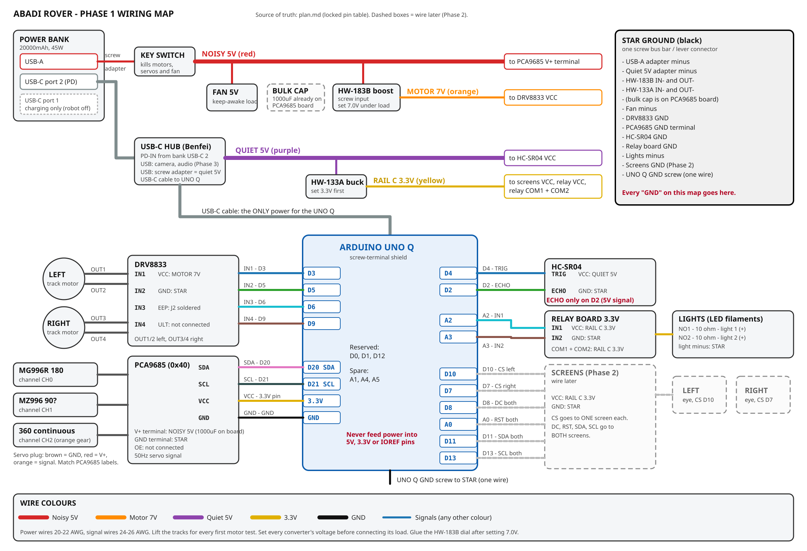

# Abadi Rover

A tracked robot rover with a "head" — pan/tilt neck, two animated eye displays and a camera — driven by a Bluetooth gamepad and built around an **Arduino UNO Q** (microcontroller plus Linux side on one board). The long-term goal is a small AI robot with a local language model on board.

## Status

| Area | State |
|---|---|
| Chassis, motors, drivers, servos, power train | Built and wired |
| Power design (4 isolated rails, star ground, key-switch kill) | Built, bench-tested (5 of 6 power tests passed; servo-rail test is part of the neck stage) |
| Gamepad (Bluetooth) | Paired; input read-out test in progress |
| Drive, neck, kill switch, eye displays | Next, in staged order (see [plan.md](plan.md)) |
| Raspberry Pi (8 GB) running a lightweight local LLM for on-board AI functions | In development — hardware not yet integrated |
| Custom carrier PCB replacing the hand-soldered wiring | Ordered |

## Hardware

| Part | Role |
|---|---|
| Arduino UNO Q 2 GB + screw-terminal shield | Controller: real-time I/O on the MCU, gamepad and app logic on the Linux side |
| ELEGOO Conqueror tracked chassis, 2× geared motors | Drive |
| DRV8833 dual H-bridge | Motor driver (7.0 V rail from a boost converter) |
| PCA9685 16-channel PWM driver | Servo control over I²C |
| 3 servos (2× MG996R-class, 1× 360° continuous) | Pan/tilt neck |
| 2× 2.0" SPI TFT (ST7789, 240×320) | Eyes |
| 2-channel relay board + 2 LED lights | Headlights |
| HC-SR04 ultrasonic sensor | Obstacle stop (pins reserved) |
| 20,000 mAh 45 W USB-C PD power bank, USB hub, buck/boost converters | Single-battery power system |
| USB webcam | Camera (later phase) |

## Design

- **Separate power rails** — brain (USB-C PD), quiet 5 V for sensors, 3.3 V for screens/relay, and a noisy 5 V → 7 V path for motors and servos — all tied at a single star ground. Verified on the bench: motor stall tests on the real power bank do not reboot the controller.
- **Hardware kill switch** cuts motors, servos and fan while the controller keeps running (built). A gamepad kill button is planned for the integration stage.
- **Planned safety stop on the microcontroller:** motors stop if no command arrives for 300 ms (for example if the gamepad disconnects).
- **Locked pin table and power design** documented once in [plan.md](plan.md); every change goes through that file.
- **Staged bring-up:** one stage at a time, each passed on real hardware before the next is written.

## Repository

| File | Contents |
|---|---|
| [plan.md](plan.md) | Build plan, locked pin table and power design, calibration table, test results, lessons learned |
| [docs/wiring.md](docs/wiring.md) | Soldering reference with power and ground diagrams |
| `docs/wiring-map.*`, `docs/relay-wiring.*` | Wiring drawings (PNG and SVG) |
| [docs/HANDOVER.md](docs/HANDOVER.md) | Hand-off prompt for continuing the build in Arduino App Lab |
| `.cursor/rules/` | Working rules for AI coding assistants used on the project |

## Roadmap

1. **Phase 1 – Body:** power, gamepad, drive, neck servos, combined app with kill switch. *(in progress)*
2. **Phase 2 – Face:** both SPI screens showing blinking eyes.
3. **Phase 3 – Brain:** camera and audio, plus an on-board Raspberry Pi (8 GB) running a small local LLM for AI functions, with the UNO Q keeping the real-time control loop. The custom carrier PCB (ordered) replaces the hand-wiring.

## Notes

Developed with AI coding assistants under my direction; hardware design, parts selection, wiring and bench testing are done by hand.
