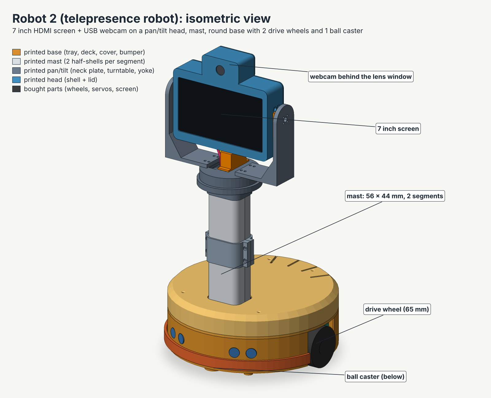

# Abadi Rover 2: the telepresence robot

A small round robot with a screen and a camera. You stay in Germany, open a link on your phone, talk to your sister through the robot, and drive it around her home. Your sister can also call you with one big button.

**Status: first design draft (5 November 2026). Nothing is built and nothing is tested yet.** Every number comes from files, web sources or calculation. Each document marks what is VERIFIED (seen in a source) and what is ASSUMED (my guess, to be tested).

This folder is separate from **Abadi Rover 1** (the tracked robot with the Raspberry Pi 5, files at the top of the repository: `plan.md`, `wiring.md`, `HANDOVER.md`). Robot 1 is still in progress and nothing here changes it. Both robots use the same motherboard from `../pcb/kicad/` (version v5, the locked pin table is `../pcb/kicad/pin-table.md`).

---

## The robot in one picture

- **Body:** a round printed base, 260 mm wide, with two 65 mm drive wheels and one ball caster. A 214 mm mast carries the head. Total height 504 mm. Weight about 2.6 kg (first estimate).
- **Head:** a 7 inch HDMI screen with the webcam above it, on a pan and tilt fork (two MG996R servos).
- **Brain, two parts:** a **Raspberry Pi 5** does the video call and the internet link; the **ESP32 on the motherboard** drives the motors, servos and sensors and stops everything if the Pi stops talking. The Pi and the ESP32 talk over one USB cable.
- **Power:** the 2S Li-ion pack, BMS, charger and fused branches as in `../pcb/kicad/power-wiring.png`. A second XL4016 module set to 5.1 V feeds the Pi and the screen.

Wiring diagram: `diagrams/wiring-robot2.png`.

---

## Documents (read in this order)

| File | What it answers |
|---|---|
| `docs/functions.md` | **What can the robot do?** The function list, in plain words. |
| `docs/wiring.md` | **How is it wired?** The final wiring table, the decisions, the power-up order. |
| `diagrams/wiring-robot2.png` / `.svg` | The wiring diagram (source: `diagrams/draw_wiring.py`). |
| `docs/parts-list.md` and `docs/parts-list.csv` | **What do I buy, and what does it cost?** Two builds (cheap and comfortable), what to buy in Germany before the trip, weights, luggage rules. |
| `docs/sbc-selection.md` | **Which small computer?** Raspberry Pi 5 recommended; why the Radxa Cubie A7S and Orange Pi Zero 2W are not recommended. |
| `docs/mechanical-design.md` + `3d/` | **The body:** base, mast, head, pan/tilt interface, weights, tip-over test, print list. OpenSCAD files (`3d/*.scad`), print-ready STL files (`3d/stl/`), pictures (`3d/renders/`). |
| `docs/peripherals.md` | **Screen, camera, sound, sensors, battery monitor.** Includes the camera test for your SC-012-SN259 and the echo test. |
| `docs/software-plan.md` | **What has to be coded, and in which order.** Video call, remote access, family screen, Wi-Fi in a new place, ESP32 firmware plan, 10 build stages with pass tests, risks. |
| `docs/esp32-serial-protocol.md` | **The USB language between the Pi and the ESP32** (commands, messages, fault codes, stopping rules). |
| `docs/00-brief.md` | The brief the helper agents worked from (your request and the fixed facts). |

---

## The decisions so far

| Question | Decision | Where |
|---|---|---|
| Which small computer? | **Raspberry Pi 5, 2 GB** (or the Pi 5 8 GB you already own, if robot 1 can wait). Cheapest that really works: Pi 4 2 GB. **Not** the Radxa Cubie A7S (no HDMI port, immature software) or the Orange Pi Zero 2W. | `docs/sbc-selection.md` |
| Video call, first version | **Public Jitsi Meet in the robot's browser**, joining a one-time room. You are always the host. Version 2: one own web page. | `docs/software-plan.md`, section 3 |
| Reaching the robot from Germany | **Tailscale** (free private link; no router change at your sister's home). | section 4 |
| What stops the robot if the link drops | Three independent timers; it stops in about 0.4 to 0.6 s. | section 4 and the protocol file |
| Chassis | A **new printed two-wheel base**, not the ELEGOO tracks (robot 1 needs those). | `docs/mechanical-design.md` |
| Motors | **Pololu 25D 12 V gearmotor, 47:1, two.** The yellow TT motors are too weak. | same |
| Screen | 7 inch HDMI touch screen (Waveshare (C) about 58 EUR, or a no-name one about 45 EUR). | `docs/peripherals.md` |
| Camera | Test your **SC-012-SN259** first (it could not be found online). Fallback: a cheap wide-angle 1080p webcam, about 22 EUR. | same |
| Pan/tilt | My default (two MG996R servos in a fork), **with a swappable plate** (INTERFACE 1) for your own design. | `docs/mechanical-design.md`, section 7 |
| Money | Cheap build about **517 EUR** if everything is bought new (371 EUR with spares from your drawer; 320 EUR if robot 1 lends parts). Comfortable build about **796 EUR** (601 / 473 EUR). | `docs/parts-list.md` |

---

## Build order (one stage at a time, one pass test each)

The software plan has the full pass tests. Stages 1 to 5, 7 and 9 must be finished **before the trip**.

1. Bench call: Pi, screen, webcam and audio only. Measures whether the Pi copes with the call.
2. The robot service: idle screen, call button, auto-start.
3. Power: the Pi and screen on the robot's own supply.
4. ESP32 link over USB, battery monitor, no motors yet.
5. Drive (wheels in the air first). Stop-time tests.
6. Pan and tilt.
7. Remote access from the internet, on mobile data.
8. Safety sensors: sonar, stair edges, tilt, low battery.
9. Polish and field kit: new-Wi-Fi rehearsal, spare SD card, family card.
10. Version 2: one page with video and controls.

Rule: no code for a later stage until the current stage passed on the real hardware. **No application code exists yet**; this folder has only plans, specs, diagrams and 3D files.

---

## What I need from you

1. **Which country** is the trip to, and **how many days** until you leave? (Decides what can be bought there, delivery times, and whether services such as Tailscale and Jitsi are reachable.)
2. **Your 3D printer and its bed size** (the design needs at least 180 x 180 mm). Do you print before the trip and pack the parts?
3. **Your pan/tilt design:** a photo, STL or the numbers in `docs/mechanical-design.md` section 7.4.
4. **The webcam SC-012-SN259:** its size and a photo, or run the 10 minute test in `docs/peripherals.md`.
5. **Can robot 1 lend its Pi 5 8 GB** (and battery parts) for the trip?
6. **Charging while the robot is on:** the current power plan says charge with the robot off. For a robot that can be called, that needs a decision. See `docs/wiring.md`, section 6.
7. The open questions at the end of each document.

---

## Honest limits of this draft

- No part was built, measured or tested. The weight, tip-over and runtime numbers are calculations.
- No tested 720p Chromium video call was found for any small board, including the Raspberry Pi. The home test in `docs/sbc-selection.md` section 10 decides this.
- Prices come from web search results, not from shop pages (the shops could not be opened). Check the live price when you buy.
- The mass (about 2.6 to 3.2 kg) is higher than your 1.5 to 2 kg wish, and the robot tips with about 4.7 N of push at head height. A shorter mast, ballast and a software tilt guard are described in `docs/mechanical-design.md`, section 8.
- Li-ion cells and power banks go in **carry-on luggage only**.
- The first 3D design has no place yet for the speaker, the camera light, the call button and a camera cover (open item C5 in `docs/peripherals.md`).
