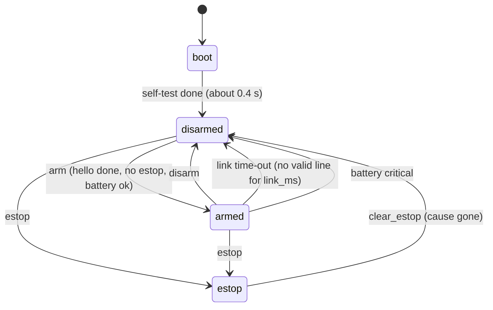

# Robot 2: the USB serial protocol between the single board computer and the ESP32

Status: **DRAFT for review, protocol version 1.** No code exists yet. This file is the contract: the robot service on the single board computer
(SBC) and the ESP32 firmware are both written against it. If code and this file ever disagree, this file wins and the code is fixed.

Written for a hobbyist. Words in `code font` are the exact text that travels on the cable. Marks: **VERIFIED** = I saw it in a file or a source;
**ASSUMED** = my best knowledge, to be checked on the real hardware (the stage in `software-plan.md` that checks it is named).

Related file: `software-plan.md` (the whole software plan; stage numbers below point into it).

---

## 1. The big picture in six lines

1. The SBC is the boss. The ESP32 is the "spinal cord": it drives motors and servos and reads sensors, nothing else. **The ESP32 does not use Wi-Fi at all.**
2. One USB cable carries everything: from the SBC's USB-A port to the ESP32 devkit's **COM** USB-C socket (the one with the USB-to-serial chip). The cable is planned to carry data only, no 5 V (ASSUMED until two bench tests pass; see "Power" in section 2).
3. Text lines in both directions. Each line is one small JSON object (a way to write data as text, see the glossary in section 16). You can watch the link with any terminal program and read it with your eyes.
4. The SBC must keep saying "go on" (`drive` every 50 ms). If it stops, the ESP32 stops the robot by itself: it starts slowing down after 0.3 s and the robot is stopped in about 0.4 s.
5. The ESP32 has no memory of settings: the SBC sends the settings every time it connects (so you can re-flash the ESP32 without losing anything).
6. Every unknown field is ignored and every unknown message gets a polite error, so old and new versions can talk to each other.

---

## 2. The physical link

| Item | Value | Mark |
|---|---|---|
| Cable | SBC USB-A (or its USB hub) to the **COM** USB-C socket of the ESP32-S3 devkit (dual USB-C, N16R8). The other socket ("USB", native) is not used for the protocol. | VERIFIED (robot 1 uses the COM socket the same way, `plan.md`) |
| ESP32 side | UART0 = GPIO43 (TX) and GPIO44 (RX), through the devkit's USB-to-serial chip. The same two pins are on the board's UART header (`pin-table.md`: UART header = GND, TX, RX). **Keep that header empty during normal use**, it is the same wire. | VERIFIED (pin-table.md, README.md) |
| Name on the SBC | The kernel calls it `/dev/ttyACM0` or `/dev/ttyUSB0`, depending on the chip. The service always opens the fixed name `/dev/robot-esp32`, made by a small udev rule from the chip's USB vendor/product ID (found once with the `lsusb` command, which lists the USB devices; udev is the Linux part that reacts when a USB device appears, see section 16). | ASSUMED, Stage 4 |
| Likely USB IDs | CP2102N: `10c4:ea60`. CH343: `1a86:55d3`. CH340: `1a86:7523`. | ASSUMED (from memory, `lsusb` decides) |
| Speed | **115200 baud, 8 data bits, no parity, 1 stop bit (8N1), no flow control.** Fixed in v1 (no negotiation). 115200 is 11 520 bytes per second; the busiest direction (ESP32 to SBC) needs about 2.5 kB/s, so there is a 4x reserve. A build option may raise both sides to 460800 later; the ESP32 boot ROM always talks at 115200, so the first 0.3 s after a reset is unreadable at any other speed (harmless, see 2.3). | ASSUMED, Stage 4 |
| Power | The ESP32 gets its 5 V **only** from the board (CLEAN 5V IN via diode D1). The USB cable between the SBC and the COM socket must carry **data only** (no 5 V wire): best a small "USB data-only adapter" ("power blocker", about 5 EUR); taping the 5 V contact is a backup only (tape pin 1 of the USB-A plug on the SBC side). Ground is common through the cable. It is not known whether the devkit's USB-to-serial chip needs the cable's 5 V to show up on the SBC, so two 5-minute bench tests are done before the trip (written out in full in `software-plan.md`, Stage 4). (The "clean-5V buck" is the small step-down voltage module on the robot that turns the battery voltage into the clean 5 V for the ESP32; "buck" just means a step-down converter.) Test A: clean-5V buck OFF, the devkit's power LED must stay dark. Test B: clean-5V buck ON, `lsusb` must list the chip and `ls /dev/ttyUSB* /dev/ttyACM*` must list one device. (If one of the two patterns matches nothing, `ls` prints a line like "cannot access ... No such file or directory" for it. That is harmless. What counts is that exactly one device name is listed.) If test B fails, use an ordinary cable, put a USB power meter in line, and check that about 0 mA flows out of the SBC port while the clean-5V buck feeds the ESP32; if the port does deliver current, do not run the robot that way until you have asked the person who designed the power plan. | ASSUMED (the data-only cable is the plan; tests A and B decide), Stage 4 |

### 2.1 Framing

- One message = one **JSON object on one line**, UTF-8 (v1 uses ASCII only), ended by `\n` (byte 0x0A). A `\r` before it is ignored.
- No line breaks inside a message. Maximum length of a line, including the `\n`: **256 bytes** in both directions. A longer line is thrown away: the ESP32 counts it (`rxlong` in `stat`) and sends one `err too_long` (no `a`, because the line was not read; at most one per second). The SBC does the same with an over-long line from the ESP32: it throws it away and counts it.
  The limit holds for every message type, so the long ones are split into several short lines: the settings (5.12) and the answer to `get cfg` (6.7).
- Some examples below (4.2, 6.3 and 6.6) are wrapped over two or three lines **only to be readable on a page**. On the cable each one is a single line.
- Anything that does not start with `{` is ignored silently. That covers boot-ROM text, library debug output and line noise.
- After an unreadable line, the receiver simply waits for the next `\n` and goes on. There is no checksum: the USB link below the UART is error-checked, and the short UART wire on the devkit is not a noisy place.
  A damaged `drive` line that still looks valid is extremely unlikely, and the 300 ms time-out limits the damage anyway.
- Keys are case-sensitive, short and lower case. Unknown keys are **ignored** (that is how we add features later).

### 2.2 Who talks when

- The SBC sends commands. The ESP32 answers commands that carry a sequence number `s`, and also sends a steady stream of telemetry (`tel`) and one-off events (`ev`) by itself.
- The ESP32 never starts any movement by itself. It only stops things by itself.
- Rate limits: SBC to ESP32 up to 60 lines per second (normal: about 25). ESP32 to SBC about 15 lines per second (normal: 10 `tel` + a few events). Excess lines on the ESP32 side are dropped and counted.
- If the ESP32 cannot send because its output buffer is full, it drops `tel`, `imu` and `log` first. It never drops `ack`, `err` or `ev`.

### 2.3 Open, reset and boot noise

On a devkit, the two serial control wires **DTR** and **RTS** are joined to the ESP32's reset pin (EN) and boot-mode pin (GPIO0) through two small transistors. That is how a
flashing tool resets the chip without any button. The side effect: Linux raises DTR and RTS for a moment every time a program opens the port, whatever the program asks for
(even pyserial with `dsrdtr=False`: that option is flow control, it does not switch the lines off). So opening the port **may reset the ESP32 once**
(ASSUMED, depends on the chip). That is normal and the protocol is built for it: after any reset the ESP32 sends a `boot` message, and the SBC then does the
`hello` handshake again (section 4). The firmware is allowed to restart at any time; the SBC must never assume it keeps state.

What the service does, so that a reset never ends in "download mode" (the chip then sits silent and waits for a flashing tool):

1. **Once, before the service runs:** `stty -F /dev/robot-esp32 -hupcl`. (`stty` is the Linux command that changes serial port settings. `hupcl` means "drop the control lines when the port is closed"; `-hupcl` turns that off, so later re-opens are quieter.) In the service file, put it on an `ExecStartPre` line (the systemd line that runs a command before the service starts). systemd wants the full path of the program, so write the line out exactly like this:

   ```
   ExecStartPre=-/usr/bin/stty -F /dev/robot-esp32 -hupcl
   ```

   The `-` right after the `=` means "if this command fails, ignore it and start the service anyway". That matters: if the ESP32 is unplugged, `/dev/robot-esp32` does not exist, `stty` fails, and without the `-` the whole service would refuse to start. To check the path on your SBC, type `which stty` and press Enter; if it prints a different path, use that one. Note that `stty` itself opens the port once, so it can cause one reset of the ESP32 (see above). That is fine: the `hello` handshake follows.
2. **At every open:** create the serial object without a port name, set `dtr = False` and `rts = False`, and only then call `open()`. Never leave one of the two lines on and the other off: DTR on with RTS off holds the boot-mode pin low, and the next reset would then start download mode.
3. **Keep the port open** for the whole life of the service where possible. Every re-open can reset the chip again.
4. **After every open,** wait up to 3 s for any line at all that starts with `{`, such as `boot` (the chip did reset on open) or `tel` (the chip did not reset and just keeps running; it sends `tel` 10 times a second by default). Do not wait for `hello`: the ESP32 only sends `hello` after the SBC has sent one. If nothing at all arrives, or the only text on the wire is the ROM message `waiting for download`, the chip is probably in download mode. Reset it with **RTS only**: RTS on for 100 ms with DTR kept off, then RTS off (this is the same reset the flashing tool uses). Then do the `hello` handshake (section 4). If any line did arrive, skip the RTS reset and go straight to the `hello` handshake.

---

## 3. The message envelope

Every message is an object with a type key `t`. The other keys depend on the type.

| Key | Type | Where | Meaning |
|---|---|---|---|
| `t` | string | all | message type, lower case, up to 12 characters, e.g. `drive` |
| `s` | integer 1..4294967295 | SBC to ESP32, optional | sequence number chosen by the SBC. If present, the ESP32 answers with `ack` or `err` carrying `"a":<same number>`. If absent, there is no answer (a bad message without `s` gets only a rate-limited `err` without `a`). |
| `a` | integer | ESP32 to SBC | "this answers your message number `a`" |
| `up` | integer | ESP32 to SBC | ESP32 uptime in milliseconds. Wraps to 0 after 49.7 days (4 294 967 295 ms). |

### 3.1 Units and conventions (used everywhere)

| Thing | Unit / range | Notes |
|---|---|---|
| Speed `v` (forward) | -1.0 .. +1.0 | +1 = forward at the allowed top speed, -1 = reverse. "1.0" means the motor gets up to the voltage `mot_vmax` (default 8.0 V, a speed cap, not the motor rating), not the raw battery. If the pack is below `mot_vmax` (for example 7.0 V), the motor gets the pack voltage, because the duty cannot go above 100 percent. |
| Turn `w` | -1.0 .. +1.0 | +1 = turn **right** (clockwise seen from above). |
| Motor value | -1.0 .. +1.0 | after mixing; sign = direction (+ = robot forward when the motor wires are right). |
| Angle | degrees, decimals allowed | pan: 0 = straight ahead, **+ = turn right**. tilt: 0 = level, **+ = look up**. |
| Angular speed | degrees per second | |
| Time | milliseconds | |
| Distance | millimetres | -1 = no echo / out of range |
| Voltage | millivolts, integer | battery pack voltage, 0 = unknown |
| Acceleration | g (1 g = 9.81 m/s^2) | |
| Numbers | decimal, `.` as separator, no exponent, no NaN | the ESP32 prints v/w with 2 decimals, angles with 1, others as integers |
| Booleans | `true` / `false` (the ESP32 also accepts `1` / `0`) | |

Mixing rule on the ESP32: `left = v + w`, `right = v - w`; if either exceeds 1.0 in size, both are scaled down together so the ratio stays.

---

## 4. Starting up: hello, versions, settings

```
SBC                                         ESP32
 | open /dev/robot-esp32                      |
 |<------------------- {"t":"boot",...}  (only if the ESP32 just reset)
 | {"t":"hello","s":1,"pmin":1,"pmax":1,...}->|
 |<--------------------- {"t":"hello","a":1,"p":1,"fw":"0.1.0",...}
 | {"t":"cfg","s":2,"set":{...}} ------------>|   (all settings, in several short lines, RAM only)
 |<----------------------------- {"t":"ack","a":2}
 | {"t":"stream","s":3,"tel_hz":10} --------->|
 | {"t":"led","s":4,"id":"cam","mode":"off"}->|
 | {"t":"look","s":5,"pan":0,"tilt":0} ------>|   (head to home, slowly)
 | {"t":"imu","s":6,"do":"cal"} -------------->|   (robot standing still, takes 2 s)
 |<------------------------------ {"t":"tel",...}  10 times a second from now on
 | ... later, when the owner has switched driving on: {"t":"arm","s":7}
```

### 4.1 `hello` (SBC to ESP32)

```json
{"t":"hello","s":1,"pmin":1,"pmax":1,"host":"robot2-svc/0.1.0"}
```

| Field | Type | Meaning |
|---|---|---|
| `pmin`, `pmax` | integer | the lowest and highest protocol version the SBC can speak |
| `host` | string, optional | free text, name and version of the service (for logs) |

### 4.2 `hello` (ESP32 to SBC, the reply)

```json
{"t":"hello","a":1,"p":1,"fw":"0.1.0","build":"2026-11-05T21:14","hw":"abadi-v5","chip":"esp32s3",
 "boot":"poweron","up":812,"caps":["drive","servo","sonar","cliff","imu","bat","btn","led"],
 "hwok":{"pca":1,"imu":1,"ads":1}}
```
(Wrapped over three lines for reading only. On the cable it is one line.)

| Field | Type | Meaning |
|---|---|---|
| `p` | integer | the protocol version that will be used = the highest version both sides know. |
| `fw` | string | firmware version, "major.minor.patch" |
| `build` | string | build date and time, for the log |
| `hw` | string | board name, fixed: `abadi-v5` (motherboard v5) |
| `chip` | string | `esp32s3` |
| `boot` | string | why the ESP32 last restarted (same values as in `boot`, section 6.1) |
| `caps` | array of strings | **features compiled into the firmware** (what it could do): `drive`, `servo`, `sonar`, `cliff`, `imu`, `bat`, `btn`, `led`, `m34` (the second driver DRV B) |
| `hwok` | object | **parts found on the I2C bus at start** (I2C is the two-wire bus the chips share, see section 16): `pca` (PCA9685 at 0x40, the 16-channel chip that drives the servos and LEDs), `imu` (GY-521 at 0x68, the motion-sensor board), `ads` (ADS1115 at 0x48, the chip that measures the battery voltage); 1 = answered, 0 = missing. A missing part also sets a fault bit (section 9). |

If there is **no common version**, the ESP32 answers with an error and does nothing else, and the SBC shows "ESP32 firmware too old/new" on the status page:

```json
{"t":"err","a":1,"c":"proto","m":"supports 1..1","pmin":1,"pmax":1}
```

### 4.3 Rules for changing the protocol later

- **Adding** a message type, a field, a config key, a fault bit or an event does **not** change the version. Receivers ignore what they do not know.
- **Changing the meaning** of an existing field, removing one, or changing a unit **does** change the version (`p` becomes 2) and the new SBC must still accept `pmin`..`pmax` ranges that include the old one for at least one release.
- A command the ESP32 does not know gets `{"t":"err","a":<s>,"c":"unknown_cmd","t0":"<its type>"}`. A telemetry type the SBC does not know is ignored.
- Until `hello` has been answered once after each `boot`, the ESP32 accepts only `hello`, `ping`, `hb`, `estop`, `get`, `reboot`. Everything else gets `err no_hello`. (`estop` always works.)

---

## 5. Commands: SBC to ESP32

Fields marked "opt" may be left out. `s` is allowed on every command and is shown only where it matters.

### 5.1 Summary

| `t` | Does what | Needs state | Answer |
|---|---|---|---|
| `hello` | start / version check | any | `hello` or `err proto` |
| `ping` | measure the round trip | any | `pong` |
| `hb` | "I am still here" (heartbeat) | any | none |
| `arm` | allow the drive motors to move | disarmed | `ack` / `err` |
| `disarm` | stop the drive motors and forbid movement | any | `ack` |
| `estop` | emergency stop, latched | any | `ack` (always) |
| `clear_estop` | release the emergency stop | estop | `ack` / `err` |
| `drive` | drive command, valid for `ttl` ms | armed | none (see 5.3) |
| `stop` | stop now (soft or hard) | any | `ack` if `s` |
| `motor` | bench test of one motor channel | armed | `ack`, later `ev motor_done` |
| `look` | move the head (pan / tilt) | not estop | `ack` if `s` |
| `relax` | switch a servo off (limp) | any | `ack` if `s` |
| `cal` | switch servo calibration mode on/off | disarmed | `ack` |
| `servo_us` | raw servo pulse (calibration only) | cal on | `ack` |
| `led` | set a named LED | any | `ack` if `s` |
| `stream` | set telemetry rates | any | `ack` |
| `get` | ask for `cfg`, `stat` or `hw` | any | that message (`cfg` comes back in several pages, 6.7) |
| `cfg` | change settings (several short lines) | see 5.12 | `ack` with the list of rejected keys |
| `bat_cal` | one-point calibration of the battery reading | any | `ack` with the new scale |
| `imu` | gyro actions (`cal`, `zero_yaw`) | disarmed | `ack`, later `ev imu_cal` |
| `reboot` | restart the ESP32 | any | `ack`, then `boot` |

### 5.2 `ping`, `hb`

```json
{"t":"ping","s":9,"n":3123456}
{"t":"pong","a":9,"n":3123456,"up":90120}
```
`n` is any integer from 0 to 4294967295 (typically the SBC's clock in ms, wrapped); it comes back unchanged so the SBC can compute the round-trip time. Expect < 20 ms.

```json
{"t":"hb"}
```
`hb` has no answer. It only proves the SBC is alive. Any valid line counts as a heartbeat for the link watchdog (section 7), so a stream of `drive` lines needs no extra `hb`.
The service sends `hb` at 4 Hz or faster while armed and about 1 Hz otherwise.

### 5.3 `drive`

```json
{"t":"drive","v":0.35,"w":-0.20,"ttl":300}
```

| Field | Type | Range / default | Meaning |
|---|---|---|---|
| `v` | float | -1.0..1.0 | forward speed |
| `w` | float | -1.0..1.0 | turn (+ = right) |
| `ttl` | integer ms | 50..500, default `ttl_def` (300) | **how long this command stays valid.** When it runs out with no newer `drive`, the robot slows to a stop by itself. The ESP32 **caps** every `ttl` at `ttl_def`, so a message can shorten the time but never make it longer (the stopping time in 7.2 relies on this). |
| `s` | opt | | add it only for a test; normal driving has no answer |

- The service repeats the newest `drive` **every 50 ms (20 Hz)** while a person is steering. It never queues old ones; if the serial port is slow it sends only the newest.
- The ESP32 clamps `v` and `w` to `max_v`/`max_w`, applies ramps (section 7.4), then the obstacle, cliff, tilt and battery limiters (section 7.3).
- A `drive` that arrives while the state is not `armed` is **not obeyed**; the ESP32 sends `err not_armed` (at most once per second) so the SBC notices quickly.
- `drive` with `v=0,w=0` is a normal "stand still" command and also refreshes the time-out.

### 5.4 `stop`

```json
{"t":"stop","s":12}
{"t":"stop","s":13,"hard":true}
```
Soft stop (default): the speed goes to zero at the `ramp_stop` rate (about 0.12 s from full speed); the robot stays armed. Hard stop (`"hard":true`): brake at once (both driver inputs high for 200 ms, then released to coast).

### 5.5 `arm`, `disarm`, `estop`, `clear_estop`

```json
{"t":"arm","s":20}
{"t":"disarm","s":21}
{"t":"estop","s":22}
{"t":"clear_estop","s":23}
```
- `arm` works only if: `hello` done, no emergency stop latched, battery not critical (no BAT_CRIT bit), and the robot is level and on the floor (no TILT or PICKUP bit). Otherwise `err` with code `estop`, `bat_crit` or `no_hello`; a tilted or lifted robot gets code `denied` with `k` = `tilt` or `pickup`, for example `{"t":"err","a":20,"c":"denied","k":"tilt","m":"robot is tilted"}`.
- `disarm`: hard stop, then the drive motors are ignored until the next `arm`. Servos are not affected.
- `estop`: brake at once, **latched**: state becomes `estop`, `drive`/`arm`/`motor`/`look` are refused. The servos freeze where they are. Only `clear_estop` (then `arm`) gets out. `estop` is accepted in every state and is always answered, even without `hello`.
  The service sends `estop` three times in a row, 20 ms apart (idempotent), because it is the one command that must not be lost.
- `clear_estop` works only if the cause is gone (e.g. the robot is no longer at a cliff edge); it moves to `disarmed`.

### 5.6 `motor` (wiring test only)

```json
{"t":"motor","s":30,"ch":1,"p":0.30,"ms":600}
```
Runs one driver channel (1 = M1 left, 2 = M2 right, 3 = M3, 4 = M4 on the second driver) at power `p` (-1..1) for `ms` (max 2000), then stops. It uses the same caps, ramps and voltage limit as `drive`
but skips the obstacle logic, so it can be used with the robot on a stand. Answered with `ack` at once and `{"t":"ev","e":"motor_done","ch":1}` when finished. Channels 3 and 4 need the `m34` feature.

### 5.7 `look`, `relax`

```json
{"t":"look","s":40,"pan":-20.0,"tilt":10.0,"spd":90}
{"t":"look","pan":5,"rel":true}
{"t":"relax","s":41,"ch":"pan"}
```

| Field | Type | Meaning |
|---|---|---|
| `pan`, `tilt` | float degrees | target angle. Leave one out to leave that axis alone. Values outside `pan_min..pan_max` / `tilt_min..tilt_max` are **clamped** (no error). |
| `rel` | bool, default false | true = add to the present angle instead of replacing it |
| `spd` | float deg/s, opt | slew speed for this move (cap: `spd_pan` / `spd_tilt`); the head always moves smoothly, never jumps |
| `ch` (relax) | `"pan"`, `"tilt"`, `"all"` | stop sending pulses to that servo (it goes limp). The next `look` switches it on again. |

The ESP32 has no position feedback: `pan`/`tilt` in telemetry are the **commanded** angles after slewing.
After a reset the servos are off (limp) until the first `look`; the first `look` starts from the home angles (0, 0) so the first move is slow and short.

### 5.8 `cal`, `servo_us` (calibration only)

```json
{"t":"cal","s":50,"on":true}
{"t":"servo_us","s":51,"ch":"pan","us":1500}
```
In calibration mode the service can send a raw pulse width (`us`, accepted range 500..2500) to find each servo's real end points and centre. Outside calibration mode, `servo_us` returns `err cal_off`. Calibration mode ends by itself after 120 s, on `cal` off, or on `estop`.
The numbers found are written into the SBC's config file (`pan_us`, `tilt_us`) and pushed with `cfg` at every start.

### 5.9 `led`

```json
{"t":"led","s":60,"id":"cam","mode":"on"}
{"t":"led","s":61,"id":"btn","mode":"blink","hz":0.8}
```

| Field | Values | Meaning |
|---|---|---|
| `id` | `cam` = the "camera is live" LED; `btn` = the light in/around the call button | names; the PCA9685 channel behind each name is a config key (`led_map`, default `{"cam":2,"btn":3}` = servo channels 2 and 3) |
| `mode` | `off`, `on`, `blink` | `blink` is a software on/off toggle by the firmware, not PWM dimming. `pulse` is **reserved for later** and refused with `err bad_arg`. |
| `v` | reserved | brightness is **not available**: all PCA9685 channels share one 50 Hz rate (the servo rate), so a dimmed LED would flicker. `v` is reserved for later; a message that carries it is refused with `err bad_arg`. |
| `hz` | 0.2..5, default 1 | blink rate |

- **Fail-safe direction:** after an ESP32 reset the `cam` LED is **on** until the SBC says otherwise (config key `cam_led_boot`, default true). A lit LED that should be off is a harmless mistake; a dark LED while the camera is live is not.
- If the SBC disappears, LEDs keep their last state.

### 5.10 `stream`, `get`

```json
{"t":"stream","s":70,"tel_hz":10,"imu_hz":0,"stat_s":5}
{"t":"get","s":71,"what":"cfg"}
```
`tel_hz` 1..20 (default 10), `imu_hz` 0..20 (0 = off, default), `stat_s` 0..60 (0 = off, default 5). `what` is `cfg`, `stat` or `hw`; the answer is the message of that name (6.6, 6.7, 4.2's `hwok`). The `cfg` answer is sent as several pages, one short line each (6.7).

### 5.11 `bat_cal` (battery calibration with a multimeter)

```json
{"t":"bat_cal","s":80,"mv":7920}
```
The owner measures the pack with a multimeter and types the value. The ESP32 sets `bat_scale` so that its reading equals `mv`, and answers `{"t":"ack","a":80,"scale":2.7512}`. The service stores that number in its config.

### 5.12 `cfg` (settings)

```json
{"t":"cfg","s":2,"set":{"max_v":0.5,"ramp_up":1.5,"pan_us":[600,1500,2400],"son_dir":"ff"}}
{"t":"cfg","s":3,"save":true}
{"t":"cfg","s":4,"reset":true}
```
- `set` changes values **in RAM**. The answer lists keys it did not accept: `{"t":"ack","a":2,"bad":["foo"]}`; a wrong type or out-of-range value gives `bad` too, and that key keeps its old value.
- **One line is too short for all the settings** (there are 43 keys, and a line may have only 256 bytes, see 2.1). So the SBC sends them in **several `cfg set` lines of at most 6 keys each**, every line under 200 bytes (the longest 6-key line is about 170 bytes). Each line gets its own `ack` (its own `s`), and the service collects every `bad` list. The long values (`led_map`, `pan_us`, `tilt_us`) are the reason for the 6-key rule.
- `save:true` writes the present values to the ESP32's flash (NVS). Flash writes are slow (can stall the control loop for 50-100 ms), so `save` is only accepted while **disarmed**. Normal operation does not use it: the SBC sends all the settings (in several lines) at every start.
- `reset:true` returns RAM and flash to the factory defaults of the firmware.
- Keys that change motor or safety behaviour (`max_v`, `max_w`, `mot_vmax`, `ttl_def`, `link_ms`, `son_stop`, ...) are accepted only while **disarmed** (`err denied` otherwise).
- All keys, types, units and defaults are in section 10.

### 5.13 `imu`, `reboot`

```json
{"t":"imu","s":90,"do":"cal"}
{"t":"imu","s":91,"do":"zero_yaw"}
{"t":"reboot","s":92}
```
`cal` measures the gyro's zero offset for 2 s (the robot must stand still; `ev imu_cal` reports ok or fail). The service sends `imu cal` once after every start or `boot`, while the robot is disarmed (section 13, step 3). `zero_yaw` sets the yaw angle to 0. `reboot` answers `ack`, waits 100 ms and restarts the ESP32; a `boot` message follows ~0.4 s later.

---

## 6. Messages: ESP32 to SBC

### 6.1 `boot` (after every reset, unasked)

```json
{"t":"boot","up":410,"fw":"0.1.0","p":1,"reset":"poweron"}
```
`reset` is one of: `poweron`, `external` (reset button), `software` (our `reboot`), `panic` (a crash), `int_wdt`, `task_wdt`, `other_wdt`, `brownout`, `deepsleep`, `unknown`.
A `panic`, `*_wdt` or `brownout` is logged by the service as a **warning** and counted; three within ten minutes raise a notification to the owner.

### 6.2 `ack`, `err`

```json
{"t":"ack","a":2,"bad":["foo"]}
{"t":"err","a":12,"c":"bad_arg","k":"v","m":"v out of range"}
{"t":"err","c":"not_armed","t0":"drive"}
```

| Field | Meaning |
|---|---|
| `a` | the `s` of the command being answered (missing if the command had no `s`) |
| `c` | error code (table 8) |
| `k` | the offending key, if one |
| `t0` | the type of the offending command (given when `a` is missing) |
| `m` | short text for people, max 60 characters |

### 6.3 `tel`: the main telemetry (10 per second by default)

```json
{"t":"tel","up":84213,"st":"armed","f":0,"lim":0,"v":0.35,"w":0.00,"ml":0.35,"mr":0.35,
 "pan":-12.5,"tilt":8.0,"son":[412,-1],"cl":[0,0],"pit":1.2,"rol":-0.4,"yaw":93.1,
 "bat":7640,"chg":-1,"age":87}
```
(Wrapped over three lines for reading only. On the cable it is one line.)

| Field | Type | Unit | Meaning |
|---|---|---|---|
| `up` | int | ms | ESP32 uptime |
| `st` | string | | state: `boot`, `disarmed`, `armed`, `estop` |
| `f` | int | bit mask | active **faults** (table 9). 0 = none. |
| `lim` | int | bit mask | motion **limiters** active right now (table 7.3): 1 obstacle ahead (stop), 2 obstacle ahead (slow), 4 obstacle behind, 8 cliff, 16 battery speed cap, 32 no fresh drive command (idle), 64 supply-voltage duty cap active |
| `v`, `w` | float | -1..1 | speed and turn **actually applied** now (after ramps and limiters) |
| `ml`, `mr` | float | -1..1 | left and right motor value now (before the supply-voltage scaling) |
| `pan`, `tilt` | float | degrees | commanded head angles after slewing; `null` while the servo is limp |
| `son` | [int,int] | mm | sonar 1 and 2, `-1` = no echo / out of range, valid range 20..4000 |
| `cl` | [int,int] | 0/1 | cliff sensors left and right; **1 = no floor seen** |
| `pit`, `rol` | float | degrees | tilt of the robot: pitch + = nose up, roll + = right side down. `null` if no IMU. |
| `yaw` | float | degrees | turn angle since the last `zero_yaw` or reset, -180..180. Drifts about 1-2 degrees per minute after `cal` (ASSUMED). `null` if no IMU. |
| `bat` | int | mV | battery pack voltage, filtered over ~1 s; 0 = unknown |
| `chg` | int | | charger plugged in: 1 yes, 0 no, -1 unknown or not wired (optional second ADS1115 input) |
| `age` | int | ms | time since the last accepted `drive` (65535 = never since arming). Lets the SBC see the time-out clock. |

About 215 bytes per message, 10 per second = 2.2 kB/s.

### 6.4 `imu` (only when `imu_hz` > 0; for tests)

```json
{"t":"imu","up":84250,"a":[0.01,-0.02,1.00],"g":[0.2,-0.1,0.0]}
```
`a` = acceleration x,y,z in g (x forward, y left, z up, robot level), `g` = turn rates in degrees/second (same axes). One line is 63 to 76 bytes, so at 20 Hz this is about 1.3 to 1.5 kB/s. Both streams at 20 Hz fit (`tel` 4.5 kB/s + `imu` 1.5 kB/s = about 6 kB/s of the 11.5 kB/s available), but they leave less room for replies. Keep `tel_hz` at 10 for normal use.

### 6.5 `pong`
See 5.2.

### 6.6 `stat`: health counters (every `stat_s` seconds and on `get`)

```json
{"t":"stat","up":90000,"rx":4521,"rxbad":0,"rxlong":0,"txdrop":0,"loop_max":2310,"heap":182340,
 "i2cerr":0,"temp":41.5,"reset":"poweron","lastcmd":"drive"}
```
(Wrapped over two lines for reading only. On the cable it is one line.)

| Field | Meaning |
|---|---|
| `rx`, `rxbad`, `rxlong` | lines received OK / not parseable / too long since boot |
| `txdrop` | telemetry lines dropped because the output buffer was full |
| `loop_max` | longest control-loop run in microseconds since the last `stat` (should stay under 5000) |
| `heap` | free memory in bytes |
| `i2cerr` | I2C errors since boot |
| `temp` | chip temperature in degrees C |
| `reset` | reason of the last reset |
| `lastcmd` | type of the last command accepted |

### 6.7 `cfg` (answer to `get cfg`)

```json
{"t":"cfg","a":71,"ver":1,"part":1,"of":6,"v":{"max_v":0.9,"max_w":0.6,"ramp_up":2.0,"ramp_down":3.0,"ramp_stop":8.0,"min_duty":0.25,"mot_vmax":8.0,"vbat_assume":8400}}
```
All the keys of section 10 do not fit in one 256-byte line (2.1), so the answer comes in **pages**: one `cfg` line per page, all with the same `a` (the `s` of the `get`). `part` is the page number (1, 2, ...), `of` is the number of pages, and `v` holds at most **8 keys**, in the order of the table in section 10 (a row with two keys counts as two keys). With the 43 keys of version 1 that is 6 pages, the longest about 200 bytes. The ESP32 sends the pages back to back; the SBC has everything when `part` equals `of`. If a page is missing, the SBC asks again with a new `get`. If a page would ever grow past 250 bytes, the firmware uses fewer keys on it; `part` and `of` always tell the truth. `ver` is the config layout version.

### 6.8 `ev`: events (unasked, sent the moment they happen)

Every `ev` has `e` (what happened) and `up`.

| `e` | Extra fields | Sent when |
|---|---|---|
| `state` | `to`, `why` | the state changed. `why`: `arm`, `disarm`, `estop`, `clear`, `link`, `bat_crit`, `boot` |
| `ttl` | | the newest `drive` ran out (robot is slowing down by itself). Sent once per run-out. |
| `limit` | `lim` | the limiter mask changed |
| `fault` | `f`, `on`, `off` | a fault bit was set (`on` = bits just set) or cleared (`off`) |
| `btn` | `id` (`call` or `bump`), `k` | button event. For `call`: `k` = `down`, `up`, `short` (released before `btn_long` is reached, so under 1.5 s with the default; this includes a press between 0.8 and 1.5 s), `long` (held >= `btn_long`, sent while still held; the release after it gives only `up`). For `bump` (the optional bump switches on GPIO46, section 11): `k` = `down` (a switch closed) or `up` (open again). In version 1 a bump is only reported; what to do about it is decided by the service. |
| `cliff` | `cl` | a cliff sensor changed |
| `obstacle` | `mm`, `dir` (`f`/`r`) | first time the stop distance is reached |
| `pickup` | `on` | the robot was lifted (on) or put down (off) |
| `bat` | `lvl` (`ok`,`low`,`crit`), `mv` | battery level class changed |
| `motor_done` | `ch` | a `motor` test finished |
| `imu_cal` | `ok`, `bias` | gyro calibration finished |
| `cfg_saved` | | `cfg save` finished |

Examples:
```json
{"t":"ev","up":90210,"e":"state","to":"disarmed","why":"link"}
{"t":"ev","up":90333,"e":"btn","id":"call","k":"short"}
{"t":"ev","up":90900,"e":"btn","id":"bump","k":"down"}
{"t":"ev","up":91000,"e":"limit","lim":1}
{"t":"ev","up":91450,"e":"bat","lvl":"low","mv":6790}
```

### 6.9 `log`

```json
{"t":"log","up":1200,"l":"w","m":"ADS1115 not found"}
```
`l` = `e` error, `w` warning, `i` info. Default level `w`. At most 5 log lines per second. Never used for data.

---

## 7. States, watchdogs and the stopping rules

### 7.1 States



Servos and LEDs work in `disarmed` and `armed`. In `estop` the servos freeze and `look` is refused.

### 7.2 The four independent timers that keep the robot safe

Each timer works alone: none of them needs another one to work. Timer 1 runs on the SBC, timers 2 to 4 run on the ESP32.

| # | Name | Rule | Default | Effect |
|---|---|---|---|---|
| 1 | **Service dead-man** (on the SBC) | the robot service gets no steering input from the browser for this long | 250 ms | the service turns the silent browser into `stop` / `drive 0` (see `software-plan.md`, section 4) |
| 2 | **Drive time-out** (`ttl`) | each `drive` sets "valid until now + ttl" (`ttl` is capped at `ttl_def`, see 5.3). After that, the target speed becomes 0. | 300 ms (`ttl_def` 50..500) | soft stop at `ramp_stop`, still armed, `ev ttl` |
| 3 | **Task watchdog** (hardware) on the control task | the control loop (every 10 ms) must run at least every 500 ms | 500 ms | the chip resets itself; during and after the reset the driver pins are inputs and the DRV8833's internal pull-downs hold them low = **motors coast** (VERIFIED: TI datasheet, 150 kOhm internal pull-down on the input pins) |
| 4 | **Link watchdog** (`link_ms`), only while armed | if no valid line of any kind arrives for `link_ms` | 1000 ms (300..5000) | hard stop, state `disarmed`, fault bit LINK_LOST, `ev state ... why link`. Re-arming is needed after the link returns. |

**About timer 3.** The Arduino-ESP32 library starts with a 5 s watchdog that only watches the idle tasks (ASSUMED, from forum reports; check in Stage 5), which is useless here. So the firmware **reconfigures it to 500 ms with panic switched on** (`timeout_ms` = 500, `trigger_panic` = true), subscribes the `control` task, and the `control` task **feeds it every 10 ms**. A panic prints a stack dump on the serial port; the SBC ignores it because it does not start with `{`. Stage 5 tests it by deliberately hanging the loop (wheels off the ground).

**Worst-case stopping time** (from the last good `drive` that reached the ESP32, with the default `ttl`): 300 ms (timer 2) + about 120 ms soft-stop ramp = **about 0.42 s, in round numbers about 0.4 s**. The figure holds for any `drive` line because every `ttl` is capped at `ttl_def`; it changes only if `ttl_def` itself is raised.
If the firmware itself hangs, the PWM hardware would keep the last speed until timer 3 fires: at most **about 0.6 s** including the reset. Both are close to the "about half a second" goal. (ASSUMED numbers, measured in Stage 5 with phone slow-motion video.)

Rule for the SBC side: the service sends `drive` every 50 ms **only while a person is actively steering**, and timer 1 covers a silent browser. The ESP32 timers are the last line, not the first.

### 7.3 Limiters (applied on the ESP32 every 10 ms, strongest wins)

Order of priority: `estop` > fault/`disarm` > link watchdog > `ttl` > cliff > obstacle > battery cap > operator command.

| Limiter | Condition | Effect | `lim` bit |
|---|---|---|---|
| Obstacle stop | sonar listed as `f` in `son_dir` reads below `son_stop` (default 250 mm) for 2 readings in a row, and `v > 0` | forward part of `v` forced to 0 (turning and reverse stay allowed) | 1 |
| Obstacle slow | below `son_slow` (500 mm) | `v` capped at 0.35 of `max_v` | 2 |
| Obstacle behind | sonar listed as `r` below `son_stop` and `v < 0` | reverse part forced to 0 | 4 |
| Cliff | either cliff sensor shows "no floor" (3 samples in a row) and `v > 0` | forward stops at once (`ramp_stop`), reverse allowed, turning limited to half | 8 |
| Battery | `bat` below `bat_warn` (6800 mV) | `v` capped at 0.5 | 16 |
| Battery critical | `bat` below `bat_crit` (6400 mV) for 10 s | state `disarmed` (why `bat_crit`), `arm` refused | (fault) |
| Tilt | pitch or roll (size, ignoring the sign) above `tilt_stop` (10 degrees) | hard stop, fault TILT; cleared when level again | (fault) |
| Pickup | acceleration z differs from 1 g by more than `pickup_g` (0.35 g) for 150 ms | hard stop, fault PICKUP; cleared when level for 1 s | (fault) |
| Supply-voltage cap | the pack voltage is above `mot_vmax` | all duty cycles scaled by `mot_vmax / pack voltage` (see 7.4) | 64 |

How to choose `tilt_stop`: it must be above ramp slopes and the pitch while braking (about 5 degrees) and well below the real tipping angle of the robot (about 20 degrees; the recomputed figure is in `mechanical-design.md`, section 8.2). Default 10 degrees, allowed range 10..60.

A sonar is a safety **helper**, not a guarantee: soft cushions, thin chair legs and steep surfaces can be invisible to it.

### 7.4 Motor behaviour the firmware must implement

- **Driver (DRV8833) control:** each motor uses two inputs. Forward: one input held high and the other carries the PWM with inverted duty (slow decay, smoother at low speed; VERIFIED in the TI datasheet: "slow decay: one input held high, PWM on the other"). Reverse: the same with the inputs swapped. Stop: both low = coast; both high = brake.
- **Which pins:** left motor M1 = IN1A (GPIO4) + IN2A (GPIO16); right motor M2 = IN3A (GPIO1) + IN4A (GPIO5); spare M3 = IN1B (GPIO8) + IN2B (GPIO11); spare M4 = IN3B (GPIO9) + IN4B (GPIO10). (VERIFIED, `pin-table.md`.) A motor that turns the wrong way is fixed with `inv_l` / `inv_r` / `swap_lr`, not by swapping wires.
- **PWM:** 20 kHz (above hearing), 10-bit resolution. The ESP32-S3 has 8 hardware PWM channels (ASSUMED, from memory; check the datasheet); two motors use 4 of them, four motors would use all 8.
- **Ramps** (per second, in units of full scale): speed up `ramp_up` 2.0 (0 to full in 0.5 s), slow down `ramp_down` 3.0, stop after time-out or `stop` `ramp_stop` 8.0 (full to zero in 0.125 s). Reversing direction passes through zero at `ramp_down`. Applied to each motor separately.
- **Dead band:** the smallest value that moves the robot is `min_duty` (default 0.25, found in Stage 5). Values between 0 and 0.04 are 0; values above are mapped to `min_duty..1`.
- **Supply-voltage scaling:** the DRV8833 modules are fed with the raw pack (6.0-8.4 V). Robot 2 uses Pololu 25D **12 V** motors (VERIFIED: `mechanical-design.md`, section 5.5), so they are run below their rating and `mot_vmax` is a **speed cap, not the motor rating**. The duty is multiplied by `min(1, mot_vmax / vpack)`; `mot_vmax` default **8.0 V**. At a full pack (8.4 V) the factor is 0.95; at 8.0 V or less there is no scaling, and the robot gets slower as the pack runs down. Stage 5 starts at 8.0 and never goes above the pack voltage (8.4 V); the duty is limited to 100 percent. With no battery reading, `vbat_assume` (8400 mV) is used = the cautious case.
- **Hard stop:** both inputs high (brake) for 200 ms, then both low (coast).
- **At boot:** all eight pins are inputs (the driver's pull-downs keep it off), then switched to outputs low only when the firmware is ready.

### 7.5 Servo behaviour (PCA9685 at I2C 0x40)

- PWM frequency 50 Hz, 12-bit steps. With the internal 25 MHz clock the prescale value is 121; real chips are 5-10 % off, so `osc_hz` is a setting (default 25 000 000) and the pulse widths are calibrated per servo (`pan_us`, `tilt_us` = [min, centre, max] in microseconds). ASSUMED, Stage 6.
- Update rate 50 Hz. Each update moves toward the target by at most `spd * 0.02 s`, with a gentle start and finish (3-frame averaging) so the camera image does not shake.
- Soft limits `pan_min/max`, `tilt_min/max` stop the head before the mechanical ends (set from the 3D design in Stage 6). The pan limit starts at +/-30 degrees and is widened (to about +/-80) only after the cable loop has been proven with the real cable bundle in Stage 6.
- Servos are not relaxed by default (`pan_relax`, `tilt_relax` = 0 ms = never): a tilted head with a screen on it would sag. The setting exists in case the pan axis should rest.

---

## 8. Error codes (`c` in `err`)

| Code | Meaning | Typical cause |
|---|---|---|
| `bad_json` | the line started with `{` but could not be read | damaged line (no `a`) |
| `too_long` | line over 256 bytes (thrown away and counted as `rxlong`; this is the one error that has no `a`, see 2.1) | a message that is too big: split it |
| `unknown_cmd` | `t` not known | newer SBC, older firmware |
| `bad_arg` | wrong type or missing required field (`k` names it) | |
| `range` | number outside the allowed range (the value is **not** used) | `ttl` 5000 |
| `no_hello` | command before the handshake | ESP32 just reset |
| `proto` | no common protocol version | |
| `not_armed` | motion command while not armed | after link loss or reset |
| `estop` | refused because the emergency stop is latched | |
| `bat_crit` | refused: battery critical | |
| `denied` | refused in this state (`k` says why): `arm` while tilted (`k` = `tilt`) or lifted (`k` = `pickup`); a safety key in `cfg` while armed | robot not level / on the floor; robot armed |
| `cal_off` | `servo_us` outside calibration mode | |
| `hw_missing` | the part is not there (`k`: `pca`, `imu`, `ads`, `m34`) | |
| `busy` | previous action still running (`motor`, `imu cal`) | |
| `internal` | firmware problem; also a `log e` | |

`bad_json`, `too_long`, `not_armed` and `unknown_cmd` without `s` are limited to one per second each, so a confused SBC cannot flood the link.

## 9. Fault bits (`f` in `tel`)

| Bit | Value | Name | Set when | Cleared when |
|---|---|---|---|---|
| 0 | 1 | `LINK_LOST` | link watchdog fired | a valid line arrives again (but re-arm is still needed) |
| 1 | 2 | `BAT_LOW` | `bat` < `bat_warn` | `bat` > `bat_warn` + 150 mV for 10 s |
| 2 | 4 | `BAT_CRIT` | `bat` < `bat_crit` for 10 s | `bat` > `bat_crit` + 300 mV |
| 3 | 8 | `TILT` | tilt beyond `tilt_stop` | level again for 1 s |
| 4 | 16 | `PICKUP` | lifted | put down for 1 s |
| 5 | 32 | `IMU_FAIL` | GY-521 missing or I2C error | an IMU read works again |
| 6 | 64 | `PCA_FAIL` | PCA9685 missing or I2C error (servos dead) | a write works again |
| 7 | 128 | `ADS_FAIL` | ADS1115 missing (battery unknown; `vbat_assume` used) | a read works again |
| 8 | 256 | `I2C_RECOVERED` | the firmware had to free a stuck I2C bus (SDA held low) | next `clear` of the log (informational, cleared after 60 s) |

Missing optional parts (`IMU_FAIL`, `ADS_FAIL`) do **not** stop driving; the limiter that depends on them is just inactive, and the service shows a warning on the status page.
`PCA_FAIL` does not stop driving either.

---

## 10. Settings (keys of `cfg`)

The SBC keeps the real values in its own config file (`/etc/robot2/esp32.toml`) and pushes them at every start, in several short `cfg set` lines (5.12). "Safety key" = refused while armed.

| Key | Type | Unit | Default | Range | Meaning |
|---|---|---|---|---|---|
| `max_v` * | float | | 0.90 | 0.1..1.0 | ceiling for forward/reverse. The real top speed is about 0.36 m/s (Pololu 25D 47:1 at 7.4 V, ASSUMED). The service's speed modes are re-tuned in Stage 5 from measured m/s: Creep about 0.08, Normal about 0.15 to 0.2, Fast about 0.3 m/s. |
| `max_w` * | float | | 0.60 | 0.1..1.0 | ceiling for turning |
| `ramp_up` | float | 1/s | 2.0 | 0.5..10 | speed-up limit |
| `ramp_down` | float | 1/s | 3.0 | 0.5..10 | slow-down limit |
| `ramp_stop` * | float | 1/s | 8.0 | 2..20 | slow-down after time-out / `stop` |
| `min_duty` | float | | 0.25 | 0..0.6 | smallest duty that moves the robot |
| `mot_vmax` * | float | V | 8.0 | 3..8.4 | a speed cap, not the motor rating. Robot 2 uses Pololu 25D 12 V motors on the 6.0-8.4 V pack. Start at 8.0; never above the pack voltage (8.4 V); duty is limited to 100 percent. |
| `vbat_assume` | int | mV | 8400 | 5000..9000 | pack voltage used if there is no reading |
| `inv_l`, `inv_r` | bool | | false | | reverse a motor's direction |
| `swap_lr` | bool | | false | | swap left and right |
| `ttl_def` * | int | ms | 300 | 50..500 | default `ttl` |
| `link_ms` * | int | ms | 1000 | 300..5000 | link watchdog |
| `son_stop` * | int | mm | 250 | 100..1000 | sonar stop distance |
| `son_slow` | int | mm | 500 | 150..2000 | sonar slow-down distance |
| `son_dir` | string | | `"ff"` | 2 chars of `f` `r` `x` | what each sonar guards: front, rear, off (set by where they are mounted) |
| `cliff_en` | bool | | true | | cliff sensors on/off |
| `cliff_act` | int | | 1 | 0/1 | pin level that means "no floor" (check the real module) |
| `tilt_stop` * | float | deg | 10 | 10..60 | tilt limit. Keep it above ramp slopes and braking pitch (about 5 degrees) and well below the tipping angle (about 20 degrees, see 7.3). |
| `pickup_g` | float | g | 0.35 | 0.1..1.0 | lift detection |
| `bat_warn` | int | mV | 6800 | 6000..8000 | low-battery warning |
| `bat_crit` | int | mV | 6400 | 5800..7500 | critical |
| `bat_scale` | float | | 2.741 | 1..10 | pack mV = ADS input mV x scale. Default = (47k + 27k) / 27k, the suggested divider. Set exactly by `bat_cal`. |
| `pan_min`, `pan_max` | float | deg | -30, 30 | -135..135 | pan limits. Start at +/-30 until the cable loop is proven with the real bundle in Stage 6; then about +/-80 (servo travel +/-90 is ASSUMED, measured in Stage 6). The range allows the optional 270 degree servo. |
| `tilt_min`, `tilt_max` | float | deg | -25, 35 | -90..90 | tilt limits |
| `pan_us`, `tilt_us` | array of 3 int | us | [600,1500,2400] | 500..2500 | pulse at min angle, at 0 degrees, at max angle |
| `pan_inv`, `tilt_inv` | bool | | false | | reverse a servo |
| `spd_pan`, `spd_tilt` | float | deg/s | 90, 60 | 5..300 | top slew speed |
| `pan_relax`, `tilt_relax` | int | ms | 0 | 0..60000 | go limp after this long without a command (0 = never) |
| `osc_hz` | int | Hz | 25000000 | 20e6..30e6 | PCA9685 clock correction |
| `led_map` | object | | {"cam":2,"btn":3} | PCA9685 channels 2..15 | which channel is which LED |
| `cam_led_boot` | bool | | true | | `cam` LED is on after a reset |
| `btn_long` | int | ms | 1500 | 500..5000 | long-press time |
| `tel_hz`, `imu_hz`, `stat_s` | | | 10, 0, 5 | see `stream` | also settable here |
| `log_lvl` | string | | `"w"` | `e` `w` `i` | log verbosity |

\* safety key.

---

## 11. Pin map the firmware uses

All from `pcb/kicad/pin-table.md` (VERIFIED) except the ones marked as proposals.

| Function | GPIO | Header / part | Notes |
|---|---|---|---|
| Left motor | 4 (IN1A), 16 (IN2A) | DRV A, M1 | |
| Right motor | 1 (IN3A), 5 (IN4A) | DRV A, M2 | |
| Spare motor 3 / 4 | 8, 11 / 9, 10 | DRV B, M3 / M4 | not used in v1 (`m34`) |
| I2C data / clock | **7 (SDA), 6 (SCL)** | I2C sensor header, PCA9685, GY-521 | bus at 400 kHz. 0x40 PCA9685, 0x68 GY-521, **0x48 ADS1115** (no clash). |
| Sonar trigger | 12 | SONAR 1 and SONAR 2 share it | both fire together |
| Sonar echo 1 / 2 | 13 / 14 | via the board's 1k/2k dividers | measured with edge interrupts, never with a blocking call |
| Cliff sensor left / right | 21 / 3 | SPARE IO header pins 8 / 3 | **proposal following the draft wiring diagram** (`abadi-rover-2/diagrams/wiring-robot2.png`); GPIO3 is a boot-strapping pin, harmless after start |
| Call button | **45** | SPARE IO header pin 5 (and GND pin 1) | **proposal.** Button to GND, internal pull-up after start. GPIO45 is a strapping pin, but it is pulled low by default, so a button to GND is safe even if held at power-up. |
| Optional bump input | 46 | SPARE IO header pin 4 | input only. **Optional, not in the first build.** If bump switches are fitted: switches between GPIO46 and 3V3, plus a 10 kOhm resistor from GPIO46 to GND (pull-**down**), so the pin idles low like its reset default and a closed switch reads high. GPIO46 is a strapping pin (it is read when the chip starts); a pull-up could block download mode (the exact boot table is ASSUMED, check the ESP32-S3 datasheet). The firmware reports it as `ev btn` with `id` `bump` (6.8). Without switches the pin is left unused. **Proposal.** |
| Dev-kit RGB LED | 38 or 48 (depends on the devkit revision) | on the ESP32 board | not wired; optional status colour |
| "Camera live" LED, button light | none (PCA9685 channels 2 and 3) | servo header CH2 / CH3 | **proposal:** a 5 mm LED from the channel's signal pin to its GND pin, with a ~220 ohm resistor in series (no extra resistor if the PCA9685 module already has a 220 ohm resistor on every output; see `peripherals.md`). On or off only, no dimming (5.9). Needs no ESP32 pin. |
| Battery monitor | I2C: **ADS1115 on the I2C SENSOR header** | input A0 = pack through a divider; input A1 = charger sense (optional) | address 0x48. Divider suggestion: 47k from pack + to A0 and 27k from A0 to GND, plus 100 nF at A0: 8.4 V gives 3.07 V (the ADS1115 pins must stay below its supply + 0.3 V = 3.6 V). About 0.11 mA continuous drain, so connect it after the main switch. |
| Console / protocol UART | 43 (TX), 44 (RX) | UART header = devkit COM socket | the protocol link |
| Not used by robot 2 | 2, 39, 40, 41, 42, 47 (SPI screens), 15, 17, 18 (relays) | | leave as inputs |

SPARE IO header, pin by pin (VERIFIED, `pin-table.md`): 1 = GND, 2 = ESP32 3V3, 3 = GPIO3, 4 = GPIO46 (optional bump input), 5 = GPIO45, 6 = GPIO48, 7 = GPIO38, 8 = GPIO21.
DRV8833 input names (VERIFIED): IN1A = GPIO4, IN2A = GPIO16, IN3A = GPIO1, IN4A = GPIO5 (driver A); IN1B = GPIO8, IN2B = GPIO11, IN3B = GPIO9, IN4B = GPIO10 (driver B). Sonar: TRIG = GPIO12, ECHO1_3V = GPIO13, ECHO2_3V = GPIO14. I2C: SDA = GPIO7, SCL = GPIO6. Relays (unused): RLY1 = GPIO15, RLY2 = GPIO18, RLY3 = GPIO17.

---

## 12. Timing and budget summary

| Item | Value |
|---|---|
| `drive` from the service | every 50 ms while steering (minimum 10 Hz) |
| `hb` | >= 4 Hz armed, ~1 Hz otherwise |
| service dead-man (on the SBC) | 250 ms |
| `ttl` (capped at `ttl_def`) | 300 ms |
| task watchdog (reconfigured to 500 ms, panic on, fed every 10 ms) | 500 ms |
| link watchdog | 1000 ms |
| `tel` | 10 Hz, ~215 B each |
| `stat` | every 5 s |
| Control loop | 100 Hz (10 ms) |
| Servo update | 50 Hz |
| IMU sampling | 100 Hz, published inside `tel` at the `tel` rate |
| Sonar | every 66 ms (15 Hz), listening window 30 ms |
| Cliff / button / bump | polled at 100 Hz, 3 equal samples in a row = changed |
| Battery | one reading every 100 ms, median of 5, low-pass ~1 s |
| Reply to a command | < 20 ms (typical) |
| Boot to `boot` message | about 0.4 s after reset (ASSUMED) |
| Line budget | commands ~1.5 kB/s, telemetry ~2.5 kB/s of 11.5 kB/s available |

---

## 13. What the SBC side must do (reference behaviour)

1. Open `/dev/robot-esp32` at 115200 as described in 2.3 (`-hupcl` set once; DTR and RTS set low **before** `open()`). Read lines; ignore anything not starting with `{`.
2. Send `hello`; wait 500 ms; retry up to 3 times, then show "ESP32 not answering" and keep retrying every 5 s (the robot can still make calls). If nothing at all comes back after the open, or only `waiting for download`, do the RTS-only reset of 2.3 first.
3. After `hello` OK: send the settings from the config file as several `cfg set` lines (at most 6 keys and under 200 bytes per line, one `ack` each; collect every `bad` list), then `stream`, `led cam off` (or on if the camera is in use), `look` to home, and then `imu cal` (the robot must stand still and be disarmed; wait for `ev imu_cal`).
4. If a `boot` message arrives at any time: go back to step 2. Count it. Note `reset` reason.
5. If no `tel` arrives for 1 s: treat the link as down, close and reopen the port, go to step 2. Reopening can reset the ESP32 once (2.3), so allow 2 s for `boot` before judging the link again. Also reopen if the device vanishes (USB unplugged).
6. `arm` only when the owner has switched driving on **and** a call is active (or in test mode). `disarm` when the call ends or driving is switched off.
7. While steering: newest `drive` every 50 ms. When the person lets go: `drive 0,0` three times, then `hb` only.
8. Never write more than the newest `drive` into the port: if a write takes more than 50 ms, drop it and note a "slow port" warning.
9. `estop` three times, 20 ms apart, whenever anything in the service or the web page asks for it.
10. Log every `err`, `ev`, `boot`, and a one-line summary of `stat` once a minute.

## 14. Test transcript ("golden file", for the bench simulator and for Stage 4)

How to replay it (by hand in a terminal program, or by a small script):

- A line that starts with `>> ` is sent by the tester, who plays the SBC. Send everything after those three characters, then Enter.
- A line that starts with `<< ` is what the ESP32 must send back. Everything after those three characters is **exactly one complete JSON object on one line** (none is longer than 256 bytes; the longest is about 210).
- A line that starts with `#` in column 1 is a remark. It is never sent. A remark that starts with `# DO:` tells the tester what to do between two lines (send a line again and again, or stay silent).
- The ESP32 sends `tel` 10 times a second. The transcript shows only the ones that matter; a replay tool skips all other `tel` lines.
- The timing rules (not the absolute `up` numbers) must hold: `ev ttl` comes 300 ms after the last `drive`; the link event comes 1000 ms after the last line the tester sent.
- Typing by hand does not work for the step `# DO: send the next line every 50 ms for 2 s`: nobody can type 40 lines in 2 s. Use the small script for that step. If you only have a terminal program, send that `drive` line **once** instead. Then expect `ev ttl` about 300 ms later (the ESP32 stops because no second `drive` came), and the link event (`"to":"disarmed","why":"link"`) 1000 ms after the last line you sent. In that case do not compare the `tel` lines with `"v":0.30` exactly: with one line only, the speed values in `tel` will differ.

```
# Golden transcript, protocol version 1. '>>' = the tester (SBC side) sends the JSON object after it; '<<' = the ESP32 must answer with this.
# Every other line is a remark (starts with # in column 1).
>> {"t":"hello","s":1,"pmin":1,"pmax":1,"host":"test"}
<< {"t":"hello","a":1,"p":1,"fw":"0.1.0","build":"x","hw":"abadi-v5","chip":"esp32s3","boot":"poweron","up":900,"caps":["drive","servo","sonar","cliff","imu","bat","btn","led"],"hwok":{"pca":1,"imu":1,"ads":1}}
# Settings travel in several short cfg set lines (at most 6 keys each). The first line holds one key the ESP32 does not know (foo).
>> {"t":"cfg","s":2,"set":{"max_v":0.4,"foo":1}}
<< {"t":"ack","a":2,"bad":["foo"]}
>> {"t":"cfg","s":3,"set":{"max_w":0.5,"mot_vmax":8.0,"tilt_stop":10.0}}
<< {"t":"ack","a":3}
# get cfg is answered in pages (8 keys per page, same a, part 1 to 6). The values show the two cfg set lines above.
>> {"t":"get","s":4,"what":"cfg"}
<< {"t":"cfg","a":4,"ver":1,"part":1,"of":6,"v":{"max_v":0.4,"max_w":0.5,"ramp_up":2.0,"ramp_down":3.0,"ramp_stop":8.0,"min_duty":0.25,"mot_vmax":8.0,"vbat_assume":8400}}
<< {"t":"cfg","a":4,"ver":1,"part":2,"of":6,"v":{"inv_l":false,"inv_r":false,"swap_lr":false,"ttl_def":300,"link_ms":1000,"son_stop":250,"son_slow":500,"son_dir":"ff"}}
<< {"t":"cfg","a":4,"ver":1,"part":3,"of":6,"v":{"cliff_en":true,"cliff_act":1,"tilt_stop":10.0,"pickup_g":0.35,"bat_warn":6800,"bat_crit":6400,"bat_scale":2.741,"pan_min":-30.0}}
<< {"t":"cfg","a":4,"ver":1,"part":4,"of":6,"v":{"pan_max":30.0,"tilt_min":-25.0,"tilt_max":35.0,"pan_us":[600,1500,2400],"tilt_us":[600,1500,2400],"pan_inv":false,"tilt_inv":false,"spd_pan":90}}
<< {"t":"cfg","a":4,"ver":1,"part":5,"of":6,"v":{"spd_tilt":60,"pan_relax":0,"tilt_relax":0,"osc_hz":25000000,"led_map":{"cam":2,"btn":3},"cam_led_boot":true,"btn_long":1500,"tel_hz":10}}
<< {"t":"cfg","a":4,"ver":1,"part":6,"of":6,"v":{"imu_hz":0,"stat_s":5,"log_lvl":"w"}}
>> {"t":"stream","s":5,"tel_hz":10}
<< {"t":"ack","a":5}
# The ESP32 sends tel 10 times a second. The transcript shows only the tel lines that matter; a replay tool skips the others.
<< {"t":"tel","up":1400,"st":"disarmed","f":0,"lim":0,"v":0.00,"w":0.00,"ml":0.00,"mr":0.00,"pan":null,"tilt":null,"son":[-1,-1],"cl":[0,0],"pit":0.3,"rol":-0.1,"yaw":0.0,"bat":7712,"chg":-1,"age":65535}
>> {"t":"drive","v":0.30,"w":0.00,"ttl":300}
<< {"t":"err","c":"not_armed","t0":"drive"}
>> {"t":"arm","s":6}
<< {"t":"ack","a":6}
<< {"t":"ev","up":2100,"e":"state","to":"armed","why":"arm"}
# DO: send the next line every 50 ms for 2 s (from about up 2100 to about up 4100).
>> {"t":"drive","v":0.30,"w":0.00,"ttl":300}
<< {"t":"tel","up":2600,"st":"armed","f":0,"lim":0,"v":0.30,"w":0.00,"ml":0.30,"mr":0.30,"pan":null,"tilt":null,"son":[-1,-1],"cl":[0,0],"pit":0.3,"rol":-0.1,"yaw":0.0,"bat":7705,"chg":-1,"age":20}
# DO: now send nothing at all (no drive, no hb). The last drive went in at about up 4100.
# The ttl (300 ms) runs out at about up 4400, so the robot is already at v 0.00 in the tel at up 4500, and age shows about 400.
<< {"t":"ev","up":4400,"e":"ttl"}
<< {"t":"tel","up":4500,"st":"armed","f":0,"lim":32,"v":0.00,"w":0.00,"ml":0.00,"mr":0.00,"pan":null,"tilt":null,"son":[-1,-1],"cl":[0,0],"pit":0.3,"rol":-0.1,"yaw":0.0,"bat":7710,"chg":-1,"age":400}
# Still silent. The link watchdog (1000 ms after the last valid line, about up 4100) fires at about up 5100.
<< {"t":"ev","up":5100,"e":"state","to":"disarmed","why":"link"}
<< {"t":"ev","up":5100,"e":"fault","f":1,"on":1,"off":0}
```

Pass rule for Stage 4: the transcript above can be replayed against the real ESP32 with a terminal program and the answers match in shape (keys, value types and order; numbers such as `up`, `bat` and `pit` differ).

## 15. Open items (decide in the stage named)

| Item | Decision needed | Stage |
|---|---|---|
| USB IDs of the owner's devkit COM chip | read with `lsusb` for the udev rule | 4 |
| DTR/RTS reset on port open: does it happen? Can the chip ever end in download mode after an open? | if it resets: keep as is (handled, 2.3). If it ever ends in download mode, check that the service never sets one of the two lines alone; if it still happens or it disturbs, add a 100 nF capacitor EN-GND or use a different cable | 4 |
| Does the devkit's COM chip show up on the SBC through the data-only cable? | bench tests A and B (section 2, "Power"; steps in `software-plan.md`, Stage 4); if B fails use an ordinary cable | 4 |
| Cliff sensor output level for "no floor" | set `cliff_act` | 8 |
| Sonar mounting (front / rear) | set `son_dir` | 8 |
| `mot_vmax` (start at 8.0, never above 8.4) and `min_duty` | measure | 5 |
| Servo end points and soft limits; pan limit +/-30 until the cable loop is proven | calibrate, depends on the pan/tilt design | 6 |
| Bump switches on GPIO46 (optional, not in the first build) | fit them only after checking the boot-mode table in the ESP32-S3 datasheet | 8 |
| Is the charger-sense input (`chg`) wired? | optional, needs a divider from the charger input to ADS1115 A1 | 3 |
| Baud rate 460800 | only if `tel` at 20 Hz plus `imu` is ever needed | later |

## 16. Glossary (words used in this file)

| Word | What it means |
|---|---|
| JSON | A way to write data as plain text. An object is written in curly braces with `"name":value` pairs, a list in square brackets. Every message in this file is one JSON object on one line. |
| UART | The simple serial port of the ESP32 (one wire to send, TX, one to receive, RX). The chip on the devkit's COM socket turns it into USB. |
| baud | How fast a serial line sends symbols. At 115200 baud with 8N1 framing the link carries 11 520 bytes per second. |
| DTR / RTS | Two spare control wires of a serial port ("data terminal ready", "request to send"). On an ESP32 devkit they are joined to the reset and boot-mode pins, so opening the port can reset the chip (2.3). |
| udev | The part of Linux that reacts when a USB device is plugged in. Our udev rule gives the ESP32 the fixed name `/dev/robot-esp32`. |
| ttl | "Time to live": for how many milliseconds a `drive` command stays valid before the robot stops by itself. |
| PWM | Pulse-width modulation: an output is switched on and off very fast, and the share of "on" time sets the motor power or the servo angle. |
| I2C | A two-wire bus (SDA = data, SCL = clock) that the ESP32 uses to talk to the servo chip, the motion sensor and the battery-measuring chip. |
| mV | Millivolt, a thousandth of a volt: 7640 mV = 7.64 V. |
| NVS | Non-volatile storage: a small area of the ESP32's flash memory that keeps settings when the power is off. |
| fault bit | One bit of the number `f` in `tel`. Each bit is one problem (table in section 9). `f` = 9 means bit 0 (LINK_LOST) and bit 3 (TILT) are both set. |
| latch | To stay switched on until somebody clears it on purpose. The emergency stop is latched: only `clear_estop` releases it. |
