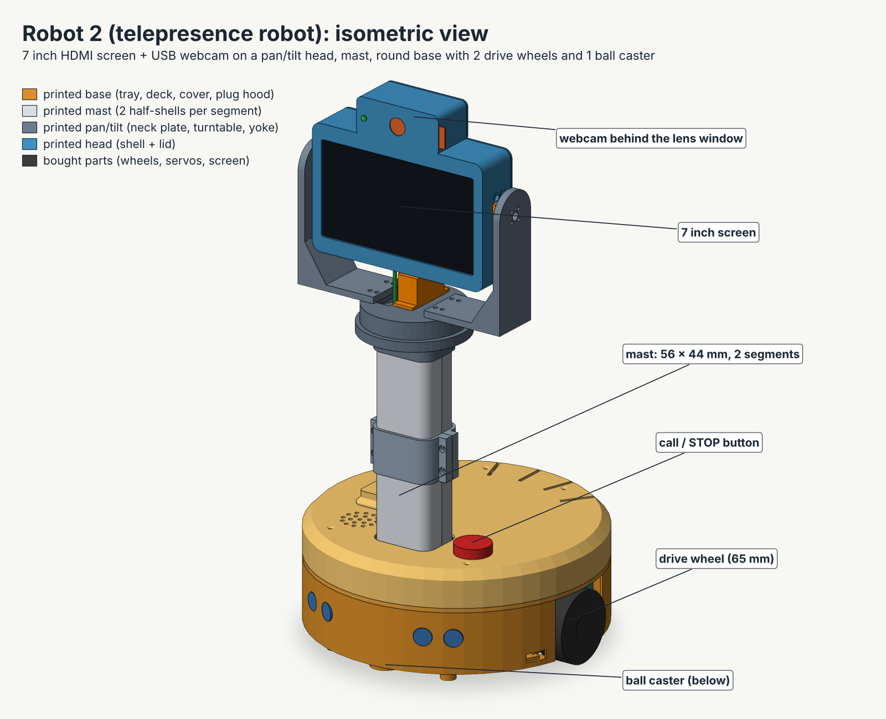
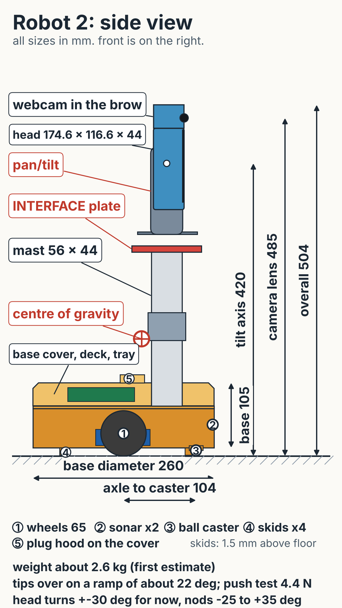
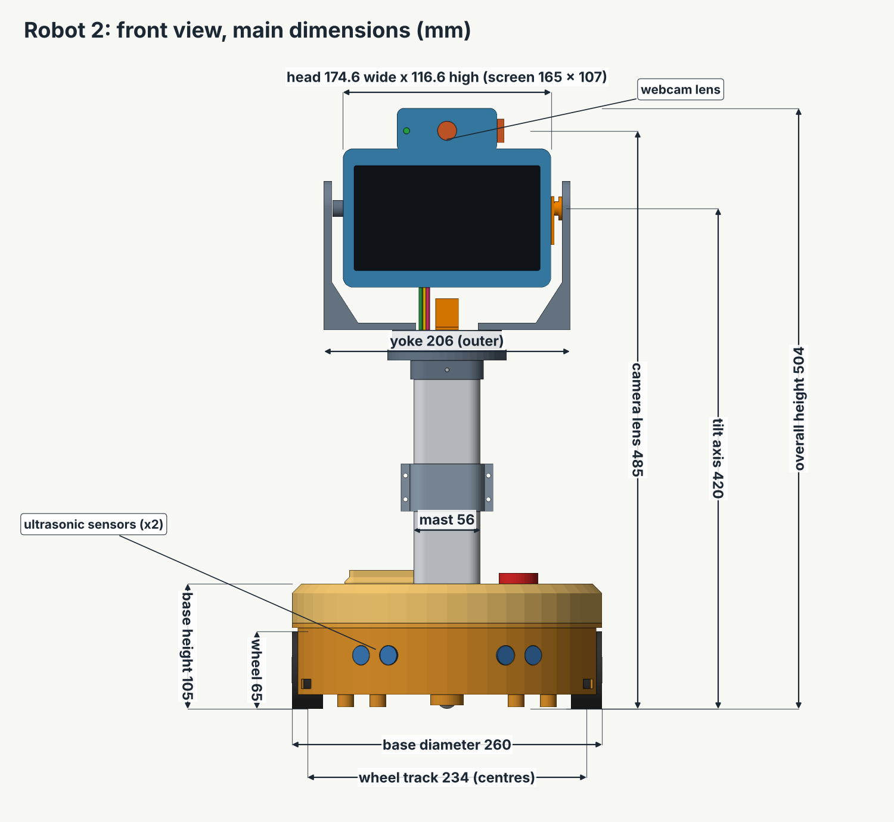
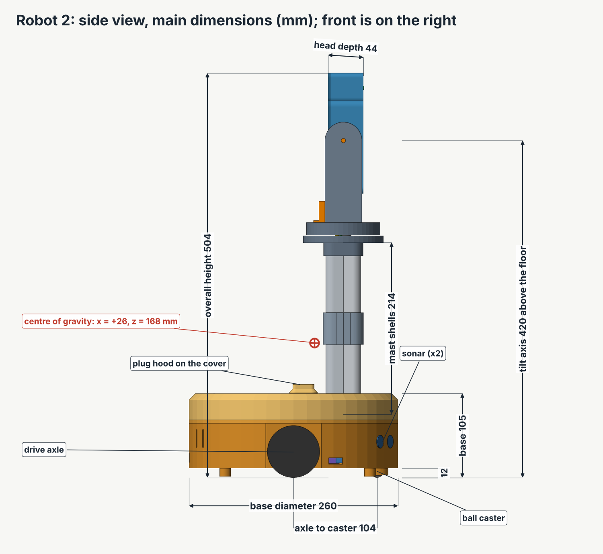
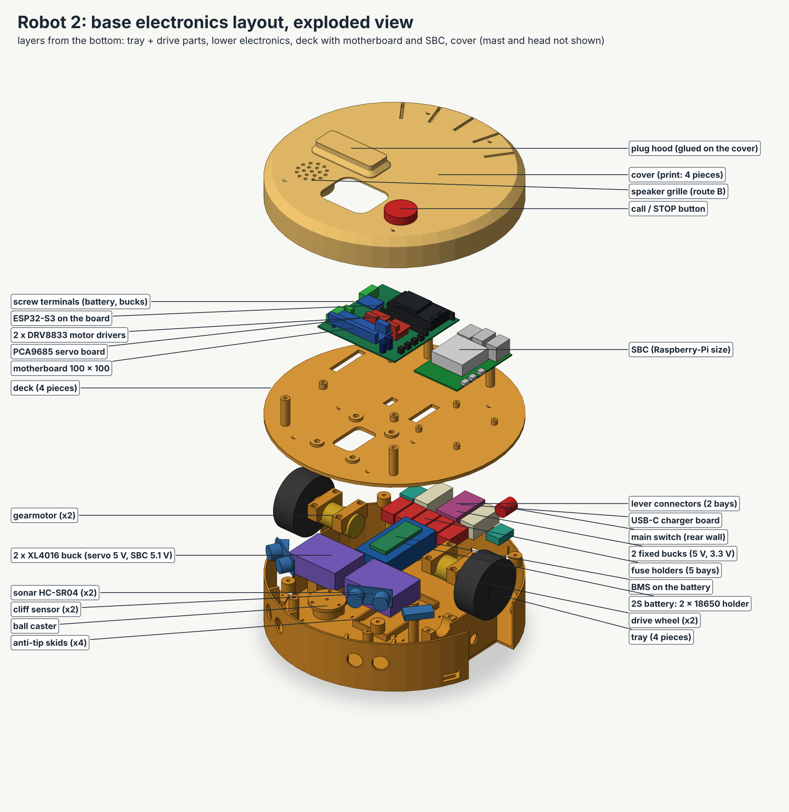
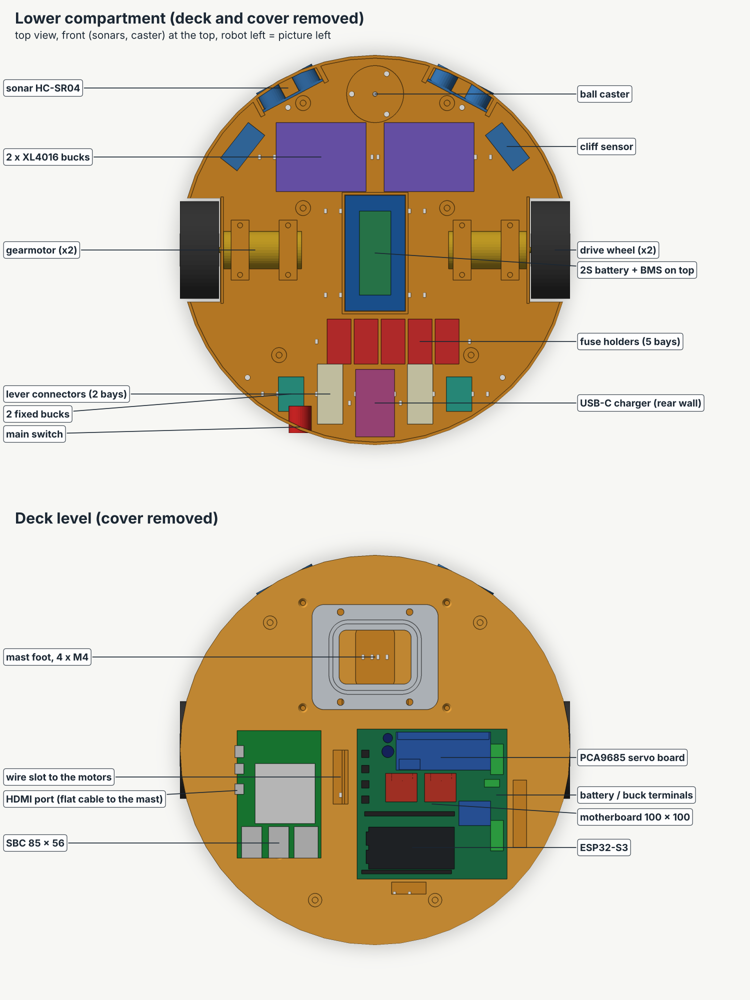
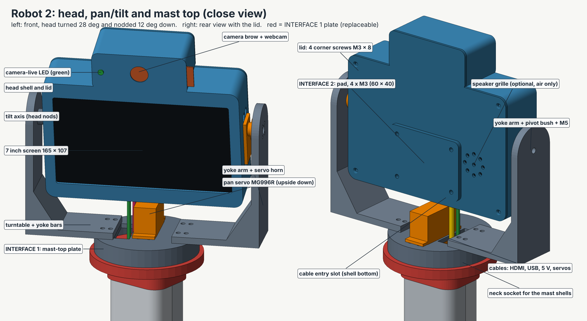
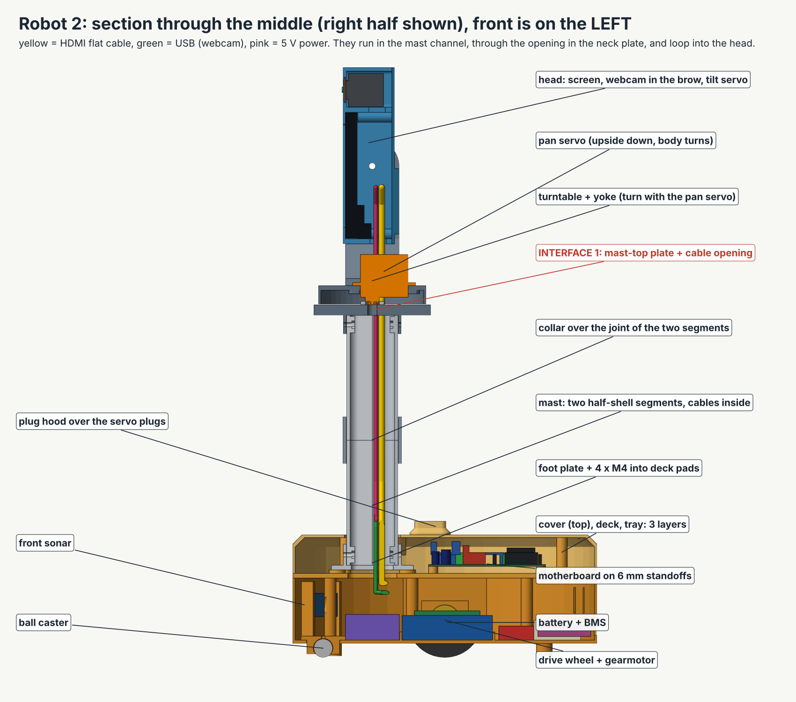
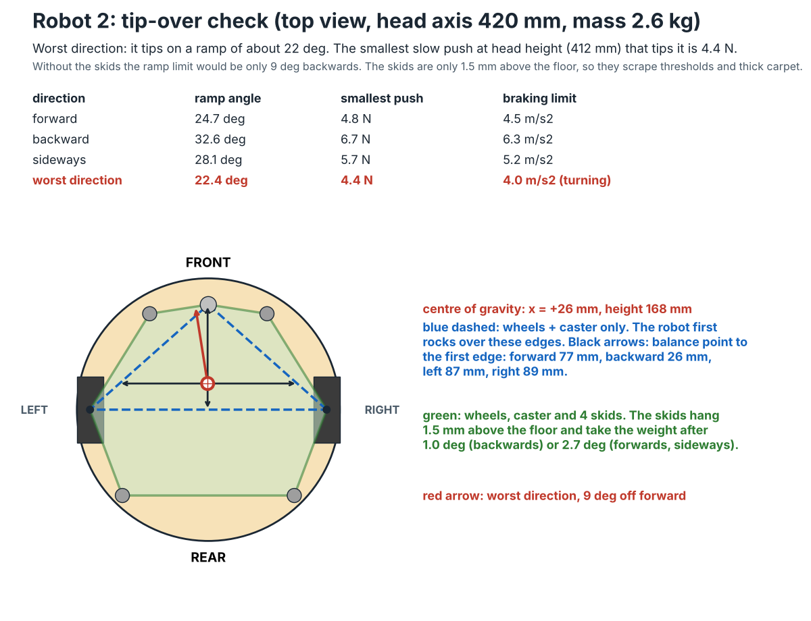
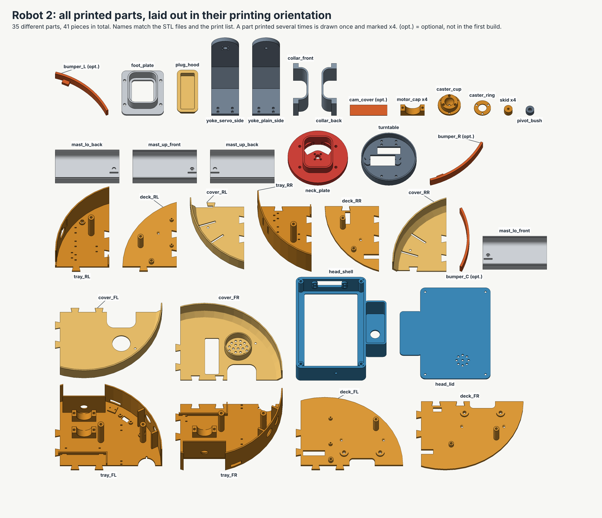

# Robot 2: mechanical design (first draft)

Written 5 November 2026 for the telepresence robot and updated after the independent review. The sizes of the printed parts come from the CAD files. The masses, balance point, tip-over, braking and torque numbers come from the scripts in `../3d/tools/`; they are calculations (A), not measurements. The numbers of bought parts (servo, horn, sonar, screen, cooler, Pololu and TT motors, ELEGOO chassis) come from web pages or from your files; each one carries its own V or A mark where it appears. This file covers the body only: base, wheels, mast, head, pan/tilt, cable routes, weights, tip-over, print list, hardware, assembly. The small computer is chosen in `sbc-selection.md`. Wiring, software and the shopping list are in other files.

**This file has no prices.** The shopping list with prices, shops and weights is `parts-list.md`. Where this file disagrees with `parts-list.md` or `wiring.md` (power parts, fuses, screen power, number of bucks), those files win.

**Words used here.** SBC = single board computer (the Raspberry-Pi-type brain). Motherboard = your 100 x 100 mm ESP32 board (version v5). Mast = the tube between base and head. Pan = turn left/right. Tilt = nod up/down. Yoke = the U-shaped fork that holds the head. CoG = centre of gravity (the balance point). Skid = one of the four small anti-tip feet under the base. Tip angle = the angle of a ramp at which the robot falls over. Bundle = the cables that go up the mast, tied together. Plug hood = a small printed box over the servo plugs. CAD = the 3D drawing files (OpenSCAD files). PETG = a strong 3D-printer plastic. Heat-set insert = a small brass nut that you melt into plastic with a soldering iron. STL = the file format a 3D printer slicer reads. OpenSCAD = a free program that builds 3D models from numbers. CA glue = cyanoacrylate glue, the thin superglue. BMS = battery management system, the small board on the battery pack that guards the cells against over-charge, over-discharge and short circuit. Buck = a small module that turns the battery voltage down to a steady 5 V (XL4016 is the type of the two adjustable ones). GPIO45 = pin number 45 of the ESP32 chip (GPIO = general-purpose input/output); the call / STOP button is wired to it. ESP32 = the control chip on the motherboard. PCA9685 = the servo driver part on the motherboard (the three servo plugs go onto its header). DRV8833 = the motor driver module. HDMI = the picture cable standard. PTFE = Teflon (the slippery plastic tape).

**How sure am I.** (V) = I saw it in a web source or a file. For a web page whose text I could not open, this means "search summary only, re-check the page". Board data from the files in `pcb/kicad/` is (V) from the repository. (A) = my assumption or my own calculation; check it. Every tip-over, mass and torque number in this file is (A): it is a calculation, not a measurement.

---

## 1. The short answer

| | |
|---|---|
| **What I designed** | A round, low base (260 mm wide, 105 mm high) with two driven wheels, one ball caster and four anti-tip skids. A 214 mm mast carries a head with the 7 inch HDMI screen and the webcam on a pan/tilt fork. Total height **504 mm**. On the cover top there is a hole for the call / STOP button, a speaker grille, a servo-plug window with a small plug hood (they stand up to 117 mm) and, in the head, a hole for the camera-live LED and a slot for the camera cover (section 7.1). |
| **Recommended chassis** | A **new printed two-wheel base** (not the ELEGOO Conqueror tracks). Reasons in section 3. |
| **Head height** | The screen centre is at 412 mm and the camera lens at 485 mm above the floor. That is about sofa-seat height for the screen. A shorter 340 mm version is one number to change (section 8). |
| **Motors** | **Pololu 25D metal gearmotor, 12 V, medium-power, 47:1** (two). The 1:48 TT motors are too weak (calculation in section 5.5). |
| **Weight** | About **2.6 kg** (2608 g from the CAD volumes, first estimate, A). That is above the 1.5 to 2 kg in your request, so the motors are sized for 3 kg. |
| **Speed** | The motors reach about **0.36 m/s** with no load on a 7.4 V pack (A, section 5.5). |
| **Stability** | The robot tips over on a ramp of about **22 degrees** (worst direction, A). The smallest push that tips it is about **4.4 N** (about 0.45 kg of force) at head height. The four skids hang only 1.5 mm above the floor, so they scrape door thresholds and thick carpet (section 5.4). That is honest but not great: see section 8 for what to do about it. |
| **Printing** | First build: 38 pieces, 32 different parts, about 1.1 kg of PETG, about 43 hours (rough, A). The optional bumper adds 3 pieces. Biggest part 178 x 138 mm, so a printer bed of **180 x 180 mm works (tight), 200 x 200 mm is comfortable**. |
| **Pan/tilt** | My own default uses two MG996R servos. The part you can swap for your own design is the round **INTERFACE 1 plate** at the top of the mast, plus an optional **INTERFACE 2 pad** on the back of the head. Section 7.4 lists the dimensions I need from you. |

### Questions I need you to answer (they change the design)

1. **Which 3D printer do you have, and what is its bed size?** (Largest parts 178 x 138 mm and the head shell 151 x 175 mm; tallest part 125 mm.) If the bed is smaller than 180 x 180 mm, tell me; I will cut the parts smaller.
2. **Where will you print?** The plan assumes you print **before** you travel and pack the parts (they stack in a small box). Is that right?
3. **Send me the real size of the webcam SC-012-SN259** (length x width x height of the body, and where the lens is). I assumed 60 x 30 x 28 mm.
4. **Which exact 7 inch screen** will you buy? (I designed for 165 x 107 x 10 mm, see section 7.1.)
5. **Your pan/tilt design:** the numbers in section 7.4, or a photo or STL of it.
6. **Is robot 1's battery pack reused or is this a new pack?** I assumed a plain 2 x 18650 holder (77 x 40 x 21 mm).

---

## 2. Pictures

All pictures are in `../3d/renders/`. They are drawn from the real 3D files (the OpenSCAD files in `../3d/`).

| Picture | What it shows |
|---|---|
| `robot2-iso.png` | Whole robot, isometric view |
| `robot2-front.png` | Front view with the main dimensions |
| `robot2-side.png` | Side view with the main dimensions and the balance point |
| `robot2-sketch-side-phone.png` | **Simple dimensioned side sketch for a phone screen** |
| `robot2-base-exploded.png` | **Exploded view of the base electronics layout** |
| `robot2-layout-top.png` | Top views: lower compartment and deck level |
| `robot2-head-pantilt.png` | **Close view of the head and pan/tilt** (front and back) |
| `robot2-section.png` | Cut through the middle: cable path in the mast |
| `robot2-stability.png` | Tip-over picture (top view, support area) with the numbers of section 8.2 |
| `robot2-print-parts.png` | Every printed part in its printing position |




*Phone sketch: total height 504 mm, weight about 2.6 kg (first estimate), tips over on a ramp of about 22 degrees, push test 4.4 N, head turns +-30 degrees for now (interim limit, section 6.3) and nods -25 to +35 degrees, skids 1.5 mm above the floor. All numbers are (A), from the CAD and the calculation in section 8.*

---

## 3. Chassis: ELEGOO Conqueror tracks or a new printed base?

| | (a) Re-use the ELEGOO Conqueror tracked chassis | (b) New printed two-wheel base (recommended) |
|---|---|---|
| **Is it free?** | It is robot 1's chassis. You would have to take robot 1 apart or buy a second one. | Costs filament and print time (prices: `parts-list.md`). |
| **Size and weight** | Listings give about 21.8 x 22.3 x 18.8 cm and about 1.5 kg (V, shop listings, search summary only, re-check the page; the order of the three numbers is not stated). Heavy to carry on a trip. | Parts are small pieces you can pack in a box. Base is 260 mm wide, printed parts weigh about 0.6 kg for the base. |
| **Turning** | Tracks scrub on carpet when turning. You need more motor torque and the carpet wears. | Two wheels in the middle turn on the spot with little scrub. |
| **Stability** | Narrow track (about 16 cm, A) for a 0.5 m tall robot. Tips easier. | Wheel track 234 mm plus four anti-tip skids. |
| **Room inside** | Open metal plates made for an Arduino. The 100 x 100 mm board, the SBC, a 2S pack and 3 bucks do not fit without a new top plate. | Designed around your parts: 100 x 100 mm board on its 4 holes, SBC, pack, bucks, fuses. |
| **Mast fixing** | Needs a printed top plate anyway. | Mast is part of the design. |
| **Looks** | A tank. | A friendly round base, like a small home robot. |

**Recommendation: (b).** The tracks fit a rough-terrain tank, not a tall robot that rolls over a living-room floor, and robot 1 needs that chassis.

---

## 4. The design in one page

### 4.1 Coordinates (used in all files)

Origin on the floor under the centre of the base. **+x = front** (the way the screen looks), **+y = robot left**, **+z = up**. All sizes in millimetres.

### 4.2 Main dimensions

| Item | Value |
|---|---|
| Base | round, **260 mm** diameter, **105 mm** high (top of the cover), floor underside 12 mm above the ground. The plug hood on the cover top reaches 116.6 mm and the button cap about 114 mm (A). 265 mm front to back with the optional bumper. |
| Drive wheels | **65 mm** diameter (parameter `wheel_d`), 26 mm wide, axle at x = 0, wheel centres at y = +-117 (track 234 mm) |
| Ball caster | x = +104 (axle to caster 104 mm), steel ball 16 mm |
| Anti-tip skids | 4 skids, **1.5 mm above the floor** (parameter `skid_gap`): (95, +-58) and (-85, +-85) |
| Mast | stadium-rounded rectangle **56 x 44 mm**, wall 3 mm, at x = +62; shells from z = 79 to z = 292.6 (214 mm) |
| Mast-top plate (INTERFACE 1) | round 100 mm, 9 mm thick, top at z = 301.6 |
| Turntable top | z = 318 |
| Tilt axis | z = **420** (parameter `head_axis_h`) |
| Head | **174.6 wide x 116.6 high x 44 deep**, centre at z = 412, camera "brow" (84 x 34 mm) on top; top of brow z = **504** |
| Yoke (fork) | 206 mm wide over the arms |
| Camera lens | z = 485 |
| Pan range | The stock MG996R servo travels about +-90 degrees (A, measured in Stage 6). The normal software limit is +-80 degrees once the cable loop is proven. **Until then the interim limit is +-30 degrees** (section 6.3, open design item). A 270 degree servo is optional and only needed for the +-120 degree case. |
| Tilt range | 25 degrees down, 35 degrees up (-25 to +35, positive = the head looks up) |




### 4.3 Layers of the base (bottom to top)

| Layer | Height z (mm) | What is on it |
|---|---|---|
| **Tray** (printed) | floor 12 to 15, rim up to 68 | wheel wells with motor saddles, caster, battery cradle, buck modules, fuses, lever connectors, charger board, main switch, sonars, cliff sensors |
| **Deck** (printed) | 68 to 72 | the 100 x 100 mm motherboard on 4 standoffs, the SBC on 4 standoffs, the mast foot |
| **Cover** (printed) | 72 to 105 | closes the base, vent slots at the rear, 48 x 60 mm opening for the mast, a 23 x 69 mm window over the servo plugs (closed by the plug hood), the 30 mm button hole and the speaker grille (section 7.1) |
| Bumper (printed, **optional, not in the first build**) | z 18 to 34, 1 to 5 mm outside the rim | front arc with two micro switches (section 5.6) |

The tray, deck and cover are each **printed in 4 pieces** (front-left, front-right, rear-left, rear-right) that lock with dovetails and are glued. This is what makes the base fit a small printer bed.




---

## 5. Base in detail

### 5.1 Motherboard (V board data from `pcb/kicad/`)

- **Board version.** You report 5 boards ordered. Confirm that the ordered files are version v5 (`pcb/kicad/pin-table.md`); the hole pattern and the connector sides used here are the v5 ones. The board README says to order only after the paper test-fit passes.
- The board sits on the **deck** on **4 printed standoffs, 6 mm high**, on its four M3 holes (92 mm spacing). Hole positions on the deck: (10, -84), (10, 8), (-82, -84), (-82, 8). Standoffs have M3 heat-set inserts. Use **4 screws M3 x 6**: the insert hole is only 6 mm deep, so an M3 x 8 would bottom out before its head clamps the 1.6 mm board.
- The board is turned 90 degrees: its **bottom edge (PCA9685 servo plugs) faces the front and the mast**, its **left edge (the four screw terminals and POWER OUT) faces the robot's right side**, its **right edge (motor plugs M1 to M4 and the ESP32 USB-C end) faces the SBC**.
- **ESP32 USB-C:** the two USB-C sockets sit 8 mm inside the right edge. A straight plug sticks out about 12 mm more. The SBC starts 24 mm from the board edge, so a short (about 20 cm) USB-A to USB-C cable makes the bend easily (V: the board says USB-C toward the right edge). The cable plugs into a small data-only adapter at the SBC end (`peripherals.md`, 6.1); the adapter and the cable plug together need more room than the SBC end has, see 5.2.
- **Tall parts on the board** (from `build_board.py`; heights above the board top are my estimate, A): ESP32 on its two sockets about 15 mm, PCA9685 module with its **bare** 3-row header strip about 19 mm, DRV8833 modules on sockets about 17 mm (white plug on the plug side), screw terminals 10 mm, capacitor C1 12.5 mm. **Budget 20 mm for the bare parts.** The cover is 3 mm above that (underside at z = 102.6; board top at z = 79.6, so the 20 mm budget ends at z = 99.6; the bare header top is at z = 98.7, just under that line).
- **Servo plugs are NOT in that budget.** A 3-pin servo plug is pushed onto the PCA9685 header and its wires leave upwards. With an assumed plug height of 14 mm on the 2.5 mm header base (A: parameter `plug_h`, **measure your plug**) the plug top is at z = 106.2, 3.6 mm above the cover underside, and the wires need about 8 mm more to bend away. So the cover has a **23 x 69 mm window** over the header strip (x 1 to 24, y -80 to -11) and a printed **plug hood** (35 x 81 x 11.6 mm, print part `plug_hood`) is glued over it with CA glue. The hood adds 12 mm of headroom and its top is at z = 116.6. The three servo plugs (pan, tilt, camera LED) go onto the header through the window **before** the hood is glued on (assembly step 9). Alternative: right-angle servo plugs (about 6 mm high); then set `plug_relief = false` in `robot2_params.scad` (no window, no hood). Keep new holes out of the hood footprint (x -5 to 30, y -86 to -5).
- **DRV8833 plug side:** the modules are inserted so the white plug side is toward the bottom edge of the board (the board prints "white plug v"). On the deck this is the side toward the mast. There are 15 mm of free space in front of the plugs. **Insert driver module A only at step 6 of the power-up order in `wiring.md`, section 4 (the motors), after the first power tests, and check the white-plug bar before BATT IN is connected.**
- **Wire holes in the deck** (so wires go between the compartments): a 36 x 10 mm slot next to the motor plugs M1/M2; a 45 x 9 mm slot at the board's left edge for battery and buck wires; an **8 x 23 mm slot beside the board's rear edge** (x -96 to -88, y -34 to -11) for the sensor wires (sonar, cliff, bumper): the wires climb over the rear edge of the board to the sonar header and the SPARE IO header (the SPARE IO strip is 3.5 mm from that edge). The slot used to be under the board, where wires would have been trapped in the gap below the PCB. A 14 x 8 mm spare slot.

### 5.2 SBC (generic Raspberry-Pi-sized envelope 85 x 56 mm, parameter)

- SBC mount holes: 58 x 49 mm pattern, M2.5 (A: the usual Raspberry Pi pattern, from memory; check your board). Four printed standoffs 5 mm high, hole 2.2 mm for self-tapping M2.5 x 6 screws (an upgrade is 4 M2.5 inserts).
- Position: x from -72 to 13, y from 36 to 92. The **USB and network end faces the rear**, the **edge with the power and micro-HDMI sockets faces the robot's left rim**.
- Cables: **HDMI** leaves the left edge (about x = -14), bends toward the mast foot. **USB webcam** plugs into a USB port at the rear end and runs forward. **USB link to the ESP32** through a data-only adapter (see `sbc-selection.md`). **5.1 V power** comes from the XL4016 module in the lower compartment through the deck slot.
- **Use right-angle (90 degree) USB-A plugs for the ESP32 link and the webcam.** The USB ports face the rear. Between the port face (x = -72) and the curved wall there are only **20 to 31 mm** at the USB 2 stack (y 75 to 89) and **34 to 42 mm** at the USB 3 stack (y 57 to 71) (A, from the CAD). A straight USB-A plug sticks out about 30 to 40 mm (A) and the data-only adapter adds its own length, so a straight plug would press on the wall. Use a right-angle adapter and a right-angle plug on the webcam side (cable leaving sideways; dry-fit with the real parts). If you cannot get them, the other fix is to move the SBC 10 mm forward (raise `sbc_x0` by 10 in `robot2_params.scad`; not tested: the SBC would then end at x = 23 and the foot plate starts at x = 27). The right-angle parts are not yet in `parts-list.md`.
- The cover is at 102.6, a Pi 5 with Active Cooler is about 95 mm high at its tallest point (cooler 63.5 x 42.5 x 13.7 mm: V, search summary only, re-check the page; USB stack height A). A different board of Raspberry-Pi size also fits; for a different shape change `sbc_l`, `sbc_w` and the hole parameters.

### 5.3 Power parts (lower compartment)

All of these are shown in `robot2-layout-top.png`. Sizes of bought modules are my assumptions (A); measure yours and change the numbers in `robot2_params.scad`. The parts, counts and prices are in `parts-list.md`; the wiring is in `wiring.md`. Robot 2 has **three bucks** in total (two XL4016 and one fixed 5 V buck) and **no 3.3 V buck**.

| Part | Count | Where | Size used (A) |
|---|---|---|---|
| 2 x 18650 holder (the 2S pack) | 1 (first build: 2 cells) | in a low cradle at the centre, x -2 | 77 x 40 x 21 |
| BMS board (HX-2S-JH20 type) | 1 | on top of the pack | 56 x 21 x 4 |
| XL4016 buck modules (servo 5.0 V and Pi 5.1 V) | 2 | front, beside the caster, long side across | 46 x 60 x 22 with heat sink |
| Fixed buck (clean 5 V only; no 3.3 V buck) | **1** | rear; the CAD draws two bays at the rear left and right, one is a spare spot | 23 x 17 x 8 |
| Fuse holders: BATT IN, servo, clean 5 V, Pi buck, screen | **5** (**6** in the cheap build with the route-B speaker amplifier: it gets its own 1 A fuse) | rear, in a row (the CAD draws 5 bays; put a 6th holder on the free floor beside the row, dry-fit it, A) | 30 x 16 x 12 |
| Lever connectors (Wago 221-415, 5-way) | **4** (two for the plus splice and two for the minus splice, each pair joined by a 10 cm jumper) | rear (the CAD draws two bays; the other two go on the free floor beside them, dry-fit, A) | 40 x 17 x 17 |
| USB-C charger board | 1 | rear centre, **USB-C socket faces the rear window** (16 x 12 mm hole in the rim, 19 to 31 mm above the floor) | 45 x 26 x 10 |
| Main switch | 1 | rear wall, left, hole 19 mm (parameter `sw_d`) | round rocker, 15 mm body |

The two rear tray posts are at (-70, +-64), clear of the fuse holders and of the mini bucks. (In the first draft they stood at (-70, +-35), inside two fuse holders; the CAD test now finds 0 mm3 of overlap between the posts and every bay.) The deck holes for the posts follow. Everything is held with double-sided foam tape and zip ties. The floor has 36 slots (3 x 1.6 mm pairs) next to every module for zip ties. The XL4016 modules get warm: the cover has vent slots and the rim has 4 vent slots at the rear.

### 5.4 Wheels, caster, anti-tip skids

- **Wheels:** 65 mm rubber-tyre robot wheels with a hub for a 4 mm D-shaft (A: the Pololu 25D shaft is a 4 mm D-shaft; check on the motor you buy). Parameter `wheel_d`. Wheel width 26 mm (A). The wheel sits in a **window in the tray rim**, outer face flush with the rim.
- **Motor mount:** the motor body (25 mm round, 52 mm long) lies on a **printed saddle** and is held by two **printed caps** per motor (2 x M3 x 20 each). The gearbox face sits 0.2 mm from a thin printed wall; the 4 mm shaft and the small round boss on the gearbox go through a 12 mm hole in that wall.
- **Ball caster:** a printed cup (flange on the floor) holds a **16 mm steel ball** (a 5/8 inch bearing ball also fits) behind a printed ring with a 14 mm hole. 3 x M3 screws hold the ring, 3 x M3 + nuts hold the flange. If you prefer, buy a ready ball caster and change `caster_x`; the floor has a 28.5 mm hole.
- **Anti-tip skids:** four printed skids (Ø 14, 10.5 mm high) on M3 screws, **1.5 mm above the floor** (parameter `skid_gap`; the first draft had 4 mm, which would give tip-over figures about 13 percent lower, section 8.2). They take weight after about **1.0 degree** of tilt when the robot tips backwards over the axle, but only after about **2.7 degrees** forwards or sideways. They stop the nose-up tip behind the wheels and widen the sideways support. **The front skids are only 1.5 mm above the floor, so they will scrape door thresholds and thick carpet.** Lift the robot over a threshold, or lay a small ramp (a thin wedge of wood or a threshold ramp strip) in front of it.

### 5.5 Motor choice and the torque calculation

**What the robot needs.** Rolling resistance of a small hard wheel on carpet: coefficient 0.10 (A, typical range 0.05 to 0.15). Wheel radius 32.5 mm. Torque per wheel = force x 0.0325 / 2.

| Robot mass | Flat carpet, steady | Flat carpet, speeding up 0.3 m/s2 | 5 degree ramp on carpet |
|---|---|---|---|
| 2.0 kg | 0.032 N·m (0.33 kg·cm) | 0.042 N·m | 0.060 N·m (0.61 kg·cm) |
| **2.6 kg (this design)** | 0.042 N·m (0.42 kg·cm) | 0.054 N·m | **0.078 N·m (0.79 kg·cm)** |
| 3.0 kg (design limit) | 0.048 N·m | 0.062 N·m | 0.089 N·m (0.91 kg·cm) |

**TT 1:48 motors (the yellow ones).** Shop copies of Adafruit's figures (V, search summary only, re-check the page): 200 rpm no load at 6 V, stall torque 0.8 kg·cm at 6 V, stall current 1.5 A at 6 V (about 1.85 A at 7.4 V, calculated). Result for this robot:
- The motor is **rated for 6 V maximum**; on the 7.4 V pack it would draw up to 1.85 A when stalled. The DRV8833 module gives 1.5 A continuous (2 A peak) per channel (V from your brief). Over the limit.
- At 6 V the stall torque (0.8 kg·cm) is **less than the ramp need (0.91 kg·cm at 3 kg)**. At 7.4 V the ramp takes 92 % of stall torque: 1.7 A and 0.06 m/s.
- On flat carpet it needs 43 to 53 % of stall torque all the time. Plastic gears, hot motor. **Too weak. I do not recommend them.**

**Chosen motor: Pololu 25D metal gearmotor, 12 V, medium power (MP), 47:1** (Pololu item 3229). 25 mm round, 52 mm long, 4 mm D-shaft. These are 12 V motors run from the 6.0 to 8.4 V pack, so they are slower and gentler than on 12 V. Values for the 7.4 V case (speeds follow from 12 V data by simple scaling, A):

| Motor | Seen on the Pololu page (V, search summary only, re-check the page) | At 7.4 V: no-load speed | At 7.4 V: stall torque | At 7.4 V: stall current | Flat carpet, 2.6 kg | 5 degree ramp, 3 kg |
|---|---|---|---|---|---|---|
| TT 1:48 | 200 rpm, 0.8 kg·cm, 1.5 A (at 6 V) | 0.84 m/s | 0.99 kg·cm | **1.85 A** (too high) | 0.48 m/s, 0.9 A | **92 % of stall**, 0.06 m/s, 1.7 A |
| **Pololu 25D MP 47:1** | 170 rpm, 1.8 A stall at 12 V (V, search summary only; the whole driver margin rests on this one number, see the resistance check below). Stall torque about 5.2 kg·cm at 12 V is my estimate (A: 0.17 kg·cm motor torque x 46.85 x 65 % gearbox) | **0.36 m/s** | 3.2 kg·cm (A) | **1.11 A** (1.26 A at 8.4 V) | 0.31 m/s, 0.2 A | 0.25 m/s, 0.36 A |
| Pololu 25D LP 47:1 (cooler, slower) | 120 rpm, 0.9 A, 4.8 kg·cm at 12 V (V, search summary only, item 3253) | 0.25 m/s | 2.96 kg·cm | 0.56 A | 0.22 m/s, 0.11 A | 0.17 m/s, 0.19 A |
| Generic 25GA-370, 12 V, "130 rpm" | **sellers disagree by 4x**: one lists 0.5 rated and 2 kg·cm stall, others claim 20 kg·cm (V, conflicting, search summary only) | 0.27 m/s | 1.23 kg·cm (one seller's number) | 0.56 A | 0.18 m/s | **74 % of stall**, 0.07 m/s |

**Result:** the MP 47:1 stays under 1.5 A even when stalled (1.26 A at a full 8.4 V pack) and uses only 13 % (flat carpet, 2.6 kg) to 28 % (5 degree ramp, 3 kg) of its stall torque at 7.4 V (A). The LP version is a good second choice if a shop has it (slower, 0.2 A). A cheap generic 25GA-370 is only acceptable if the listing **states a stall torque of at least 4 kg·cm at 12 V**; test one before buying two. Price and shops: `parts-list.md`, group 5 (Pololu ships to Germany, VAT is added at checkout). The two spare motor spots M3/M4 on the board are not used.

**Speed on the 6.0 to 8.4 V pack (A, no load).** 0.29 m/s at 6.0 V, 0.36 m/s at 7.4 V, **0.39 m/s at 8.0 V** and 0.41 m/s at 8.4 V; on flat carpet with the robot's mass about 0.31 m/s at 7.4 V. The firmware setting `mot_vmax` (default **8.0**) is a speed cap, not the motor rating: Stage 5 starts at 8.0 and never goes above the pack voltage (8.4 V); the duty cannot go above 100 percent. The real top speed is about 0.36 m/s; the driving speed modes (Creep, Normal, Fast) are re-tuned in Stage 5 from measured metres per second.

**Check the stall current with a multimeter when the motors arrive (1 minute).** The driver margin (1.26 A against 1.5 A per DRV8833 channel, only 16 % spare) rests on the one stall current above, which I could only see in a search summary. Measure the winding resistance of each motor with the multimeter on its two wires. 12 V / 1.8 A is about **6.7 Ohm**. If it reads **well below 5 Ohm**, the real stall current is higher: **do not fit the motors to the DRV8833 until the figure is rechecked.** Keep the software duty cap (about 85 percent).

**The robot should not be driven at 100 % into a wall**: stall is survivable for seconds only. Software can limit the PWM to about 85 %.

### 5.6 Sensors and bumper

- **Two front sonars (HC-SR04):** 45 x 20 x 15 mm with two 16 mm transducers (V, shop listings, search summary only, re-check the page). They sit at **+-28 degrees**, facing outward through **4 round holes of 16.6 mm** in the rim, centre height 45 mm. Two printed cheeks hold each board; foam tape does the rest. The board's 1k/2k echo dividers are on the motherboard (V, from `pcb/kicad/`).
- **Two downward cliff sensors:** IR reflective modules about 31 x 14 x 7 mm (A) at **+-52 degrees**, radius 112 mm. Each module lies with its long side along the arc; it has a 12 mm (along the arc) x 7 mm window in the floor and two 3.5 mm bosses 22 mm apart with 2.7 mm holes (self-tapping M3 x 6). They look at the floor 12 mm below. On carpet the floor can be darker or lighter: tune the sensor's potentiometer. Which spare pins to use is for the wiring file (the SPARE IO header).
- **The cliff sensors protect only a short margin (read this before the first drive).** They sit at x = 69.0 mm, y = +-88.3 mm. That is **35 mm behind the caster** (x = 104) and only **about 43 mm ahead of the balance point** (x = 25.9). The robot is lost once the balance point passes the edge, so the sensor, the ESP32 and the motor brake must finish within about 43 mm; the real margin is probably shorter, because the front of the robot dips as soon as the caster is over the edge (A). The stop itself (3 samples at 100 Hz = 30 ms, then a soft stop of 0.125 s, protocol 7.3 and 7.4) needs **about 33 mm at the top speed of 0.36 m/s** (A) and nothing is left for motor lag. At 0.12 m/s it needs about 11 mm. So:
  - **Near an edge or stairs, drive in mode Creep (about 0.08 m/s) and never faster than about 0.12 m/s.**
  - **Nothing protects driving in reverse.** There is no sensor at the back.
  - **The first drives are away from stairs.**
  - Why they were not moved forward: I searched for a place nearer the caster (x 105 to 125). A 30 x 14 mm module has no room ahead of about x = 77 (caster flange to x 123, XL4016 bays to x 85, tray columns, sonar cheeks). Only a much smaller module (about 16 x 10 mm) might fit near x = 115 (flat 2D check only, not checked in 3D). This is an open design item if you want more margin.
- **Bumper (optional, NOT in the first build):** a low front arc (1 to 5 mm outside the rim, z 18 to 34) in **three 50 degree pieces** glued edge to edge. Two arms (12 mm wide, z 18 to 24) go through slots in the rim at **+-66 degrees** (19.4 x 8 mm; the arms are not at +-38 degrees any more, because there they crossed the sonar cheek) and press two small **lever micro switches** (A: KW12-3 type, 20 x 10.2 x 6.4 mm, 2 pieces) that lie flat on two 2.8 mm pads in the tray, each fixed with 2 small self-tapping screws (M2, pilot holes 1.8 mm). The switch lever is its own return spring. If the arc is pushed about 3.5 mm (A), a switch closes. It sits below the sonar holes, so it does not block them. The switch type, the lever contact and the 3.5 mm travel are assumptions. With `bumper_slots = true` (the default) the tray already has the two slots and the pads, which costs nothing and saves a reprint; without the bumper the two small slots stay open (set `bumper_slots = false` for a closed rim). The bumper parts print standing on the arc with the arm flat on the bed, no supports (section 9). How to wire the switches (GPIO46): `peripherals.md`, 5.4.

---

## 6. Mast and cable routing

### 6.1 Mast

- **Two segments, each of two half shells** (front and back), 107 mm long, 56 x 44 mm outside, wall 3 mm. A tongue and groove runs along the seam. This lets you **lay the cables into the channel** before closing, so the connectors never have to pass through the mast tube (they only pass the neck openings, section 6.3).
- Channel inside: **50 x 38 mm**.
- **Foot plate** (70 x 84 mm) bolts to 4 pads on the deck with 4 x M4 x 10 into M4 heat-set inserts. A socket (18 mm high) takes the lower shell; two M3 x 12 screws hold the shell (each shell has a captive M3 nut on the inside). The screws are at x = 36 and 88, z = 88: they are under the cover, so fit them before the cover goes on (assembly step 8).
- A **collar** (two halves, 40 mm high, 4 x M3 x 20 with nuts) clamps the joint between the two segments (its lower edge is at z = 166).
- **The cover and the mast.** The cover is one glued disc with a closed 48 x 60 mm opening, 2 mm wider all round than the mast (44 x 56 mm), so the finished cover cannot pass the collar (77 mm wide), the neck plate (100 mm) or the head (174.6 mm). That is why the cover is fitted **before** the collar, the upper shells, the neck and the head are built (assembly step 9). Only the two lower half shells, which are as wide as the mast (44 x 56 mm) and pass the opening, are on the foot at that time (assembly step 8); their two foot screws are at z = 88, under the cover, so they are fitted before the cover goes on. Once everything is built, the cover (screwed to its four posts only) can still be slid **up the lower shell as far as the collar, about 60 mm**, which opens the base all round (section 11, "Opening the base later").
- The top end goes into the **16 mm deep socket under the INTERFACE 1 plate**, again with 2 x M3 x 12 screws.
- **Stiffness (A, my calculation, printed PETG modulus 1500 MPa):** the weak direction (front to back) has I = 50,000 mm4. A 5 N push at head height bends the mast **0.9 mm** and loads the plastic with **0.75 MPa**. The mast is not the weak link. The joints and the base are. After building, do a wiggle test: hold the head and shake the mast; if the collar slips, add 2 M3 screws through the collar into the shells.

### 6.2 Cable list (what goes up the mast)

| Cable | Type | From | To | Notes |
|---|---|---|---|---|
| Screen picture | **HDMI flat cable**, micro-HDMI plug to HDMI-A plug (slim; 0.8 m in `parts-list.md`, the route needs about 0.65 m) | SBC (HDMI0) | screen | About 120 mm along the deck, 215 mm up the mast, 36 mm through the neck, 60 mm inside the head, plus a loop. The big plug (about 21 x 11 mm, A) passes the neck-plate opening and the 38 x 14 mm turntable slot lengthwise and must turn 90 degrees between the turntable slot and the head slot. **Thread it from the head end** (section 6.3 and assembly step 12). |
| Webcam | USB cable of the webcam (about 1.5 m: coil the extra in the head); **right-angle USB-A plug** at the SBC (section 5.2) | SBC USB port (blue USB 3 port) | webcam in the brow | 4 mm round. The camera body (60 x 30 x 28 mm, A) does not fit through the neck. If the camera cable is fixed to the camera (most are), the SBC end has to be a USB-A extension cable (male right-angle plug to female socket, about 1 m) and the camera's own plug joins it inside the head (A; this extension is not yet in `parts-list.md`). |
| Screen power | 2 wires (red/black), about 0.5 mm2, 5.1 V | the **5.1 V Pi buck** (its lever connector) **through its own 1 A fuse** (`wiring.md`, C1; not from POWER OUT) | screen's micro-USB power input (use a power-only cable) | About 0.5 A |
| Servo leads | 3 x servo **extension cable** 50 cm (3 wires each): pan, tilt and the camera LED | PCA9685 channels 0, 1 and 2 | pan servo, tilt servo, camera LED | The pan servo is in the neck, the tilt servo and the LED in the head. For the LED use a 3-pin plug with the red (V+) wire cut off or taped (`peripherals.md`, 5.4). Plug colours: brown or black = GND, red = V+, orange or yellow = signal. A reversed plug puts 5 V on the signal pin and can damage the board. |
| Touch USB (if the screen has touch) | thin USB cable, micro-USB to USB-A, data only (adapter at the SBC end) | SBC | screen's touch port | Skip it only if the screen has no touch |

The button on the cover top, the speaker and the ESP32 link stay in the base; they do not go up the mast. Total bundle is about 25 x 12 mm (A). It passes through the mast channel (50 x 38 mm), the neck-plate cable opening (a kidney shape, 762 mm2, see 6.3), the turntable slot (38 x 14 mm) and the **14 x 30 mm cable slot in the bottom of the head** (long side along y; the slot is at y = -26 to +4).

### 6.3 Cable path and the pan limit (OPEN DESIGN ITEM)

**The pan limit in one sentence:** the servo travels about +-90 degrees (A, measured in Stage 6) and the software limit is +-80 degrees once the cable loop is proven, but **until the loop is proven with the real cable bundle in Stage 6 the interim limit is +-30 degrees** (lower it to +-20 degrees if the bundle is stiff).

**What the problem was.** The bundle goes through the neck plate (fixed) and then through the turntable (it turns with the head). The two are only 12.4 mm apart (plate top z = 301.6, turntable underside z = 314). The bundle sits about 19 mm beside the pan axis. When the head pans by an angle, the turntable slot moves sideways by 2 x 19 x sin(angle / 2) (9.8 mm at 30 degrees, 26.9 mm at 90 degrees) and turns by the same angle. The first draft had the same fixed slot in both parts and put the 100 mm slack loop above the turntable, where both ends turn together and the loop takes up nothing. A straight 25 x 12 mm bundle turned by 30 degrees then had 30 percent of its section outside the plate slot, and by 90 degrees all of it. It would have jammed the head and stalled the pan servo.

**What is done now (no height changed):**
- The neck-plate opening is the **swept envelope of the bundle for +-30 degrees**: a kidney shape of 762 mm2 (x +-22.2 mm, y -28.2 to -3.6 mm, centred on the bundle at y = -19), clipped to the inside of the mast socket. The turntable slot is 38 x 14 mm, so the 12 mm bundle has 1 mm of play on each side.
- **Do not tie the bundle to the neck plate or to the turntable.** In the CAD test a bundle tied to the plate fails at +-30 degrees. Tie it **low in the mast** (a self-adhesive tie mount on a mast shell or on the deck) and **inside the head**. The free length between the two ties is about 240 mm (A), so the pan twist spreads over it. The tie points are not drawn in the CAD (use adhesive tie mounts).
- Leave a loop of about 100 mm of spare cable inside the head so that the nod (-25 to +35 degrees) does not pull the bundle. That loop is for the tilt, not for the pan.
- **The HDMI plug is threaded from the head end.** Its big plug (21 x 11 mm) must turn 90 degrees between the turntable slot (long side along x) and the head slot (long side along y): that turn is static, in the 36 mm gap above the turntable. Do the threading with the head lid off: tie a strong thread to the plug, drop the other end of the thread down from the head through the head slot, the turntable slot, the plate opening and the mast, and pull the plug up from the head end (assembly step 12).
- The picture `robot2-head-pantilt.png` shows the neck.

**CAD test results (a straight, stiff 25 x 12 mm bundle that turns with the head; A).** It fits the plate opening up to about +-28 degrees (at +-30 degrees one corner touches by 13 mm3, a 1.1 mm corner; the 21 x 11 mm HDMI plug passes at 0 and +-30 degrees with no contact). It touches the rounded corners of the mast hole just under the plate from about +-5 degrees on (at +-30 degrees about 31 mm2 of its 300 mm2 section, a 4 mm corner), so a soft bundle must squeeze one corner a little; a stiff one needs the smaller limit. At +-90 degrees half of the bundle is outside the mast hole, so no opening in the plate can fix that.

**Rejected: a service loop between the plate and the turntable.** An S-bend of a 12 mm bundle (bend radius about 30 mm, A) needs about 33 mm of height for +-30 degrees and about 50 mm for +-90 degrees, plus about 10 mm for two clamps. The gap would have to grow from 12.4 mm to about 43 mm (+-30 degrees) or 60 mm (+-90 degrees): 31 or 48 mm more. That is more than 20 mm taller, so the heights were not changed (design-review decision). The cheaper fix is the interim limit above.

**Open design item:** +-90 degrees needs the cable on the pan axis (a hollow pan shaft or a slip ring) or a taller neck. Both change the heights by more than 20 mm. This is not designed yet. If the bundle does not survive +-80 degrees in Stage 6, keep the smaller limit and tell the 3D design. The optional 270 degree servo is only needed for the +-120 degree case and is not in the parts list; the plan works without it.




---

## 7. Head and pan/tilt

### 7.1 Screen and camera

- **7 inch screen (default):** I assumed **165 x 100 x 10 mm** as asked. The Waveshare wiki lists the 7 inch HDMI LCD (C) at **164.90 x 106.96 x 8 mm** with a visible area of **154.21 x 85.92 mm** (V, search summary only, re-check the page; I could not open it). My pocket is **166.2 x 108.2 mm** (screen 165 x 107 + 1.2 mm of play in total, 0.6 mm per side; parameter `scr_clear`; the first draft had only 0.6 mm in total, which is too tight for printed PETG). The head is then 174.6 x 116.6 mm. Weight 200 to 250 g with the driver board as in your request; shop listings range from 211 to 380 g (V, conflicting, search summary only; the larger numbers include packaging). The window in the front plate is 156 x 88 mm and is **centred in the pocket (A)**. The real picture area is probably **not** centred on the screen board. **Before you print `head_shell`, cut a paper template of the real screen (outline and picture area), lay it in the pocket and change `scr_vis_dz` and the window size if needed.** The screen is held by the front lip and by four corner posts (with foam tape). Pocket depth is 10 mm; behind it is a 29.6 mm deep space for the driver board and the HDMI plug.
- **Camera:** the webcam sits in a **brow** above the screen so it looks the same way as the screen (the remote person looks "into" the camera). The brow is 84 x 34 mm (it is wider than the camera, to make room for the LED). Its inner size fits a webcam up to **60 x 30 x 28 mm (A)**, 1.5 mm behind the front wall. The lens window is 16 mm. **Please send me the real size** or take the camera out of its case and tell me the circuit board size.
- **Camera-live LED and camera cover (before the head is printed):** a **5.2 mm hole** in the brow front wall, 34 mm to the robot's right of the lens centre and at lens height, for a 5 mm LED (A: measure your LED). Next to it a **slide-cover slot**: a flat channel inside the 3 mm front wall (0.8 mm of wall stays in front of it and behind it), closed at the robot's right and open at the robot's left side of the brow. The cover is the small part `cam_cover` (62 x 20 x 1 mm, prints flat) or a piece of thin plastic card; pushed in it shuts the lens window, pulled out by about 22 mm it opens it. The slot is a 22 mm bridge when the shell prints front face down: if it sags, print the shell with a support there or use the plastic card.
- **Call / STOP button:** a **30 mm round hole in the cover top**, left of the mast, at x = 62, y = +60 (A: measure your button; many 30 mm arcade buttons need a 28 to 30 mm hole). About 25 mm of free depth is kept behind it (30 mm down to the deck). The button cap stands up to about 114 mm.
- **Speaker, route B (a 40 mm speaker, 4 ohm, 3 W):** in the **cover top, not in the head lid**. A grille of 19 holes (3.5 mm) inside a 36 mm opening at x = 56, y = -60 (right of the mast), facing up, with a 42 mm pocket ring 15 mm deep hanging under the cover top (A: measure the real speaker depth). The ring stands up from the bed when the cover is printed upside down, so no support is needed. The speaker is low and the microphone is in the head, about 40 cm higher. The 9-hole grille in the head lid is only an **air grille**: it faces backwards, about 10 cm from the camera microphone.
- **Speakerphone, route A:** a flat spot of 115 mm diameter on the cover top, behind the mast, centred at x = -14, y = +59. Nothing is cut there. A 125 mm puck would not fit without covering the vent slots. The size (100 to 125 mm) and weight (350 g) are not verified.
- **Keep clear:** the plug hood (x -5 to 30, y -86 to -5), the mast opening (x 38 to 86, |y| < 30), the cover posts and the vent slots. All the places above were checked in the CAD with intersection tests: no overlap (the closest clearance is 1.2 mm, LED flange to webcam body). Sizes marked (A) are parameters in `robot2_params.scad`.
- **Lid:** 4 x M3 x 8 into inserts in the corner posts. The lid carries the **INTERFACE 2 pad** (section 7.4).

### 7.2 Alternative 10.1 inch screen (parameters)

Change these numbers in `robot2_params.scad` (A: I could not find a reliable outline for the 1024 x 600 10.1 inch HDMI LCD; one shop lists 235 x 144, which may be the outline or the visible area):

```
scr_w = 235;  scr_h = 146;  scr_t = 12;       // outline of the screen (check yours)
scr_vis_w = 224;  scr_vis_h = 126;            // visible area
```

The head becomes about 244 x 155 mm (does not fit a 220 mm bed, needs about 250 mm), the neck height and the yoke follow automatically. The head weighs about 0.55 kg more. The tip-over table (section 8) has a row for this: the tip angle falls to about 16 degrees, so use the shorter mast or the ballast. **My recommendation is to stay at 7 inch for a first build.**

### 7.3 Default pan/tilt (two MG996R servos)

- **Servo (V, search summary only, re-check the page):** MG996R body **40.7 x 19.7 x 42.9 mm, 55 g** (HobbyKing), 25-tooth spline, metal gears. Ear screw holes about 9.5 mm apart (Kitronik listing, V, search summary only); I assumed **49.5 mm** along the length, ear plane **10 mm** below the output face, shaft **10.2 mm** from the end of the case (A: these three numbers are not in the sources I found). Put the real servo next to the model before printing the turntable and the head; change `srv_ear_hole_dx`, `srv_ear_below_top`, `srv_shaft_off`, `srv_spline_above_case` if needed. The four ear pads under the turntable are trimmed by the servo-case cut-out (in the first draft they overlapped the servo case by about 1.1 mm each); the ear numbers are still assumptions, so dry-fit.
- **Aluminium horn:** 25T disc horn, **20 mm disc, 4 x M3 threaded holes on a 14 mm circle** (V, shop listings, search summary only). You need **2 horns** (`parts-list.md`, group 6). The servo kit's plastic horn is **not** used.
- **Pan (turn):** the servo is mounted **upside down**. Its horn is screwed to the top of the mast-top plate (4 x M3 x 14 from below, through plain holes). The servo body, the **turntable** and the **yoke** turn. The head weight rides on a **12 mm skirt** of the turntable that slides on a ring of PTFE tape (plastic tape, 0.2 mm) on the plate. The servo only turns; it does not carry the weight sideways. This design keeps the cable channel in the mast free.
- **Tilt (nod):** the second MG996R sits **inside the head** at the right-hand end. Its horn is screwed to the yoke arm (4 x M3 x 10 from the outside). A **printed bush and one M5 x 30 bolt** are the other pivot on the opposite side. The tilt axis passes near the head's balance point (3 mm behind the middle, 8 mm above).
- **Clearance:** the head's lower corner swings on a 70.9 mm radius, about 4.6 mm above the pan servo's top at every tilt angle. This is why the axis is 102 mm above the turntable (parameter `neck_axis_above_tt`, calculated).
- **Torque check (A, my calculation):** servo stall torque about 0.92 N·m at 4.8 V and 1.08 N·m at 6 V (9.4 and 11 kg·cm are the usual datasheet numbers, A). The servos run from the 5.0 V servo buck (an XL4016 set to 5.0 V, see `wiring.md`), so the table below uses the lower 4.8 V figure, which is on the safe side.

| | Static (balance error) | Moving | Friction | **Need** | Servo has | Load |
|---|---|---|---|---|---|---|
| Tilt, balance point 10 mm off | 0.059 N·m | 0.020 N·m (30 degrees in 0.3 s) | 0.02 N·m | **0.10 N·m** | 0.92 N·m | **11 %** |
| Tilt, balance point 25 mm off (heavy webcam) | 0.148 N·m | 0.020 | 0.02 | **0.19 N·m** | 0.92 N·m | 20 % |
| Pan (turn 90 degrees in 1 s) | none | 0.016 N·m | 0.083 N·m (glide ring) | **0.10 N·m** | 0.92 N·m | 11 % |

The tilting mass is 0.604 kg and the panning mass 0.773 kg (A, from the CAD volumes). How well the head is balanced decides how much current the tilt servo takes just to hold the head (`peripherals.md`, 6.3).

Both servos are fine. One warning: **do not force the head by hand while powered**; 10 N at the screen is 1 N·m, which can strip servo gears.

### 7.4 INTERFACE: how to swap in your own pan/tilt design

Two clearly marked interfaces. Their numbers are at the top of `robot2_params.scad` (section "PAN / TILT") and the file `pan_tilt_interface.scad` starts with a comment block that says the same.

| | Where | Default (A) | Variables |
|---|---|---|---|
| **INTERFACE 1** | the round **mast-top plate** (red in the pictures), 100 mm round, 9 mm thick | **4 x M4 holes, 60 x 40 mm pattern**, a cable opening beside the middle (a kidney shape of 762 mm2, cut for the bundle swept over +-30 degrees, see 6.3; `if1_slot_w` x `if1_slot_h` = 27 x 14 mm is the opening at pan 0), socket for the mast shells below | `if1_bolt_dx`, `if1_bolt_dy`, `if1_bolt_d`, `if1_slot_w`, `if1_slot_h`, `pan_cable_deg` |
| **INTERFACE 2** | a **pad on the back of the head lid** | **4 x M3 inserts, 60 x 40 mm pattern**, pad 76 x 56 x 4 mm | `if2_bolt_dx`, `if2_bolt_dy`, `if2_bolt_d` |
| Servo horn | pan: top of the plate. Tilt: inner face of the yoke arm | 25T aluminium disc horn, 20 mm disc, 4 x M3 on a 14 mm circle (V, shop listings, search summary only, re-check the page) | `horn_d`, `horn_pcd`, `horn_hole`, `horn_t` |

**To use your design:** print only `neck_plate` (and the mast, head, base). Do not print `turntable`, `yoke_servo_side`, `yoke_plain_side`, `pivot_bush`. Bolt your pan/tilt base to INTERFACE 1 and your tilt output (platform or bracket) to INTERFACE 2 on the head lid.

**Two more things to do for your own design.**
1. **Close the head.** Open `3d/head.scad` in a text editor and change the line `use_default_tilt = true;` to `use_default_tilt = false;` (or, on the command line, add `-D use_default_tilt=false`). Then the head shell has **no servo window, no ear bosses, no pivot hole and no nut pockets**; without this the shell would have an open slot in its side wall, because it is cut for my MG996R tilt servo. Export `head_shell` again (section 12).
2. **Enter your tilt-axis height.** Put the height of **your** tilt axis above the floor into `head_axis_h` in `robot2_params.scad` (my default is 420). The mast and neck heights follow from it, but `neck_axis_above_tt` (102 mm) was worked out for my yoke, so check the mast-top plate height `z_neck_plate_top` against your own pan/tilt base. `head_axis_y` and `head_axis_z` only matter for my tilt axis.

**Please send me these dimensions (a photo with a ruler is enough):**

1. **Base mounting:** screw size, **hole spacing (x and y)** or bolt-circle diameter, and the outline of the base plate (width x depth). Where is the **pan axis** relative to the holes?
2. **Height** from the base plate's bottom face to the **tilt axis** (mm), and how far forward or back the tilt axis is from the pan axis.
3. **Tilt output:** either (a) the **gap between two arms** and the **diameter of the pivot hole**, or (b) a **platform plate**: its size and the **screw pattern** (screw size, spacing).
4. **Servo models** and the **angles** they give for pan and tilt. Which servo carries the weight?
5. **Cable path:** is there a hollow shaft or a slot? Size of the slot in mm.
6. **Mass** of the whole unit in grams.
7. A **photo, STEP or STL** of the design if you have it. With an STL I can drop it into `assembly.scad` and check collisions.

If his head hangs between two arms like mine, tell me the arm spacing and I move the head pivots. If it screws on a platform from behind, INTERFACE 2 is already the fix.

---

## 8. Weight, balance point and tip-over

### 8.1 Mass and balance point (the numbers come from the real CAD volumes)

All numbers in section 8 (and the printing figures in section 9) are made by one script, `3d/tools/summary.py`; the results are in `3d/tools/results/numbers.txt`. Run `python run_all.py` in `3d/tools` after you change a number (section 12). The mass table is for the **first build**: the cheap build with the route-B speaker, 2 cells, 6 fuse holders, 4 lever connectors, the call / STOP button (20 g) and the speaker (20 g) in the cover, no bumper, no speakerphone (A).

Printed parts: volume of every printed part from the STL x 1.27 g/cm3 (PETG) x a fill factor (0.45 to 0.9 depending on wall thickness; plates 0.5, thin walls 0.8). Expect **plus or minus 20 %**; weigh the real parts and tell me. Bought parts: my assumptions (A) unless marked (V).

| Group | Mass | Balance point of the group (x, y, z mm) |
|---|---|---|
| **Base** (printed 607 g, bought 848 g, wiring and screws 105 g) | **1560 g** | (-0.7, -0.9, 47.6) |
| **Mast** (shells, collars, foot, cables, screws) | **229 g** | (62, -3.5, 178) |
| **Head and neck** (screen, head shell, lid, yoke, servos, webcam, cables) | **818 g** | (66.4, 4.9, 395.5) |
| **Whole robot** | **2608 g** | **(25.9, 0.7, 168.3)** |

Biggest items:

| Item | g | z of its balance point (mm) | Source |
|---|---|---|---|
| Tray (4 pieces) | 268 | 25 | printed |
| 7 inch screen with driver | 230 | 408 | your request (200 to 250 g) |
| Gearmotors x2 | 180 | 33 | V Pololu page: about 90 g each (search summary only) |
| Cover (4 pieces) | 158 | 98 | printed |
| Deck (4 pieces) | 135 | 71 | printed |
| Head shell | 130 | 427 | printed |
| Battery 2 x 18650 + holder | 115 | 26 | A |
| XL4016 x2 | 110 | 26 | A |
| Yoke (2 pieces) | 95 | 353 | printed |
| Wheels x2, wiring and zip ties in the base, tilt servo, webcam | 60 each | | A |
| SBC with cooler | 56 | 78 | A |
| Pan servo | 55 | 326 | V (55 g, search summary only) |
| Head lid | 55 | 414 | printed |
| Fuse holders x6 | 54 | 21 | A |

**The robot is 2.6 kg, above the 1.5 to 2 kg you asked for.** The printed discs are heavy. Ways to save 150 to 250 g (changes in `base.scad`): cover top 1.6 mm instead of 2.4 mm, cut big windows in the deck, print at 10 % infill with 3 walls, skip the speaker, use a single XL4016 if you skip the SBC buck. None of these is needed for the motors to work. The comfortable build (4 cells and a speakerphone on the cover top, no route-B speaker) comes to 3.03 kg in this table; `parts-list.md` counts about 3.2 kg for it, so weigh the real robot.

### 8.2 Tip-over (my calculation from the table above, A)

**What "tip angle" means here.** It is the angle of a ramp (or of a tilted table under the robot) at which the robot falls over, pushed by nothing else (a slow, quasi-static model, no bounce). When it happens the robot body is tilted a little more than the ramp (about 25 degrees in the worst direction), because it has rocked onto its skids by then. The gyro in the software sees the body angle.

Support points: wheels at (0, +-117), caster at (104, 0), four skids at (95, +-58) and (-85, +-85). The balance point is at x = +25.9 mm, 168.3 mm high. The skids hang **1.5 mm above the floor**. They take weight after about **1.0 degree** when the robot tips **backwards** over the axle, but only after about **2.7 degrees forwards or sideways**, because the front skids are 31.8 mm outside the wheel-to-caster edge. Until then the wheel-to-caster edge (57.9 mm from the balance point) is the tipping edge. (The first draft of this file worked out the tip angles as if the skids stood on the floor, and said "after about 2 degrees", 24 degrees and 4.7 N. With the skids 1.5 mm above the floor the worst case is lower.)

| Direction | Distance from balance point to the tipping edge that decides (measured in the push direction) | Tip angle (ramp) | Push at head centre (412 mm) that tips it | Braking limit |
|---|---|---|---|---|
| Forward (nose down a slope) | 77.5 mm (the **first** edge, wheel to caster; the last edge is at 71.2 mm and needs only 4.4 N, so the first edge decides) | **24.7 degrees** | 4.8 N | 4.5 m/s2 |
| Backward (nose up a slope) | 107.9 mm with skids (only **25.9 mm** without skids) | **32.6 degrees** (8.7 degrees without skids) | 6.7 N | 6.3 m/s2 |
| Sideways | 91.2 mm | **28.1 degrees** | 5.7 N | 5.2 m/s2 |
| **Worst direction** (about 9 degrees off forward, over the front corner) | about 70 mm | **22.4 degrees** | **4.4 N** (4.36) | **4.0 m/s2 while turning**, 4.5 straight ahead |

**What the skid gap does** (same mass and balance point; the parameter is `skid_gap`):

| `skid_gap` | Worst tip angle | Smallest push | Braking limit while turning |
|---|---|---|---|
| 0 mm (skids on the floor) | 24.6 degrees | 4.8 N | 4.5 m/s2 |
| **1.5 mm (this design)** | **22.4 degrees** | **4.4 N** | **4.0 m/s2** |
| 4 mm (first draft) | 19.6 degrees | 3.8 N | 3.5 m/s2 |

**Push test explained.** A push F at height h tips the robot when F x h is bigger than weight x distance. The weight is 2.608 kg x 9.81 = 25.6 N, so for forward F = 25.6 x 77.5 / 412 = 4.8 N, for backward 25.6 x 107.9 / 412 = 6.7 N and for sideways 25.6 x 91.2 / 412 = 5.7 N. The robot can tip over two edges one after the other (first the wheel-to-caster line, then the skids). The edge that needs the **bigger** push decides: for backward, sideways and the worst direction that is the last edge, for forward it is the first one. At the head centre 412 mm the smallest push is **4.4 N in the worst direction** (about 0.45 kg of force, about a gentle push with one hand). The wheel grip against sliding sideways is about 12 N (12.2), so the robot **tips before it slides**. Braking: the robot tips if it brakes harder than **4.5 m/s2 straight ahead or about 4.0 m/s2 while turning**. The firmware's soft stop (full speed to zero in 0.125 s, protocol 7.4) is about 2.9 m/s2 at 0.36 m/s (A), under both limits. A hard stop (`estop`) can brake harder than that: try it first at Creep speed.



*Stability picture: top view with the support area. Worst direction: it tips on a ramp of about 22 degrees and needs a 4.4 N push at head height; forward 24.7, backward 32.6, sideways 28.1 degrees; the skids hang 1.5 mm above the floor and take weight after 1.0 degree backwards or 2.7 degrees forwards and sideways; without the skids only 8.7 degrees (A).*

**Mast height comparison (head axis above the floor).** Tip angle = the worst direction, on a ramp, with the skids at 1.5 mm (without skids in brackets):

| Variant | Mass | Balance height | Worst tip angle (without skids) | Smallest tipping push at head centre | Sideways push | Braking limit while turning |
|---|---|---|---|---|---|---|
| Short, axis **340 mm** | 2.52 kg | 140 mm | 27.0 degrees (10.0) | 5.4 N | 6.9 N | 5.0 m/s2 |
| **Default, axis 420 mm** | 2.61 kg | 168 mm | 22.4 degrees (8.7) | **4.4 N** | 5.7 N | 4.0 m/s2 |
| Tall, axis 500 mm | 2.69 kg | 197 mm | 18.8 degrees (7.8) | 3.7 N | 4.8 N | 3.4 m/s2 |
| Default + 400 g steel ballast in the tray | 3.01 kg | 148 mm | 25.9 degrees (9.1) | 5.2 N | 6.7 N | 4.8 m/s2 |
| 10.1 inch head (+0.55 kg), axis 420 mm | 3.16 kg | 211 mm | 15.8 degrees (9.3) | 4.5 N | 6.3 N | 2.8 m/s2 |
| Comfortable build: 4 cells + speakerphone on the cover top (A) | 3.03 kg | 159 mm | 24.8 degrees | 5.4 N | 6.3 N | 4.5 m/s2 |
| Default with the optional bumper | 2.64 kg | 166 mm | 22.4 degrees | 4.4 N | 5.7 N | 4.0 m/s2 |

**Why 420 mm.** A sofa seat is about 40 to 45 cm high, a table about 75 cm. With the screen centre at 412 mm and the camera at 485 mm, the camera sees a person sitting on a sofa from slightly below (tilt up to +35 degrees covers a face at 1.1 m from 2 m away: about 17 degrees up). On a table top, the camera ends up at about eye height of a seated person (75 + 48.5 = 123 cm).

**Is the default stable enough? My honest answer:** it is a **tall and light-headed robot** on a 26 cm base. It is fine for adults and a calm room. In a home with young children or a dog, **use the 340 mm mast and the ballast** (each adds about 1 N to the tipping push). To build the 340 mm version, change one line, `head_axis_h = 340;` in `robot2_params.scad`, and re-export; the mast, neck and heights follow automatically (I tested this: the mast shells become 67 mm each).

**What else helps.**
1. The motherboard has a gyro (GY-521). The software **stops the motors and holds when the tilt is bigger than `tilt_stop`, default 10 degrees** (`esp32-serial-protocol.md`, 7.3; allowed range 10 to 60). The rule for the value: it must be above ramp slopes and the pitch while braking (about 5 degrees) and well below the real tipping angle of the robot (about 22 degrees on a ramp, 25 degrees of body tilt in the worst direction, A). A guard set at 30 degrees would fire only after the robot has already fallen.
2. Stairs and edges: the cliff sensors only protect a short margin and nothing protects reversing. Read section 5.6 (Creep speed, first drives away from stairs).
3. Thresholds and thick carpet: the skids are 1.5 mm above the floor and will scrape (section 5.4).
4. Do the tip test yourself: put the robot on a board on a table, with a cushion on the table in front of it, and slowly lift one end of the board (or tilt the base by hand over a cushion). It should tip at about 22 degrees in the worst direction (about 25 degrees straight forward). If it tips much earlier, a part (the cells, the SBC) is heavier than I assumed, or the head is.

---

## 9. Print list

All parts are **PETG** (strong, does not creep in a warm room or car; PLA softens at about 55 degrees C and may bend in a summer suitcase). Parts are already **turned into their printing position** in the STL files: all 35 files were checked (closed, one body, lowest point on z = 0; the three bumper parts included). Times are rough (A, 1.9 minutes per gram plus 12 minutes): 0.4 mm nozzle, 0.2 mm layers, 4 walls, 15 to 20 % gyroid infill, an ordinary 60 mm/s printer. A fast printer can be twice as quick. **First build (without the optional bumper): 32 different parts, 38 pieces, about 1.1 kg of plastic (1123 g; plan on 1.5 kg of filament with brim and waste) and about 43 hours.** The optional bumper adds 3 pieces, 27 g and 1.4 hours (all 35 parts together: 41 pieces, 1150 g, 44.6 hours). `cam_cover` can be a piece of thin plastic card instead of a print.

**Largest part:** `deck_FL` and `cover_FL` **178 x 138 mm**, `tray_FL` 178 x 133 x 56 mm, `head_shell` 151 x 175 x 42 mm (needs a 175 mm bed), `head_lid` 151 x 175 x 6 mm, `yoke_*` 46 x 78 x **125 mm tall**. So you need a bed of at least **180 x 180 mm** (very tight; use a skirt, not a wide brim) and a print height of 130 mm. **200 x 200 mm is comfortable; 220 x 220 mm is easy.** Please tell me the printer.

For parts with the same name ending: FL = front left, FR = front right, RL = rear left, RR = rear right (robot's left is +y).

| STL file (`3d/stl/`) | Qty | Size mm (x, y, z) | About g | About time | Orientation | Supports |
|---|---|---|---|---|---|---|
| `tray_FL` | 1 | 178 x 133 x 56 | 92 | 3 h 07 | floor down, rim and posts up | none; use a brim (the 53 mm posts are tall and thin). The 19.4 mm bumper slots in the rim are short bridges |
| `tray_FR` | 1 | 178 x 125 x 56 | 91 | 3 h 05 | same | same |
| `tray_RL` | 1 | 90 x 131 x 56 | 42 | 1 h 32 | same | same |
| `tray_RR` | 1 | 90 x 123 x 56 | 42 | 1 h 32 | same | same |
| `deck_FL` | 1 | 178 x 138 x 35 | 47 | 1 h 42 | flat, standoffs up | none |
| `deck_FR` | 1 | 178 x 130 x 35 | 46 | 1 h 40 | same | none |
| `deck_RL` | 1 | 90 x 131 x 35 | 22 | 53 min | same | none |
| `deck_RR` | 1 | 90 x 123 x 35 | 20 | 50 min | same | none |
| `cover_FL` | 1 | 178 x 138 x 33 | 52 | 1 h 51 | **upside down**: top plate on the bed, skirt up | none (the speaker pocket ring stands up from the bed) |
| `cover_FR` | 1 | 178 x 130 x 33 | 52 | 1 h 51 | same | same |
| `cover_RL` | 1 | 90 x 131 x 33 | 27 | 1 h 04 | same | same |
| `cover_RR` | 1 | 90 x 123 x 33 | 27 | 1 h 03 | same | same |
| `caster_cup` | 1 | 38 x 38 x 14 | 9 | 29 min | flange down | none |
| `caster_ring` | 1 | 28 x 28 x 2 | 1 | 14 min | flat | none |
| `motor_cap` | 4 | 40 x 12 x 16 | 5 | 21 min each | flat top down | none |
| `skid` | 4 | 14 x 14 x 10.5 | 2 | 15 min each | as is | none |
| `plug_hood` | 1 | 35 x 81 x 12 | 10 | 31 min | **upside down**: hood top on the bed, flange up | none (glue the flange to the cover top) |
| `bumper_R` / `bumper_L` (**optional**) | 1 each | 88 x 75 x 16 | 9 | 29 min each | arc standing on its edge, arm lying flat on the bed | none |
| `bumper_C` (**optional**) | 1 | 16 x 114 x 16 | 8 | 28 min | arc standing on its edge | none |
| `foot_plate` | 1 | 70 x 84 x 22 | 19 | 48 min | plate down, socket up | none |
| `mast_lo_front`, `mast_lo_back` | 1 each | 107 x 56 x 24 / 22 | 31 / 30 | 1 h 11 / 1 h 09 | lying on the outer back face, open side up | none |
| `mast_up_front`, `mast_up_back` | 1 each | 107 x 56 x 24 / 22 | 31 / 30 | 1 h 11 / 1 h 09 | same | none |
| `collar_front`, `collar_back` | 1 each | 25 x 77 x 40 | 17 | 43 / 44 min | standing | none |
| `neck_plate` (INTERFACE 1) | 1 | 100 x 100 x 25 | 40 | 1 h 28 | top face down, socket up | none |
| `turntable` | 1 | 92 x 92 x 16 | 20 | 49 min | top face down, skirt up | none |
| `yoke_servo_side` | 1 | 46 x 78 x 125 | 47 | 1 h 42 | bar flat, arm standing | none (brim) |
| `yoke_plain_side` | 1 | 46 x 78 x 125 | 48 | 1 h 42 | same | none (brim) |
| `head_shell` | 1 | 151 x 175 x 42 | 130 | 4 h 19 | **front face down** | none; if the 41 mm bridge over the servo window sags, add a support only there. The 22 mm bridge over the camera-cover slot may sag too: then use a 1 mm plastic card as the cover |
| `head_lid` | 1 | 151 x 175 x 6 | 55 | 1 h 56 | pad side down | none |
| `pivot_bush` | 1 | 14 x 14 x 9 | 1 | 15 min | as is | none |
| `cam_cover` (small; or a thin plastic card) | 1 | 62 x 20 x 1 | 2 | 15 min | flat | none |

**Tips.** Print the base quarters first and dry-fit them (dovetails need 0.25 mm of play; if they are too tight on your printer sand them). Use 5 walls for `yoke_*`, `neck_plate`, `turntable`, `foot_plate`, `caster_cup`, `motor_cap`. A fixed brim on `tray_*` stops the tall posts from tearing off. Print `mast_*` halves with a good cooling fan: the nut pockets are small.



---

## 10. Hardware list (screws, nuts, inserts, small parts)

Counts for the default design. Buy 20 % spare screws and inserts.

| Item | Count | Where used |
|---|---|---|
| **M3 heat-set inserts** (5.7 mm long brass, hole 4.0 mm) | **37** | 6 tray posts, 4 cover posts, 4 board standoffs, 8 motor saddles, 3 caster cup, 8 yoke bars, 4 head corners |
| M3 heat-set inserts, extra for INTERFACE 2 only if you use your own pan/tilt | (4) | head lid pad |
| **M4 heat-set inserts** (hole 5.6 mm) | **8** | 4 deck pads (mast foot), 4 turntable (pan servo ears) |
| Screw M3 x 6 (self-tapping into plastic for the cliff sensors) | **8** | motherboard 4 (into the standoff inserts; **not x 8**, the insert hole is only 6 mm deep), cliff sensors 4 |
| Screw M3 x 8 | **8** | head lid 4, cover top 4 (countersunk) |
| Screw M3 x 10 | 24 | deck to tray posts 6, caster flange 3, caster ring 3, yoke to turntable 8, tilt horn 4 |
| Screw M3 x 12 | 4 | mast sockets (2 at the foot, 2 at the neck) |
| Screw M3 x 14 | 4 | pan horn (from below) |
| Screw M3 x 16 | 4 | anti-tip skids |
| Screw M3 x 20 | 12 | motor caps 8, collars 4 |
| **Nut M3** | **15** | caster flange 3, skids 4, mast sockets 4 (captive in the shells), collar 4 |
| Screw M4 x 10 | 8 | mast foot 4, pan servo ears 4 |
| Screw M4 x 14 | 4 | tilt servo ears (from inside the head) |
| Nut M4 | 4 | tilt servo ears (in the outer wall pockets) |
| Bolt M5 x 30, lock nut M5, 2 washers M5 | 1 set | head pivot (opposite the tilt servo) |
| Screw M2.5 x 6 | 4 | SBC |
| Aluminium servo horn, 25T, 20 mm disc, 4 x M3 threaded | 2 | pan and tilt (the horns' own centre screws are used) |
| Steel ball 16 mm (or 5/8 in) | 1 | caster |
| PTFE tape or Teflon tape, 0.2 mm adhesive | 1 small roll | glide ring on the plate |
| Micro switch with lever (KW12-3 type), **optional, not in the first build** | 2 | bumper |
| Screw M2 x 10, self-tapping (A: length to be checked), **optional** | 4 | bumper switches, 2 per switch (pilot holes 1.8 mm) |
| Zip ties 2.5 x 100 mm | about 25 | modules, cables |
| Self-adhesive tie mounts | 2 to 4 | cable bundle: one low in the mast or on the deck, one in the head (section 6.3) |
| Double-sided foam tape | 1 roll | modules, screen, camera |
| Cyanoacrylate glue (superglue) or 2-part epoxy | 1 | tray, deck and cover seams, the plug hood, the bumper seams |
| Foam pads (about 3 mm) | few | screen retention |

The call / STOP button, the camera-live LED, the speaker (route B) or speakerphone (route A) and the USB parts are in `parts-list.md`. The M3 screw total is about 64 (8 + 8 + 24 + 4 + 4 + 4 + 12); `parts-list.md` uses the same figure.

**Bought mechanical parts: what to buy and the prices.** Prices, shops and weights are in **`parts-list.md`** (this file has none): the motors, wheels and the caster ball in group 5, the pan/tilt servos and horns in group 6, the screws, inserts, M5 bolt, PTFE tape, filament, glue, tape and zip ties in group 7, the screen and the HDMI cable in group 1, and the three servo extension cables (pan, tilt, camera LED) in group 4. Self-adhesive tie mounts, a USB-A extension cable and right-angle USB-A parts (sections 5.2, 6.2, 6.3) are not yet in that list.

Easy to buy anywhere: screws, nuts, zip ties, tape, glue. Hard to find or slow: the Pololu motors, 25T aluminium horns, heat-set inserts. **Luggage:** the pack and cells go in carry-on only (see the brief); printed parts, motors, screws, the steel ball are fine in checked luggage. The printed base pieces stack into about 30 x 25 x 20 cm.

---

## 11. Assembly steps

Tools: soldering iron (for inserts), small screwdrivers and hex keys, hobby knife, multimeter, side cutters. Do the electrical steps with the wiring file open.

**The order matters, because of the cover.** The glued cover is one disc with a closed 48 x 60 mm opening for the mast. It cannot pass the collar, the neck plate or the head, so it must be fitted **before** the collar, the upper mast shells, the neck and the head are built (step 9). Only the two **lower** half shells (44 x 56 mm) are on the foot when the cover goes on, because they pass the opening, and their two foot screws are fitted **first** (step 8): they sit at z = 88, under the cover, and cannot be reached afterwards. The cover hides the SBC, so the SBC cables must be plugged in **before** it goes on (step 7), and the board tests that need your hands on the board come before it too.

1. **Check the parts.** Dry-fit the base quarters. Sand burrs from the dovetails. Weigh two printed parts and compare with section 8. **Before you print the big parts, check every size marked (A) with the real parts:** the servo plug height (14 mm assumed, `plug_h`), the button (30 mm hole, 25 mm free depth), the LED (5.2 mm hole), the speaker depth (15 mm), the webcam (60 x 30 x 28 mm) and the servo ears (section 7.3). Cut a paper template of the real screen and lay it in the pocket outline before you print `head_shell` (section 7.1).
2. **Heat-set inserts.** Melt them in with the soldering iron tip set to about 220 degrees C, straight and flush (section 10 list). Do the tray posts, saddles, cup, deck standoffs and posts, yoke bars, head corners, deck pads, turntable.
3. **Glue the quarters:** tray, deck and cover each. Put CA glue or epoxy on the dovetails, press together on a flat table, clamp with tape for a day. The glued cover is a closed disc: do not try to fit it over the head later. **Before you glue the cover quarters**, put them together dry and check that this cover disc slides down over a lower mast shell pair standing in the foot plate's socket (the opening has 2 mm of play on each side).
4. **Tray, drive side.** Fit each motor in its saddle, fit the caps (M3 x 20). Fit the wheels on the 4 mm shafts and check they clear the rim window. Mount the caster cup (3 x M3 x 10 + nuts from below), drop in the ball, fix the ring (3 x M3 x 10). Mount the four skids (M3 x 16, nut in the pocket on the floor). Check that the base sits level on the wheels and the ball and that the four skids hang about 1.5 mm above the table.
5. **Tray, sensors.** Press the two sonar boards into the cheeks behind the holes; fix the cliff sensors on their bosses (long side along the arc). The **bumper is not in the first build**; skip it. (If you add it later: glue the three bumper pieces, slide the arms through the rim slots, screw each lever micro switch onto its pad with 2 small screws.)
6. **Lower electronics.** Pack in the cradle, BMS, charger board (USB-C socket in line with the rear window), main switch in the 19 mm hole, the fuse holders (5; 6 in the cheap build with the route-B amplifier), the 4 lever connectors, the bucks, all with foam tape and zip ties. **Do steps 1 and 2 of the power-up order in `wiring.md`, section 4, now**, with the deck still off: pack alone, then set each buck with a multimeter, check nothing is hot.
7. **Deck and SBC cables.** Lay the wires up through the deck slots; screw the deck to the 6 tray posts (M3 x 10). Mount the motherboard (4 x **M3 x 6**) with the **ESP32 USB-C toward the SBC**. Mount the SBC (4 x M2.5 x 6). **Plug the SBC cables in now, for the tests and because the cover will hide them afterwards:** the micro-HDMI plug of the HDMI cable, the ESP32 link (data-only adapter and short cable, right-angle plugs, section 5.2), the webcam (or the USB-A extension cable for it, section 6.2), the sound adapter, the touch cable and the 5.1 V pigtail. For the tests the screen and the webcam sit on the bench next to the robot, joined by these cables. Then do the rest of the power-up order in `wiring.md`, section 4 (steps 3 to 6) **now, while the cover is still off**: its step 4 (the Pi and the screen during a call, then the two cable tests A and B for the ESP32 link) needs the HDMI, webcam and USB link cables plugged in. Insert the DRV8833 module only in its step 6 and check the white-plug bar before BATT IN is connected. When the tests pass, switch the main switch off. Then lead the **loose ends** (the big HDMI plug, the webcam or its extension, the screen power wires, the touch plug) across the deck to the mast foot and leave them hanging free; do not trim the HDMI cable (it is only 0.8 m long and the route needs about 0.65 m). Lay the three servo extension cables from the mast foot to the PCA9685 and leave their plug ends lying beside the header (they are plugged on in step 9; plug a servo in earlier only for the power-up test).
8. **Mast foot and lower mast shells.** Screw the foot plate to the deck pads with 4 x M4 x 10 and pull the cable ends up through it. Lay the loose cable ends and the three servo extension cables into the two **lower** half shells (front and back), close the shells over the foot socket and fit the **two M3 x 12 foot screws now** (each shell has a captive M3 nut). The screws sit at z = 88; the cover will hide them in the next step, so they cannot be reached later without lifting the cover. Let the loose cable ends hang out of the top of the shell (about z = 186) and hold them there with a loose bit of tape so they cannot snag the cover.
9. **Cover.** First mount the call / STOP button in its 30 mm hole and the route-B speaker in its pocket ring (grille up) on the cover, with the cover upside down on the table beside the base. Give their wires small plugs and about 200 mm of slack: the cover has to be held about 90 mm above its final place to get over the top of the lower shell, and later it can be lifted 60 mm (see "Opening the base later"). Connect the plugs (button to GPIO45 and GND, speaker to the amplifier; `peripherals.md`, 5.4 and 4.6). Then hold the cover level above the top of the lower shell and lower it straight down around the shell, tucking the wire slack under it: **the lower shell with the cables comes up through the 48 x 60 mm opening**, which is only 2 mm wider than the shell on each side, so go slowly. The foot socket (49.6 x 61.6 mm) top is at z = 97 and the underside of the cover top at z = 102.6, so the cover clears the socket and the foot screws. Fit the cover with 4 screws M3 x 8 into the cover posts and check that the vent slots are free. Now pull the three servo plug ends up through the 23 x 69 mm window and push them onto the PCA9685 header (pan = channel 0, tilt = 1, camera LED = 2; check the colours against the labels printed on the board: brown or black = GND, red = V+, orange or yellow = signal), bend the wires toward the mast side, and glue the **plug hood** over the window (flange to the cover top, CA glue).
10. **Neck on the bench.** Screw the aluminium horn to the neck plate from below (4 x M3 x 14), tape the PTFE ring on the plate, fit the horn on the pan servo (centre servo to 90 degrees first), put the turntable over it, screw the servo ears to the turntable (4 x M4 x 10), screw the two yoke halves to the turntable (8 x M3 x 10). Power the pan servo from a servo tester and check that the turntable turns freely.
11. **Head.** Press in the screen with foam tape, put the webcam in the brow (lens against the window), press the 5 mm LED into its hole, slide the camera cover into its slot, mount the tilt servo (4 x M4 x 14 from inside, nuts in the outer pockets), fit its horn and screw the horn to the yoke arm (4 x M3 x 10) and fit the M5 pivot with the bush on the other side. **Leave the lid off for now**: you need to reach the plugs inside the head in step 12.
12. **Mast and cables.** (a) The lower half shells are already on the foot (step 8); do not touch their two foot screws, they are under the cover. Add the collar over the top of the lower shells, lay the upper shells on them (the cables inside). Do not tie the cables to the neck plate or the turntable (section 6.3). (b) Stand the neck and head from steps 10 and 11 next to the mast and thread the cables **from the head end**: tie a strong thread to each loose end (the HDMI plug first), drop the other end of the thread from the head through the head slot, the turntable slot and the plate opening, and pull the plugs up from the head end. The HDMI plug goes through lengthwise and is turned by 90 degrees between the turntable slot and the head slot. Plug in: HDMI and power to the screen, webcam, LED, tilt servo, pan servo. (c) Lower the neck onto the upper shells (feed the slack cable back down the mast as you go; a second pair of hands helps) and fit the two M3 x 12 screws. (d) Tie the bundle low in the mast and inside the head with adhesive tie mounts, leave a loop of about 100 mm inside the head, close the head lid (4 x M3 x 8).
13. **Test.** Wheels off the table: drive each motor, check direction. Sweep pan and tilt slowly to the limits (pan only to **+-30 degrees until the cable loop is proven in Stage 6**). Tip test on a cushion (section 8). Wiggle the mast. Leave the SBC call test (`sbc-selection.md` section 10) for the end. Remote driving stays switched off (drive permission = never) until the cliff and tilt tests of Stage 8 pass; the first drives are away from stairs, with someone next to the robot.

**Opening the base later (SBC, motherboard, wiring on the deck).** Unscrew the 4 cover screws and slide the cover **up the lower mast shell as far as the collar (about 60 mm)**: the deck level is then open all round. First pull the three servo plugs off the PCA9685 header (the plug hood lifts away with the cover) and unplug the button and speaker plugs if their wires are too short. **The fuses and the battery wiring are in the lower compartment, under the deck.** To reach them you must take the deck off, and **two of its six screws are hidden under the boards**: the rear pair at (-70, +64) and (-70, -64) sits under the SBC (5 mm above the deck) and under the motherboard (6 mm above the deck), so a screwdriver cannot reach them from above. Do it in this order. (1) Switch the main switch off and take a photo of the wiring. (2) Unplug the cables from the SBC and from the motherboard and label each one with a bit of tape. (3) Unscrew the SBC (4 x M2.5 x 6) and the motherboard (4 x M3 x 6) and lift them off. (4) Now unscrew the deck from the 6 tray posts (M3 x 10, from above), unplug the wires that come up through the deck slots, and lift the deck, or take the mast off the foot plate first (4 x M4 x 10). So carry spare fuses (`parts-list.md` has the fuse assortment): a blown fuse means opening the base.

---

## 12. Files

| File | What it is |
|---|---|
| `3d/robot2_params.scad` | **all numbers in one place** (sizes, heights, hole patterns, the two INTERFACES) |
| `3d/robot2_ghosts.scad` | simple models of the bought parts (for pictures and fit checks) |
| `3d/base.scad` | tray, deck, cover (with the button hole, speaker grille and servo-plug window), plug hood, caster, motor caps, skids, optional bumper |
| `3d/mast.scad` | mast half shells, collar, foot plate |
| `3d/pan_tilt_interface.scad` | **INTERFACE 1 plate**, turntable, yoke (the replaceable part) |
| `3d/head.scad` | head shell (with the LED hole and camera-cover slot), lid (with INTERFACE 2 pad), pivot bush, camera cover |
| `3d/assembly.scad` | the whole robot together |
| `3d/print_parts.scad` | every printed part in its printing position (used for the STL files) |
| `3d/stl/` | 35 STL files, ready to slice (valid for the default numbers only) |
| `3d/renders/` | the pictures in section 2 |
| `3d/tools/` | Python scripts that make all STL files, check them, calculate the mass, balance point, tip-over and torque numbers and draw the pictures (`3d/tools/README.md`); the numbers of this file are in `3d/tools/results/numbers.txt` |

**To change a number and make new STL files.** Install OpenSCAD (free, openscad.org; I used version 2021.01). Open `3d/robot2_params.scad` in a text editor, change the number (for example `head_axis_h = 340;`), save. The 35 STL files in `3d/stl/` are only valid for the default numbers, so after any change make them again. There are three ways. I could not try the Windows commands myself (A); the first way needs no commands at all.

1. **No terminal, one part (OpenSCAD only).** Start OpenSCAD and open `3d/print_parts.scad` (File > Open). Near the top is the line `part = "small_parts";`. Change the word between the quotes to the part name from section 9, for example `part = "head_shell";`. Press **F6** (Render) and wait until it is finished. Then choose **File > Export > Export as STL...** and save the file in `3d/stl/` under the part name (for example `head_shell.stl`).
2. **All 35 parts at once (needs Python 3).** Install Python 3 from python.org (on Windows tick "Add python.exe to PATH" in the installer). This script uses only what comes with Python. Open a terminal **in the `3d/tools` folder**: on Windows open that folder in File Explorer, click into the address bar at the top, type `cmd` and press Enter; a black window opens in that folder. (On a Mac: right-click the folder and choose "New Terminal at Folder". On Linux: right-click in the folder and choose "Open in Terminal".) **First check that OpenSCAD can be started.** The script deletes all the old STL files before it starts, so if OpenSCAD cannot be found you are left with an empty `3d/stl` folder. Type this and press Enter:

   ```
   openscad --version
   ```

   It must print a version number (this file was made with 2021.01). If it says that `openscad` is not found (on Windows: "not recognized"), fix that first: on Windows type this line in the same window (A: this is the usual install folder; check yours), then check again with the second line:

   ```
   set OPENSCAD=C:\Program Files\OpenSCAD\openscad.exe
   "%OPENSCAD%" --version
   ```

   On a Mac the program is usually inside the app, so type `export OPENSCAD=/Applications/OpenSCAD.app/Contents/MacOS/OpenSCAD` (A: usual place) and check with `"$OPENSCAD" --version`. On Linux install OpenSCAD with your package manager.

   If you want a backup of the old files, copy the whole `3d/stl` folder (for example to a new folder `stl_backup` next to it) before you go on. Now type this and press Enter (it takes a few minutes):

   ```
   python export_stl.py
   ```

   (On a Mac or Linux the command may be `python3`; on Windows, if `python` is not found, try `py`.)
3. **One part with a command (terminal in the `3d` folder).** Open the terminal as in way 2, but in the `3d` folder (the one that contains `print_parts.scad`), and type the line for your system. The quote marks are different on Windows.

   Mac and Linux:

   ```
   openscad -D 'part="head_shell"' -o stl/head_shell.stl print_parts.scad
   ```

   Windows, in the Command Prompt window opened with `cmd` as above (the Windows PowerShell treats quote marks differently; use way 1 or 2 there):

   ```
   openscad -D part=\"head_shell\" -o stl\head_shell.stl print_parts.scad
   ```

   If Windows says `openscad` is not recognized, type the full path in double quotes in front: `"C:\Program Files\OpenSCAD\openscad.exe" -D part=\"head_shell\" -o stl\head_shell.stl print_parts.scad`.

**The other scripts in `3d/tools`** (they need more Python packages: `pip install numpy scipy trimesh networkx matplotlib pillow numba`): `python check_stl.py` checks every STL file (closed, one body, lowest point on z = 0); `python summary.py` calculates the mass, balance point, tip-over, braking, torque and print-time numbers of sections 8 and 9 (results in `3d/tools/results/numbers.txt`); `python run_all.py` does everything in order, including the pictures (about 3 minutes). Change a number, run `python run_all.py`, and the files and the pictures carry the new numbers; this text file you still edit by hand.

Every file also compiles on its own and shows its part, so you can look at any file in OpenSCAD with the preview button. **Note:** the preview window can draw the half-shell mast wrongly (a known OpenSCAD preview quirk). Press the render button (F6) to see it right; the STL export is always correct. I tested every file with OpenSCAD 2021.01: all compile and export without warnings, and all 35 print parts are single closed bodies.

---

## 13. What is verified and what is assumed

**Verified (V) from files in this repository:** the motherboard size, hole pattern and connector sides (files in `pcb/kicad/`; version v5, confirm that the ordered boards are v5).

**Seen in web search results only (V, search summary only, re-check the page):** MG996R body size 40.7 x 19.7 x 42.9 mm and 55 g, 25-tooth spline (shop listings); 25T aluminium horn 20 mm disc, 4 x M3 on a 14 mm circle (shop listings); HC-SR04 45 x 20 x 15 mm with 16 mm transducers (shop listings); Waveshare 7 inch HDMI LCD (C) 164.90 x 106.96 x 8 mm, visible 154.21 x 85.92 mm (shop wiki text, I could not open the page); Pololu 25D LP 47:1 (120 rpm, 0.9 A, 4.8 kg·cm) and MP 47:1 (170 rpm, 1.8 A stall) at 12 V (the stall current is checked with a multimeter when the motors arrive, section 5.5); TT motor figures (shop copies of Adafruit's data); ELEGOO Conqueror size and weight (shop listings); Pi 5 Active Cooler 63.5 x 42.5 x 13.7 mm.

**Assumed (A, check these):**
1. All **bought module sizes** in section 5.3 (battery holder, BMS, charger, bucks, fuses, Wago, switch) and the sonar hole pitch 26 mm and the cliff module (31 x 14 x 7 mm).
2. The **MG996R ear and shaft numbers** (ear spacing 49.5 mm, ear plane 10 mm below the output face, shaft 10.2 mm from the case end) and the horn position. Dry-fit before you print the turntable and head. The MG996R travel of +-90 degrees (measured in Stage 6).
3. **Webcam size** 60 x 30 x 28 mm; **speaker** 40 mm and its 15 mm depth; **button** 30 mm hole and 25 mm depth; **LED** 5.2 mm hole; **camera cover** 1 mm thick; **speakerphone** 115 mm and 350 g; the real screen picture area (probably not centred).
4. **The servo plug height of 14 mm** and the 8 mm of bend room (parameters `plug_h` and `plug_bend`); the plug hood depends on them.
5. **Printed masses** (fill factors) and **printing times**; weigh and tell me. All mass, balance-point, tip-over, braking, torque and mast numbers are calculations (A), not measurements.
6. **Rolling resistance 0.10** on carpet, wheel width 26 mm, 4 mm D-shaft on the Pololu motor; MP 47:1 stall torque estimate.
7. **Mast joint strength** (collar friction); **dovetail fit** (0.25 mm clearance); the **41 mm bridge** over the servo window and the **22 mm bridge** over the camera-cover slot.
8. **The cable bundle** (25 x 12 mm, the HDMI plug 21 x 11 x 40 mm) and everything about the pan cable loop (section 6.3). The bundle test in the CAD used a straight, stiff bundle.
9. **The cliff stop distance** (33 mm at 0.36 m/s) and the margin to the balance point (the front dips earlier than the model says).
10. The **bumper** switch type, lever contact and the 3.5 mm travel (optional part).

---

## 14. Risks and open points

1. **Tippy.** About 4.4 N tips it, on a ramp of about 22 degrees (section 8). Short mast and ballast help; the software tilt guard `tilt_stop` (10 degrees) is part of the plan.
2. **Mass 2.6 kg** is above the target. Motors are sized for 3 kg; trims in section 8.1. The comfortable build is about 3.0 to 3.2 kg.
3. **Pololu motors are not a German shop item.** Order early (two to three weeks from the US, A). Back-up: a generic 25GA-370 that lists 4 kg·cm stall torque at 12 V, test first. Measure the winding resistance when they arrive (section 5.5).
4. **Real servo, servo plug and webcam sizes** may differ from my assumed numbers; every one is a parameter and needs a re-print of one or two parts (the plug hood for the plug height, the head shell for the webcam).
5. **The pan cable loop is an open design item.** Until it is proven with the real bundle in Stage 6 the pan limit is +-30 degrees; +-90 degrees needs the cable on the pan axis or a taller neck (section 6.3). The HDMI plug is threaded from the head end.
6. **Cliff sensors give only a short margin** (about 43 mm to the balance point), nothing protects reversing, and the first drives are away from stairs (section 5.6).
7. **Skids 1.5 mm above the floor** scrape door thresholds and thick carpet (section 5.4).
8. **Heat inside the base:** two XL4016 modules and a Pi 5 under a closed cover. The cover has vent slots, but run the 30 minute call test (`sbc-selection.md`) with the cover on and check the temperatures.
9. **Dovetail glue joints** are only as strong as the glue; the screws through the deck posts hold the layers together.
10. **Opening the base** (fuses, battery) means lifting the cover up the mast, taking off the SBC and the motherboard, and then taking off the deck (section 11): the two rear deck screws sit under the two boards. Carry spare fuses. Open design item: the two rear tray posts could be moved out from under the boards, or the deck could get a small service hatch over the fuses; the CAD does not have either yet.
11. **I did not test anything in the real world.** All pictures and numbers come from CAD and calculation. A paper-and-cardboard test of the footprints before printing is cheap: print `robot2_params.scad` (it makes a 100 x 100 mm plate with the 4 board holes) to check your printer's accuracy, then lay your real modules on the printed tray quarter.
