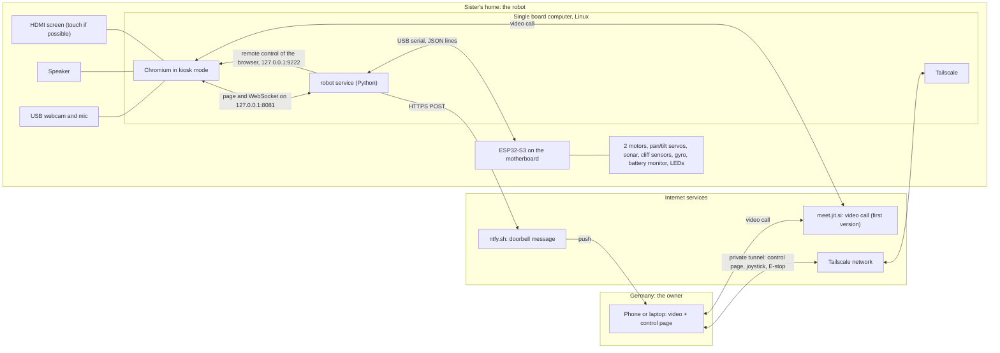
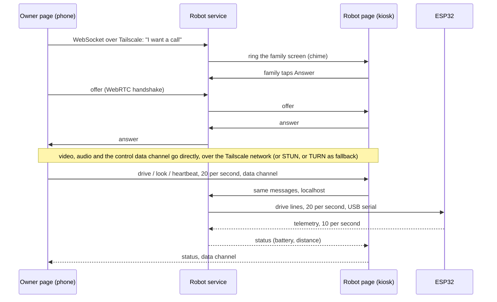

# Robot 2 (telepresence robot): the software plan

Status: **DRAFT for review, written overnight while the owner sleeps.** Nothing here is code. It is a plan, a list of choices, small configuration examples and a stage-by-stage build order.
Written for a hobbyist: short sentences, every abbreviation explained once (glossary at the end).

Marks: **VERIFIED** = I saw it in a file or a source (sources at the end). **ASSUMED** = my best knowledge or a guess that a test must confirm; the stage that confirms it is named.
Prices are in EUR, "about" means I could not check a shop today. Date of research: November 2026.

Companion file: `esp32-serial-protocol.md` (the exact USB serial language between the single board computer and the ESP32). Other documents in this folder (power, wiring, single board computer choice, 3D design) are written separately; where I depend on them I say so.

---

## 0. The short version

**What the owner wants:** he is in Germany, opens a link on his phone or laptop, sees and talks to his family through the robot's camera and screen, and drives the robot around the house. The family can also call him with one big button.

**What I recommend (details in the sections named):**

| Question | Recommendation | Section |
|---|---|---|
| How does the video call work in the first version (days, not weeks)? | **Public Jitsi Meet (meet.jit.si) in the robot's Chromium browser in kiosk mode**, auto-joining a random one-time room. Zero cost, no server. | 3 |
| What is the catch with it? | meet.jit.si wants somebody to **log in (Google, GitHub or Facebook) to start a room**. Plan: the owner always joins first as the logged-in host; the robot is a guest. | 3.2 |
| And the improved version 2? | **One own web page** with video, joystick, head control and emergency stop, built on plain WebRTC. Media and controls travel through the Tailscale private network. Fallback if that proves flaky: LiveKit Cloud (free tier) with the same page. | 3.6 |
| How does the owner reach the robot across the internet? | **Tailscale** (free, private, no router settings at the sister's home). Only the owner's devices are allowed in. | 4 |
| How does the family call him? | A big on-screen button (and the physical STOP/call button on the head) sends a push message through **ntfy** (free, simplest). | 5.3 |
| What stops the robot if the internet drops? | **Four independent timers** (250 ms, 300 ms, 500 ms, 1000 ms). The robot stops in **about 0.4 s**; about 0.6 s if the ESP32 firmware itself hangs (ASSUMED until measured in Stage 5). | 4.4 |
| How is the Wi-Fi set up in a house I do not know yet? | Pre-load the owner's phone hotspot, then add the sister's Wi-Fi from the owner's phone; a phone hotspot (plan B), a hotspot-and-web-page fallback (comitup, plan C) and a LAN cable (plan D) as fallbacks. | 6.1 |
| Firmware? | Arduino-ESP32 on the ESP32-S3, built with PlatformIO. ESP32 does **no Wi-Fi**. It is stateless: the single board computer sends all settings at every start. | 7 |
| Build order? | 10 small stages, one evening each, each with a pass test. Stages 1-5, 7 and 9 **plus the safety part of stage 8** (cliff sensors, tilt and pick-up detection, family STOP) must be done before the trip. Stage 6 (pan and tilt) is strongly recommended. Remote driving stays switched off (drive permission = never) until the cliff and tilt tests pass. | 8 |

**The three biggest risks** (full list in section 9): (1) the single board computer may be too weak for a two-way video call in a browser (test first, Stage 1); (2) the robot's power plan says "charge only with the robot switched off", which conflicts with an always-on robot, and two cells last only about 1.1 to 1.4 hours of calling (ASSUMED, measured in Stage 3); (3) the network in the destination country (blocked services, no upload speed) is unknown, so test it on day 1 there and keep a phone hotspot as a fallback.

---

## 1. What the robot does (function list, software view)

| # | Function | Who does it | First version? | Stage |
|---|---|---|---|---|
| F1 | See and hear both ways (video call) | Chromium + Jitsi (v2: own page) | Must | 1 |
| F2 | Starts by itself when switched on, goes to an idle screen | Linux services + kiosk browser | Must | 2 |
| F3 | Family presses **one big button** -> the owner's phone rings | robot service + ntfy | Must | 2 |
| F4 | Owner calls the robot; it rings, family answers (or auto-answer if the family allows it) | robot service | Must | 2 |
| F5 | Owner **drives** (forward, back, turn) with a joystick or keys | owner page + service + ESP32 | Must | 5, 7 |
| F6 | Owner moves the **head** (pan = left/right, tilt = up/down) | same | Must | 6, 7 |
| F7 | **Emergency stop** (owner page, family: hang-up button, physical STOP/call button and main switch; on-screen STOP only if the overlay test passes, 3.3) and automatic stop when the connection drops | all three layers | Must | 5, 7, 8 |
| F8 | Stops before **obstacles** (sonar) and at **stair edges** (cliff sensors); stops if lifted or tipped | ESP32 | **Must** for cliff, lift and tilt (they gate remote driving); Should for sonar | 8 |
| F9 | **Battery** monitor: warnings on the screen and on the owner's phone, polite shutdown | ESP32 (ADS1115) + service | Should | 4 |
| F10 | **Privacy:** camera only on during calls; LED shows camera live; camera-off mode; do-not-disturb. **Before the trip the Stage 2 camera-off button on the screen, the LED and the physical camera cover are enough;** the camera cut at USB level is extra hardening (3.5) | service + LED + camera cover | Must (stage 2 part); the USB-level cut is recommended, not required | 2 (required); 8 Part B (recommended) |
| F11 | Connects to **Wi-Fi in a new place** without a keyboard | NetworkManager, comitup | Must | 9 |
| F12 | **Remote updates, logs, recovery** | Tailscale SSH, Raspberry Pi Connect, watchdogs | Must | 7, 9 |
| F13 | One page with video **and** controls | own WebRTC page | Version 2 | 10 |
| F14 | Gamepad driving (the PS5-style pad the owner already has works in a browser) | owner page | Nice | 7 or later |
| F15 | Speed modes, quality modes (low / normal / HD), latency-aware speed cap | owner page + service | Should | 7, 10 |

Out of scope (the brief): AI agent, turret, anything about robot 1's own stages, auto-docking, mapping.

---

## 2. Architecture on the single board computer (SBC)

### 2.1 Picture



### 2.2 What runs on the SBC

| Part | What it is | Starts how | If it dies |
|---|---|---|---|
| **Linux** (Debian family, 64 bit; Raspberry Pi OS is the reference) | systemd, NetworkManager, PipeWire (audio), Chromium | power on | hardware watchdog reboots |
| **Chromium kiosk** | full-screen browser, no address bar. Shows the family screen (idle, ringing, in call) from `http://127.0.0.1:8081/`. In the first version it navigates to the Jitsi room for a call. | desktop auto-login, then a start script that restarts it if it crashes | start script restarts it; the service restarts it if it stops answering |
| **robot service** (one Python program, ~1000 lines, asyncio) | web server for two pages, serial bridge to the ESP32, call logic, safety supervisor, notifier, audio and screen control, health reports | systemd unit, `Restart=always` | systemd restarts it within seconds |
| **Tailscale** | private network to the owner's devices; also provides HTTPS and SSH | systemd | restarts itself |
| **ntfy** | not a program on the robot: the service sends HTTPS requests to ntfy.sh | | |
| Raspberry Pi Connect (Raspberry Pi boards only) | second, independent way to get a remote shell | systemd | |

Folder plan (so the owner and any helper always know where things are):

```
/opt/robot2/            the program (a git copy of the repository; releases/ + current symlink for easy rollback)
/etc/robot2/robot2.toml settings of the service (owner login, ntfy topic, room prefix, speed limits, volumes)
/etc/robot2/esp32.toml  settings that are pushed to the ESP32 at every start (calibration numbers)
/var/lib/robot2/        small state: do-not-disturb, last call, counters
/var/log/robot2/        call log (one JSON line per event), 30 days
```

### 2.3 Two web listeners, on purpose

| Listener | Address | Who may use it | What it serves |
|---|---|---|---|
| **Family side** | `127.0.0.1:8081` (this computer only) | the kiosk browser | family screen, buttons, volume, call, stop. No login (it is not reachable from outside). |
| **Owner side** | `127.0.0.1:8080`, published to the owner's devices by `tailscale serve` as `https://robot2.<your-tailnet>.ts.net` (the full command is in Stage 7) | only the owner, through Tailscale | control page (joystick, head, E-stop), status, call buttons, logs, admin |

Only the owner side is ever published. The service checks the identity header that Tailscale adds (the owner's login name) and refuses anything else. Tailscale Serve adds the headers `Tailscale-User-Login` and `Tailscale-User-Name`, deletes forged copies sent by a visitor, and advises listening on localhost only (VERIFIED in the Tailscale source code, s21; the Tailscale web pages only through a search summary, re-check them). **The headers are added only for requests that come from a person's own, untagged devices**, so the owner's phone and laptop must **not** be tagged. The robot itself may (and should) be a tagged machine. Use a current Tailscale version on the robot and on the owner's devices. (The source code shows no version check for these identity headers, but older builds were not tested, so this is not proven for them.)

### 2.4 Requirements this puts on the SBC (input for the SBC selection)

| Need | Why |
|---|---|
| 64-bit Debian-family Linux with Chromium, NetworkManager, PipeWire, systemd in its repositories | kiosk + audio + watchdog |
| HDMI output (a USB-C DisplayPort-only board needs an adapter; the Radxa Cubie A7S has **no HDMI port**, VERIFIED (search summary only, s18, re-check the review page)) | the screen is HDMI |
| 3 USB devices at once: webcam, ESP32 and audio (plus touch if the screen has it: then all 4 ports of a Pi 5 are used, and a keyboard for Wi-Fi plan E needs the touch cable unplugged) | use a small powered hub if the SBC has fewer ports |
| At least 2 GB RAM (4 GB comfortable) and 4 cores | Chromium + a two-way video call. A Raspberry Pi Zero 2 W (512 MB, 4 slow cores) is **probably too weak for two-way 480p video in a browser** (ASSUMED; no source measured it; Stage 1 decides). |
| 5 GHz Wi-Fi preferred | call quality is mostly Wi-Fi quality |
| A hardware watchdog | recovery from a freeze |
| The SBC document (`sbc-selection.md`, written separately) recommends a Raspberry Pi 5 (2 GB new, or the owner's own 8 GB one) and rates the Pi 4 as the cheapest board that works; it advises against the Zero-class boards and the Cubie A7S. This plan agrees. It also says Chromium does its video work in software on all of these boards, so a light call page matters. | Stage 1 still measures it |

---

## 3. The video call: options compared, and what I recommend

### 3.1 The options

| Option | Effort to start | Cost | Robot joins by itself? | One page with video **and** controls? | Privacy | Main risk | Verdict |
|---|---|---|---|---|---|---|---|
| **A. Public Jitsi (meet.jit.si) in Chromium kiosk** | hours | free | **Yes**, via URL settings (3.3) | No (two windows) | Good: for two people Jitsi connects directly (peer to peer), encrypted; random room names | Needs a logged-in host to start a room (3.2); no promise of service; embedding not allowed | **First version** |
| B. Jitsi as a Service (JaaS, 8x8) free developer plan | 1-2 evenings (account, signed token) | free for up to **25 monthly users** (VERIFIED (search summary only, re-check the 8x8 and jitsi.org pages; those sites could not be opened here); paid plans from about $99/month, so stay under 25) | Yes, with a token that makes the robot the host: no login | **Yes**: the official embedding API is allowed on their domain | Same as A | Free-plan terms can change; token must be signed by a small piece of our code | **Plan B if A's login rule becomes a nuisance** |
| C. Self-hosted Jitsi on a rented server | 1-2 days + upkeep | server about EUR 4-8 per month (ASSUMED, check hoster) + domain | Yes, no login | Yes (embedding on own domain) | Best control | Needs updates, a domain and certificates; a server that can be attacked | Not for a 1:1 robot |
| D. LiveKit (Cloud free "Build" plan, or self-hosted) | 2-3 evenings (token service + page) | Cloud: 5 000 free WebRTC participant-minutes per month (VERIFIED (search summary only, re-check livekit.io/pricing)): two people in a call use 2 minutes per minute, so about 40 hours of calls per month | Yes (our own page) | **Yes** (video and a data channel for controls in one connection) | Video passes through LiveKit's servers (encrypted; end-to-end encryption exists) | Another account and a cloud dependency; free-tier terms | **Plan C for version 2** if own WebRTC is flaky |
| **E. Own minimal WebRTC page** (plain browser WebRTC, signalling by our service, media over Tailscale) | 3-5 evenings + tests | free | Yes (our own page) | **Yes** | Best: nothing leaves your own devices and the Tailscale network | We write and test the reconnect logic ourselves; relies on Tailscale reaching a direct path (or STUN/TURN) | **Version 2** |
| F. Consumer apps (WhatsApp, Google Meet, Zoom, Telegram) | hours | free | **No** reliable auto-answer: someone must tap "accept" (WhatsApp has no built-in auto-answer and tricks need broad phone permissions, found only on low-quality sources; Zoom auto-answer exists for paid Zoom Rooms / Zoom Phone products only; for Google Meet I could not verify any way to skip "ask to join" on a personal account) | No | Accounts and phone numbers | The family must operate a phone app; can't be scripted; terms and limits change | **Only as a human fallback** ("call my sister's normal phone") |

### 3.2 Facts about public Jitsi that shaped the plan

| Fact | Mark | Source |
|---|---|---|
| Since **24 August 2023** meet.jit.si requires the person who **creates** a room to log in (Google, GitHub or Facebook at the start); others then join without any login. Reports from **December 2025** show the "waiting for the host / log in" screen is still in place. I found no 2026 announcement that changes this. | VERIFIED (press summary and a mailing-list thread only; the Jitsi blog page itself was not opened, re-check) | s1, s2 |
| meet.jit.si **no longer supports embedding** in other web pages (iFrame API); that is what JaaS is for. A third-party report says an embedded call is cut after 5 minutes; I could not confirm this in Jitsi's own text. | VERIFIED (search summary only, re-check the page) / ASSUMED (5 minutes) | s3 |
| With exactly two people Jitsi switches to a **direct peer-to-peer connection** and stops using its media server (setting `p2p.enabled`, on by default). When a third joins it moves back to the server. | VERIFIED (jitsi-meet `config.js`) | s4 |
| The settings I use in the URL (`prejoinConfig.enabled`, `startWithAudioMuted`, ...) are on Jitsi's **allow-list** for overrides from the web address. `enableWelcomePage` and `enableClosePage` are **not** on it (they cannot be set from the URL, so the page after a hang-up is Jitsi's own; the service leads the browser back to the idle screen). | VERIFIED (jitsi-meet `configWhitelist.ts`, master) | s4 |
| Echo cancellation, noise suppression and gain control are **on by default** (`disableAEC`, `disableNS`, `disableAGC` are only for turning them off). | VERIFIED (config.js) | s4 |

**Consequence for the first version.** The robot never starts a room. The owner does: when the family calls, the owner taps the notification, opens the call from the control page (this is the moment he logs in with his own Google or GitHub account, once per session; his phone/laptop normally stays logged in), and only then does the robot open the room. When the owner calls the robot, the control page opens the room on the owner's side first, then tells the robot to join. So the robot is always the guest and never needs an account.
Check at Stage 1 (10 minutes): create a room from the laptop and let a second browser join. If the "waiting for host" screen shows up for the guest and goes away by itself once the host is in, the plan works as written. If Jitsi has changed its rules again, switch to option B (JaaS) or go straight to version 2.

### 3.3 First version: how the robot joins by itself (real settings)

The robot's browser is sent to one web address. Everything after the `#` is a list of settings that Jitsi reads and applies; the part before is the server and a random room name.

```
https://meet.jit.si/R-q7k2m9x4v8c1b5n3z6d0p2w#userInfo.displayName=%22Robot%22&config.prejoinConfig.enabled=false&config.startWithAudioMuted=false&config.startWithVideoMuted=false&config.disableDeepLinking=true&config.requireDisplayName=false&config.disableThirdPartyRequests=true&config.analytics.disabled=true&config.constraints.video.height.ideal=480&config.constraints.video.height.max=480&config.constraints.video.height.min=240&config.toolbarConfig.alwaysVisible=true&config.toolbarButtons=%5B%22microphone%22,%22camera%22,%22hangup%22%5D&config.disableReactions=true&config.disablePolls=true&config.disableInviteFunctions=true&config.hideConferenceSubject=true&config.hideConferenceTimer=true
```

| Setting in the address | What it does | Why |
|---|---|---|
| `config.prejoinConfig.enabled=false` | **no "prejoin" page**; joins at once | auto-join. (The older name `prejoinPageEnabled` is replaced.) VERIFIED |
| `config.startWithAudioMuted=false`, `config.startWithVideoMuted=false` | microphone and camera on at join | a robot that joins muted is useless; privacy comes from *when* it joins (3.5), not from muting |
| `userInfo.displayName="Robot"` | the name other people see (this one is a separate URL setting, not under `config.`) | no "enter your name" box. VERIFIED (jitsi-meet settings code reads `userInfo.displayName` from the URL) |
| `config.requireDisplayName=false` | never ask for a name | |
| `config.disableDeepLinking=true` | do not offer "open in the Jitsi app" | on phones this page otherwise blocks the browser; also used on the owner's phone link |
| `config.disableThirdPartyRequests=true`, `config.analytics.disabled=true` | no avatar lookups, no statistics | privacy, fewer outgoing connections |
| `config.constraints.video.height.ideal/max=480`, `min=240` | ask the camera for about 480p | default is 720p: heavy for a small SBC and for a weak upload. **The first call is asked at 480p.** 720p at 30 frames per second is the camera test in Stage 1 and the upgrade if the CPU and the upload allow it (the SBC document plans for 720p). |
| `config.toolbarConfig.alwaysVisible=true`, `config.toolbarButtons=[microphone,camera,hangup]` | the family sees only three buttons (needs a touch screen); no chat, no invite, no settings | simple |
| `config.disableReactions/Polls/InviteFunctions`, `hideConferenceSubject/Timer` | hides clutter | |
| `config.p2p.enabled` (default already true) | direct connection for two people | lower delay, no server load |

Notes: (1) The room name `R-` + 22 random characters is made **fresh for every call** by the service; never reuse a room (3.5). (2) A hash setting that is not on Jitsi's allow-list is ignored silently, so test each effect once in Stage 1. (3) Where the toolbar is not wanted at all (no touch), the service hangs up through the remote-control channel described below.

**The browser and how the service steers it** (all of this is *configuration*, no code):

- Chromium start line (Raspberry Pi OS "Trixie"; the program is `chromium`, on the older "Bookworm" it is `chromium-browser`; ASSUMED, check with `which chromium`):

```
chromium --kiosk --noerrdialogs --disable-infobars --no-first-run --disable-session-crashed-bubble \
  --password-store=basic --autoplay-policy=no-user-gesture-required --use-fake-ui-for-media-stream \
  --remote-debugging-port=9222 --user-data-dir=/home/robot/kiosk-profile  http://127.0.0.1:8081/
```
  `--use-fake-ui-for-media-stream` = say "yes" to the camera/microphone question; `--autoplay-policy=...` = let sound play without a click; `--remote-debugging-port=9222` lets the service steer the browser (open the room, go back to the idle page, ask if the owner is still in the room). That port listens on this computer only. (Chromium's own "allowed sites for camera and microphone" policy files, `VideoCaptureAllowedUrls` / `AudioCaptureAllowedUrls`, are the cleaner alternative; they exist as Chromium policies (VERIFIED (search summary only, s15, re-check the page)), the folder `/etc/chromium/policies/managed/` is my assumption.)
- On Raspberry Pi OS the desktop is called labwc (VERIFIED (search summary only, re-check) in a news report of the 2025-11-24 release, s13; the official release notes were not read). The start script goes in `~/.config/labwc/autostart` (a Trixie forum report, s14, search summary only, re-check; it is only one user's report), after "Desktop Autologin" is switched on in `raspi-config` (ASSUMED menu text).
- The start script runs Chromium in a loop (`while true; do chromium ...; sleep 2; done`) so a crash simply restarts it.
- The service talks to Chromium over the debugging port ("Chrome DevTools Protocol", **CDP**): navigate to the room, navigate back to the idle page, listen to the page-change events (`Page.frameNavigated`, `Target.targetInfoChanged`) so that a hang-up is noticed within milliseconds (see "What the family can reach during a call", below), and read two facts from Jitsi's page (is the owner in the room; how many people are there). Those facts come from Jitsi's internal page object (`APP.conference`) which Jitsi does not promise to keep: **ASSUMED, check in Stage 2**; if it fails, the fallback is a timer ("hang up after 2 minutes alone") and the owner's own hang-up button.

**Call flows in the first version** (what happens, step by step):

| Step | A. The family calls the owner | B. The owner calls the robot |
|---|---|---|
| 1 | Family presses CALL (touch or button). Screen: "Calling [Owner]...". | Owner presses "Call the robot" on his page (refused during quiet time). |
| 2 | The service invents a fresh room name `R-` + 22 random characters and sends the ntfy message (urgent). It repeats the message at 20 s and 40 s, inside the 60 s ring window. | The service invents the room name; the robot screen rings with a chime: "[Owner] is calling". |
| 3 | Owner taps the message; his control page shows "The family is calling" and **Answer**. Answer opens the Jitsi room in a new window (he logs in as host if Jitsi asks) and tells the service. | The page opens the Jitsi room in a new window (host login if asked). |
| 4 | About 3 seconds later the service sends the robot's browser to the room (remote control, CDP). It joins with no prejoin page. LED on, banner "[Owner] can see and hear you". | The family taps ANSWER (or after 8 s if welcome mode is on) and the robot's browser goes to the room. |
| 5 | No answer within 60 s: the robot returns to idle, the log says "missed", and the owner gets **one** low-priority "missed call" message (the room name is dead from then on). | No answer within 45 s: "no answer" on the owner's page; the robot returns to idle. |
| End | Either side hangs up. If the owner leaves and the robot is alone for 30 s, the service leads the robot back to the idle page: camera released, LED off. A call is never kept longer than 3 hours without asking "still there?" on both screens. | same |

**What the family can reach during a call in the first version.** While Jitsi's page fills the screen, our own buttons (volume, STOP, "[Owner] is driving" banner) are not visible. The plan for that gap:

**Version 1 in one sentence:** during a call the family's STOP is the **hang-up button** and the **main switch**, plus the **physical STOP/call button** (item 3, a Must before the trip). An on-screen STOP and an on-screen call button over the Jitsi picture are added only if the overlay test (item 4) passes.

1. **Hanging up always switches driving off.** The service does not poll the browser. It listens to the browser's own events through the remote-control channel (CDP, see "The browser and how the service steers it" above): `Page.frameNavigated` (the page address changed) and `Target.targetInfoChanged` (the page title or address of the tab changed). These events arrive within milliseconds. **On the first event that says the page is no longer the room, the service disarms the robot** (`disarm` is a hard stop, no ramp). So Jitsi's own red hang-up button is a working family "stop everything" button, and the stop happens within about 0.5 s of the tap (ASSUMED, measured in Stage 8 pass 7 with a video). Checking the page address every 0.5 s would add up to 0.5 s of delay on top, so the service does not poll.
2. The Jitsi toolbar (microphone, camera, hang-up, shown by the URL settings above) is the family's call control; volume is the preset level plus the owner's volume slider on his page.
3. A **physical STOP/call button** on the head (a **Must** before the trip; the 3D design gives it a place, open item C5) stops the robot: pressed while the robot moves = STOP; in a call, short press = hang up; idle = call. It is wired to the ESP32 (7.6), so it works even while Jitsi owns the screen.
4. Optional, **ASSUMED to work, try in Stage 2 and again in Stage 8:** the service injects a small overlay into the Jitsi page through the same remote-control channel (a red STOP, the "[Owner] is driving" banner, volume - / +); the buttons call back to the service through the debugging channel (no network request, so no cross-site problems). **Only if the overlay test passes** are the on-screen STOP and the on-screen call button added to the first version. If it fails, items 1-3 are enough and nothing else is promised.
5. In version 2 our own page shows all of these natively (5.1).

### 3.4 Echo: stop the robot hearing itself

Echo happens when the robot's microphone picks up the speaker, and the owner hears his own voice a moment later. Layers, from most to least important:

1. **Hardware first:** a USB **speakerphone** (microphone and speaker in one case with built-in echo cancelling) is the most reliable fix (about EUR 60-85 for one that can be trusted, ASSUMED; check Amazon.de/Reichelt. Cheaper ones of EUR 17-31 are not trustworthy, see `peripherals.md` section 4). With a webcam microphone plus a separate speaker, keep them **apart** (microphone high on the head near the camera, speaker low in the body, pointing away) and keep the volume moderate.
2. **Browser echo cancelling is on by default** in Jitsi and in Chromium for any page using `getUserMedia` (VERIFIED for Jitsi's defaults). Leave `disableAEC`, `disableNS`, `disableAGC` alone.
3. **Do not stack two echo cancellers.** The Linux audio system (PipeWire) has an echo-cancel module; use it **only** if the browser's own is not enough, and then not at the same time (double processing can sound worse). ASSUMED; Stage 1 test.
4. **Volume limit in the service:** the maximum speaker volume is capped in the config (for example 70 %), and the family's volume buttons move inside that range.
5. **The owner uses headphones** (his side never echoes).
6. **Last resort, half duplex:** the service turns the robot's microphone down while the owner is speaking loudly. Not needed unless 1-5 fail.

Stage 1 test: speak on both ends at normal volume for 3 minutes; the owner (with headphones) must hear no echo of his own voice at conversation volume.

### 3.5 Privacy options for the call

| Option | What it gives | Cost / effort |
|---|---|---|
| **Camera and microphone only exist during a call.** The idle screen is a local page that never opens the camera; the browser only opens the camera when it is in a call. | The most important privacy feature: nothing is ever "always on". | built in |
| **Fresh random room per call** (22 random characters from a secure generator), delivered to the owner only through the Tailscale-protected page, never in the ntfy message. | A stranger who guesses or finds an old link cannot join. | built in |
| **"Third person" guard:** if the service sees more than 2 people in the room (through CDP), it hangs up and tells both. | Stops an uninvited visitor in public Jitsi rooms. | small, ASSUMED to work (CDP) |
| **LED that shows the camera is live**, driven by the truth: the service checks twice a second whether any program has the camera device open (`/dev/video0`). | Honest indicator even if a program misbehaves. LED on the head, wired to PCA9685 channel 2. | built in, parts about EUR 1 |
| On-screen banner "[Owner] can see and hear you" while in a call | Family always knows | built in |
| **Camera-off mode** (family button / long press): ends any call, blocks incoming calls, and switches the camera **off at the USB level** so no program can use it until the mode is lifted (Linux "deauthorize USB device"; ASSUMED to work for the owner's webcam, Stage 8 Part B) | Hard guarantee. **Required before the trip is only the screen button of Stage 2 (it ends the call, refuses calls and keeps the LED off) together with the physical cover below; the USB-level cut is recommended and may be finished at the destination.** | small |
| **Physical cover** on the camera (sliding shutter) | The sister can see it is blind | part of the 3D design (other document) |
| **Do-not-disturb** (5.4) | The owner cannot ring or auto-join during rest times | built in |
| **Drop-in ("auto-answer") off by default.** The family must switch on "[Owner] may join without asking" and can switch it off with one tap. | Consent | built in |
| Call encryption: media between two people is encrypted (WebRTC) and direct when possible. The Jitsi *server* mode (3 or more people) is not end-to-end encrypted unless that option is switched on; we only ever have 2 people. | Good enough for family | none |
| No recording, no screenshots, no photos stored. Logs contain times and events, never video, audio or names of people in the room. | | built in |

### 3.6 Version 2: one page with video and controls (my recommendation)

**Idea:** one web page, `call.html`, served by the robot service, used by both sides. On the robot it is the family screen; on the owner's phone/laptop it is the control page. Video and audio travel by plain browser WebRTC; **controls travel on the same connection** as a "data channel" (unordered, no retries, so an old joystick value is never delivered late); a normal WebSocket carries the same messages as a backup path. The robot service only relays the first handshake ("signalling") and bridges the controls to the ESP32.



| Piece | Choice | Why |
|---|---|---|
| Media path | Browser WebRTC; first choice is the Tailscale address of the robot (direct, encrypted twice), else public STUN, else a TURN relay (Cloudflare Realtime TURN has 1 000 GB per month free, VERIFIED (search summary only, re-check the Cloudflare pricing page); or the service gives out its own short-lived credentials) | no media server to rent |
| Control path | Data channel (`ordered:false, maxRetransmits:0`) + WebSocket backup | no head-of-line delay; either path alone is enough |
| Video | 640x480 at 24 fps by default; modes **Low** (360p, 15 fps, up to ~400 kbit/s), **Normal** (480p, 24 fps, up to ~900 kbit/s), **HD** (720p, 24 fps, up to ~2.5 Mbit/s), set from the owner's page with the browser's sender settings; the codec (VP8 or H.264) is chosen by measuring CPU in Stage 10 | match the weakest network and CPU |
| Reconnect | Automatic ICE restart after 3 s of trouble, new offer after 10 s; the owner page shows "connection lost, robot stopped" at once | the robot already stopped itself |
| UI (owner) | full-screen video; joystick bottom-left; head pad bottom-right (or drag on the video); big red **STOP** top-right; chips for battery, distance, link quality; mode selector; hang-up | one page |
| UI (family) | the same engine with the family layout (5.1) | one code base |
| Effort | 3-5 evenings plus tests. Developed only after the first version works (Stage 10). | |

**Decision gate.** If Stage 10's tests (2-hour soak, three different networks, mobile data) show random freezes that cannot be fixed in two evenings, keep the same page but replace the media/signalling part with **LiveKit Cloud** (option D): same screens, same controls; only the connection code changes.
**Never remove the Jitsi first version** until version 2 has been used for a week: it stays as the "Plan B" button on the owner page.

---

## 4. Remote access and drive control across the internet

### 4.1 Tailscale versus the alternatives

| Option | What it is | Good | Bad | Verdict |
|---|---|---|---|---|
| **Tailscale** | a private network between your own devices (a "tailnet"); finds the best path through routers by itself | free for personal use (the pricing FAQ says 3 users / 100 devices; one 2026 report says the free plan was raised to 6 users, either is plenty, VERIFIED only by search results: re-check tailscale.com/pricing); no router settings at the sister's home; HTTPS addresses via `tailscale serve`; SSH built in; "tagged" machines never need a key renewal; access rules (ACLs) | owner needs the app on phone and laptop; if the Tailscale service is blocked in the destination country nothing works (Stage 7 tests it); an American company's service | **Recommended** |
| Cloudflare Tunnel + Cloudflare Access | the robot makes an outgoing tunnel to Cloudflare; the owner opens a normal public address and logs in (e-mail code) | no app on the owner's device | needs a domain (about EUR 10 per year, ASSUMED) and more setup; video would still need TURN/STUN | Option if the owner cannot install Tailscale |
| ZeroTier | similar to Tailscale | similar | free device limit (ASSUMED 10, check); less polished | no gain |
| Own WireGuard to a rented server or the owner's home router | same idea, hand-made | full control | the owner's home line may be behind carrier-grade NAT (common with fibre/cable in Germany); then a rented server (about EUR 4/month) is needed; more to maintain | later, if ever |
| Open a port on the sister's router + dynamic DNS | the old way | no third party | needs her router password; insecure; fails behind carrier NAT | **Do not** |
| Tailscale Funnel (public address) | puts the robot page on the open internet | no app on the owner's side | public exposure; bandwidth limits; no identity header | emergency only |

### 4.2 What travels over which channel

| What | First version | Version 2 | Rate and size |
|---|---|---|---|
| Video and audio call | Jitsi: direct peer to peer (if it works), else via Jitsi's servers | own WebRTC, direct over the tailnet if possible | 0.4-2.5 Mbit/s each way; audio ~40 kbit/s |
| Drive and head commands, heartbeat, E-stop | **WebSocket over Tailscale** (owner page to service) | WebRTC data channel + WebSocket backup | 20 messages/s, ~60 bytes: ~10 kbit/s |
| Robot status (battery, distance, state, link quality) | WebSocket | data channel | 5 per second, ~150 bytes |
| "Family is calling" | HTTPS POST from the robot to ntfy.sh; push to the phone | same | a few per day, < 1 kB |
| The control page itself | HTTPS from the robot through Tailscale | same | ~100 kB per load |
| Admin: logs, updates, restart | Tailscale SSH (and the page's admin menu) | same | rare |

### 4.3 Latency and bandwidth: honest expectations (ASSUMED, measured in Stage 7/10)

| Part | Typical |
|---|---|
| Internet round trip Germany to the destination | 20-60 ms inside Europe, 80-150 ms Middle East/Asia, 120-200 ms Americas; far worse on mobile data or satellite |
| Tailscale overhead when the path is direct | 1-3 ms |
| Tailscale when forced through a relay ("DERP") | +20-100 ms and lower speed. `tailscale ping robot2` says "direct" or "via DERP" (VERIFIED (search summary only, re-check tailscale.com)). |
| Camera to screen delay ("glass to glass") | 250-500 ms |
| Command to wheel | 30-60 ms (serial, parser) + the ramp (0.5 s from 0 to full speed) |
| Sister's upload speed needed | 1.5 Mbit/s for Normal quality (480p), 0.6 Mbit/s for Low. Cheap home lines can be 1 Mbit/s up. |

Consequence: **the human sees the world about half a second late**, so the robot must be slow by default and protect itself locally (sonar, cliff, time-outs on the ESP32).

### 4.4 When the connection drops: the robot must stop within about half a second

Every link in the chain has its own timer. No timer depends on another one working. There are **four independent timers**:

| Timer | Where | What it does |
|---|---|---|
| **250 ms** | the robot service ("dead-man") | no message from the owner's page for 250 ms while moving: the service stops the robot |
| **300 ms** | the ESP32 (`ttl`, the drive time-out) | no new `drive` line within `ttl`: the ESP32 slows to a stop by itself |
| **500 ms** | the ESP32 task watchdog | the firmware sets the watchdog to `timeout_ms=500` with `trigger_panic=true` (the Arduino default is much longer), subscribes the `control` task and feeds it every 10 ms. If the loop hangs, the chip resets and the motor driver pins fall to "off". A panic prints a stack dump on the serial port; the SBC ignores it because it does not start with `{`. **Stage 5 tests it by deliberately hanging the loop.** |
| **1000 ms** | the ESP32 link watchdog | no message at all from the SBC for 1 s: disarm |

**Stops in about 0.4 s; about 0.6 s if the ESP32 firmware hangs** (ASSUMED until measured in Stage 5). The 0.42 s figure (300 ms + the 120 ms ramp) assumes the default `ttl`; each message's `ttl` is capped at `ttl_def` (300 ms) so that a message cannot ask for a longer time (see the protocol file; if a message could ask for `ttl` 500, the stop would take about 0.62 s).

| What fails | Who notices | After | Robot is stopped by (ASSUMED, measured in Stage 5 on the home network and again in Stage 7 over Tailscale) |
|---|---|---|---|
| Owner lets go of the stick | owner page | at once: sends `drive 0,0` three times | ~0.2 s (the ramp) |
| Tab hidden, tab closed, phone locked, page loses focus | owner page (`visibilitychange`, `blur`); if the page can no longer send (tab closed, browser killed) the service dead-man below | at once: stop + "driving off" (or after 250 ms) | ~0.2 s (~0.4 s via the dead-man) |
| Owner's phone loses signal, battery dies, browser killed | **service "dead-man"**: no message from the owner page for **250 ms** while moving | 250 ms | ~0.4 s |
| Internet cable cut, Wi-Fi at the sister's drops, Tailscale stalls | service dead-man (same) | 250 ms | ~0.4 s |
| WebSocket frozen but still "open" (TCP stall) | service dead-man (messages stop arriving); stale bursts after a stall are discarded: a message older than 200 ms (own sequence numbers + arrival gaps) is not obeyed | 250 ms | ~0.4 s |
| The robot service crashes or hangs | **ESP32 drive time-out** (`ttl` 300 ms): no new `drive` line | 300 ms | ~0.42 s |
| The SBC freezes, loses power or the USB cable falls out | ESP32 drive time-out (and link watchdog 1 s as backup, which also disarms) | 300 ms | ~0.42 s |
| ESP32 firmware hangs while the PWM hardware keeps going | ESP32 task watchdog (500 ms, reconfigured with panic enabled) resets the chip; the driver's pins then fall to "off" | 500 ms | ~0.6 s |
| Everything fails (including software) | the **hardware main switch** (family or anybody) | by hand | at once |

Details of the owner side (so that nobody has to guess later):

- The owner page sends a heartbeat every 100 ms **whenever driving is switched on**, whether or not the stick moves; `drive` goes at 20 Hz while the stick is held.
- **Driving must be switched on deliberately** (a switch on the page) and switches itself off on every reconnect, so a reconnecting phone never moves the robot by surprise.
- **One controller at a time:** a second page that connects takes over and the first one is told "someone else took control".
- **Driving only while a call is connected** (default). The family sees a banner "[Owner] is driving". Setting `drive_requires_call = false` allows driving without a call, later and only if the family agrees.
- The service never queues commands: it forwards the newest and drops older ones.
- The service dead-man (250 ms) and the tab-close handling are built and tested in **Stage 5** on a simple local drive page, so the Stage 5 stop-time tests ("let go of the stick", "close the browser tab") really test them. Stage 7 only adds the Tailscale path and repeats the tests over it.

### 4.5 Speed limits

The motors are the Pololu 25D 47:1 (12 V motors on the 6.0-8.4 V pack, `mot_vmax` 8.0, see 7.3). Their real top speed is about **0.36 m/s at 7.4 V** (mechanical-design.md 5.5, ASSUMED until measured in Stage 5). The table uses fractions of full speed (1.0 = the 0.36 m/s). The mode targets below are ASSUMED indoor values and are **re-tuned in Stage 5 from measured metres per second**: Creep about 0.08 m/s, Normal about 0.15-0.2 m/s, Fast about 0.3 m/s. Nothing goes above the real top speed of about 0.36 m/s. Speed modes are a "Should" function (F15); a robot with only the Creep and Normal limits is still complete.

| Mode | Forward/back limit (fraction) | Target speed | Turn limit | When |
|---|---|---|---|---|
| **Creep** | 0.22 | about 0.08 m/s | 0.30 | automatic when round-trip time > 500 ms, battery low, or any obstacle limiter active; also a manual choice. Also used for the very first drives at the destination. |
| **Normal** (default) | 0.50 | about 0.15-0.2 m/s | 0.50 | default |
| **Fast** | 0.85 (below the ESP32 default ceiling `max_v` = 0.9) | about 0.3 m/s | 0.60 | owner switches it on for the session; refused if round-trip time > 250 ms or the family has set do-not-disturb |
| Hard ceiling | `max_v` (default 0.9) and `max_w` on the ESP32 | about 0.32 m/s | | cannot be exceeded by any message |

- The page shows the measured round-trip time. Above 800 ms, or three missed heartbeats, driving is blocked ("connection too slow").
- Rule of thumb in the service: allowed speed = mode limit x (1 if RTT < 150 ms, falling to 0.5 at 500 ms).
- The ESP32 adds its own limiters (obstacle, cliff, battery) no matter what the SBC asks (section 7).

### 4.6 Emergency stop (owner, family, hardware)

| Level | How | What happens |
|---|---|---|
| **Software E-stop, owner** | big red button on the owner page (also the space bar / a gamepad button) | the page sends `estop` on all channels; the service sends `estop` to the ESP32 three times and locks driving until the owner presses "release" and switches driving on again |
| **Family stop, guaranteed in version 1** | Jitsi's **hang-up button** (the service sees the page change by CDP events and disarms, 3.3); the **physical STOP/call button** pressed while the robot moves (a Must before the trip) | same, plus the owner sees "stopped by the family"; driving stays locked for 30 s |
| **Family stop, only if the overlay test passes** | red STOP on the family screen during driving (and an on-screen call button) | same as above. Not promised in version 1 (3.3 item 4); in version 2 the family page has them natively. |
| **Hardware** | the robot's **main switch** (and the fuse holders) | everything off; the sister must know where it is. Mark it with a coloured label and tell her. This is the family's last resort if everything else fails. |

### 4.7 The owner's control page (first version)

One web page, opened from the notification or a bookmark: `https://robot2.<your-tailnet>.ts.net/`. It works on a phone (landscape) and a laptop.

| Element | Behaviour |
|---|---|
| **Driving switch** (grey = off, green = on) | must be turned on by hand; falls back to off on every reconnect, page hide or error |
| **Joystick** (touch) or keys **W A S D** / arrow keys | drive; letting go or releasing the key stops at once; the page also stops when the window loses focus or the phone locks |
| **Head pad** (drag a dot, or keys **I J K L**) | pan and tilt; double-tap centres the head |
| **STOP** (big red, also the space bar) | emergency stop (4.6) |
| **Mode** (Creep / Normal / Fast) | speed limits (4.5); Fast needs a confirmation |
| **Call buttons** | "Call the robot", "Answer" (when the family called), "Hang up", "Open video" (opens the Jitsi room in a second window or tab, first version only) |
| **Status chips** | battery %, round-trip time, front distance, "cliff", "stopped by the family", call state, Tailscale path |
| **Admin menu** (owner only) | last 200 log lines, restart browser / service, reboot, ESP32 status counters, calibrate battery |
| Gamepad (optional) | the browser's Gamepad API can read the PS5-style pad the owner already has: left stick drives, right stick moves the head, **holding** a shoulder button is the dead-man (let go = stop), a face button is STOP (ASSUMED to work in Chrome/Chromium, Stage 7) |

Messages between the page and the service (JSON over one WebSocket, `/ws/control`; this is *not* the ESP32 protocol):

| Direction | `t` | Fields | Rate |
|---|---|---|---|
| page to service | `hb` | `q` (counter) | 10 per second while the driving switch is on |
| | `drive` | `x` (-1..1 turn), `y` (-1..1 forward), `q` | 20 per second while the stick is held; three zero messages on release |
| | `look` | `pan`, `tilt` (degrees) or `dx`, `dy` | up to 20 per second while dragging |
| | `estop`, `drive_on`, `drive_off`, `mode`, `call` | small | on events |
| service to page | `status` | battery, round trip, call state, limiters, faults, distances | 5 per second |
| | `lock` | reason: `family_stop`, `takeover`, `slow_link`, `battery`, `estop` | on events |
| | `pong` | echo of `q` for the round-trip meter | per `hb` |

The service turns the stick values into `v` and `w` for the ESP32: dead zone 8 %, a gentle curve (so small stick movements are fine movements), mode limit and round-trip factor from 4.5, then sends the newest value every 50 ms.
**First-version limitation:** the control page cannot show the Jitsi video inside itself (meet.jit.si does not allow embedding, 3.2). On a laptop the owner puts two windows side by side; on a phone the practical way is the phone for the control page and a laptop/tablet for the video. A plain `<iframe>` of the room might still work; try it for ten minutes in Stage 7 but do not depend on it. This is the main reason for version 2.

### 4.8 Who is allowed in (authentication)

| Layer | What |
|---|---|
| 1. The tailnet | only the owner's own devices are in the Tailscale network; the Tailscale account uses a login with 2-step verification; the robot is a **tagged** machine (its key never expires; VERIFIED (search summary only, re-check tailscale.com)); the owner's phone and laptop are **not** tagged (otherwise Tailscale adds no identity header, see 2.3); access rules let only the owner reach the robot's ports 443 (control page) and 22 (SSH) |
| 2. The service | listens on `127.0.0.1` only. It reads the identity header that `tailscale serve` adds (only present for requests from the owner's own, untagged devices) and accepts only the login named `owner_login` in `robot2.toml`; any other request, or a request with no header, gets "forbidden". The family-side listener is a different port that is never published. **Test setting:** before Tailscale exists (the home tests of Stages 2 and 5) no header can arrive, so the setting `header_check` in `robot2.toml` is set to `off` for those tests. The shipped value is `on`; while it is `off` the owner page shows a red note "identity check OFF (test)", and Stage 7 sets it back to `on`. |
| 3. Driving | the driving switch, one controller at a time, family permission, "only during a call" |
| 4. Administration | SSH by key only (no passwords), through Tailscale SSH; the default user name is not used |
| 5. The doorbell | the ntfy topic is a long random secret and carries no room name |
| 6. Optional extra | a 4-digit PIN that must be typed to switch driving on |

A note on privacy: the HTTPS certificates that `tailscale serve` uses are recorded in public certificate logs, which expose the machine name and the tailnet name. Pick a boring machine name (`robot2`) and do not use a real family name in the tailnet name (ASSUMED behaviour from how public certificates work).

---

## 5. What the family sees and does

### 5.1 Screens (family side, full-screen, big text, simple icons; text in the family's language(s), icons first)

In the screens below **[Owner]** stands for the owner's first name, set in `robot2.toml` (the plan does not assume it). Texts live in one file per language.

| Screen | Shows | Buttons |
|---|---|---|
| **Idle** | a friendly face (animated eyes), the time, a small row of icons: Wi-Fi ok, battery, "[Owner] is online" (green dot if his control page was open in the last 5 minutes), "camera is OFF" | one **huge green CALL button**; small: volume - / +, sleep (moon, do-not-disturb), privacy |
| **Calling** (family pressed call) | "Calling [Owner]..." with a gentle animation; he has been notified | red CANCEL |
| **Ringing** (owner calls) | chime + "[Owner] is calling" | huge green ANSWER, red DECLINE. If "welcome mode" is on, it rings 8 seconds and then connects. |
| **In call** | the owner's video full-screen; a small self-view; a banner "[Owner] can see and hear you" (LED on); buttons fade out after 4 s and come back on touch | HANG UP, MUTE microphone, volume - / +, CAMERA OFF |
| **Owner is driving** | banner "[Owner] is driving the robot" | red **STOP** always visible in version 2. In the first version, while Jitsi owns the screen, the on-screen STOP exists only if the overlay test passes; the sure family stops are the hang-up button, the physical button and the main switch (3.3) |
| **Do not disturb** | a moon and "Quiet time until 8:00" | CALL still works; WAKE |
| **Privacy (camera off)** | "Camera is off" | tap to turn on |
| **Low battery** | battery icon and "Please plug in the charger" (and the owner gets a message) | |
| **No network** | "No internet." + the Wi-Fi name and a QR code / short instructions to connect | |
| **Fault** | "Something is not working, please switch me off and on again" (ESP32 missing is *not* a fault for calling; the head and wheels just don't move) | |

A physical big arcade-style **STOP/call button** on the head (wired to the ESP32, GPIO45) is **a Must before the trip, with or without a touch screen** (it is the family's sure STOP while Jitsi fills the screen, 3.3). It does the main things: idle: call; ringing: answer; in call: hang up; held for 1.5 s: privacy mode; pressed while the robot moves: STOP. If the screen has **no touch**, volume then stays at the preset level and the owner can change it from his page. **A touch screen is strongly recommended** (cost and choice in the SBC/screen document). The 3D design gives the button its place (open item C5, `mechanical-design.md`).

### 5.2 Buttons and what they really do

| Button | Action |
|---|---|
| Call | state -> calling; service sends the ntfy message (and repeats it at 20 s and 40 s); waits up to 60 s; on answer opens the room (first version) |
| Volume | `wpctl set-volume` on the default speaker, 5 % steps, clamped to the configured maximum; also shown as a bar. Full commands (type them in a terminal to test; `wpctl` is the PipeWire control program, `wpctl status` lists the audio devices): `wpctl set-volume -l 0.7 @DEFAULT_AUDIO_SINK@ 5%+` (5 % louder, never above 70 %) and `wpctl set-volume @DEFAULT_AUDIO_SINK@ 5%-` (5 % quieter). ASSUMED syntax; check with `wpctl --help` in Stage 1. |
| Mute | mutes the microphone **in the call** and in the system (`wpctl set-mute @DEFAULT_AUDIO_SOURCE@ toggle` on the default microphone); a red microphone icon stays on screen |
| Camera off | in call: hides video (Jitsi button / service); not in call: privacy mode (3.5) |
| STOP | `estop` as in 4.6 |
| Sleep / do-not-disturb | 5.4 |

### 5.3 Telling the owner: ntfy, Telegram or something else

| Option | Simple? | Cost | Notes | Verdict |
|---|---|---|---|---|
| **ntfy** (ntfy.sh app on Android/iPhone, or a browser tab) | **Simplest**: no account, no bot. The robot sends one HTTPS request; the phone buzzes. | free; the public server is for fair use (VERIFIED: the FAQ says "as long as you don't abuse it, it'll be available and free"; the docs' example limit is 250 messages per day per visitor; we send a handful) | The topic name is the only password: use a long random one (VERIFIED in ntfy docs: "the topic is essentially a password"); never put secrets in the message. Priority `urgent` makes the phone vibrate and pop up; `Click` opens a web address when tapped (VERIFIED in ntfy docs). Phone-call (voice) notifications need a paid account. Can be self-hosted later. | **Recommended** |
| Telegram bot | Easy but needs a bot token and a chat id, a Telegram account | free | Good second channel; Telegram is blocked in some countries | optional backup |
| Pushover | One-time purchase per phone platform (about EUR 5, ASSUMED) | small | Very reliable "emergency" priority | optional |
| E-mail / SMS | slow / costs | | | no |

Example (this is a command line, not application code; the service sends the same request):

```
curl -H "Title: The robot is calling" -H "Priority: urgent" -H "Tags: telephone_receiver" \
     -H "Click: https://robot2.your-tailnet.ts.net/" -d "Tap to answer" https://ntfy.sh/robot2-XXXXXXXXXXXXXXXXXXXXXXXX
```

The message contains no room name: the owner taps it, lands on his Tailscale-protected page, and the page shows the call and the join button. If there is no answer, repeat the message at 20 s and 40 s (inside the 60 s ring window, while the room still exists). At 60 s the robot gives up, shows "[Owner] did not answer yet" on the family screen, and the owner gets **one** low-priority "missed call" message. No repeat comes after the call is cancelled.

### 5.4 Do-not-disturb and sleep

| Setting | Meaning | Who sets it |
|---|---|---|
| Quiet time (moon) | for a chosen time (1 h, until morning): the owner cannot ring or auto-join; the robot does not move; the screen dims. The CALL button still reaches the owner. | family on the robot, or a daily schedule in the config (for example 22:00-08:00) |
| Welcome mode (auto-answer) | the owner may join after 8 s of ringing without a tap | family only (default **off**) |
| Drive permission | `during call` / `ask each time` / `never`. **The shipped setting is `never`** until the cliff, lift and tilt tests of Stage 8 pass; after that the default becomes `during call`. For the home tests of Stages 5 and 7 the owner sets it by hand, standing next to the robot. | family on the robot |
| Screen sleep | after 2 min idle the screen dims, after 10 min it turns off; any touch, button, ring or call wakes it | config |

### 5.5 Volume and mute behaviour in a sentence

Volume and mute buttons change the real audio devices (not just the Jitsi page), the speaker has a configured maximum, mute is visible (red icon), and a call always starts at the stored comfortable level.

---

## 6. Setup in a place we do not know yet: Wi-Fi, updates, logs, recovery

### 6.1 Wi-Fi at the destination (try in this order)

| Plan | How | Needs | Mark |
|---|---|---|---|
| **A. Known networks in advance** | Before leaving, store on the robot (NetworkManager keeps many): the owner's **phone hotspot** (name and password the owner chooses), and, if the sister can send them, her home Wi-Fi name and password (Raspberry Pi Imager can pre-load one; others with `nmcli device wifi connect "NAME" password "PASSWORD"`). Give the home Wi-Fi the higher priority and the hotspot the lower one, so the hotspot is used only when the home Wi-Fi is not there (the exact commands are in the box below the table). | nothing at the destination | works |
| **B. Phone hotspot bootstrap** | At the sister's: switch on the owner's phone hotspot, switch the robot on: it connects, Tailscale comes up. Then (from the owner's laptop/phone, through Tailscale, or on the robot's own screen) add her home Wi-Fi: `nmcli device wifi connect "NAME" password "PASSWORD"` and give it a higher priority (commands in the box below). | the owner's phone | works; **the simplest "no keyboard" way** |
| **C. Hotspot with a set-up page (comitup)** | If the robot finds no known network it makes its own Wi-Fi called `comitup-NNN`; a phone that joins it gets a page to pick the home network and type the password. | the package `comitup` (works with NetworkManager and has a captive portal in hotspot mode; VERIFIED: the project page was opened in this review and says "requires NetworkManager and systemd"). **comitup 1.43 had a captive-portal problem on Trixie in Oct 2025 (issue 269), reported working on the 2025-12-04 image; the sister may need to open the page by hand; test in Stage 9 and keep plan B first.** | known limit: if the Wi-Fi works but has no internet, it does not switch back |
| **D. Cable** | Plug a LAN cable into the router; the robot uses it at once. | an SBC with an Ethernet port (or a USB adapter) | most boards |
| **E. Keyboard + the screen** | **Unplug the touch cable and plug in the keyboard** (all 4 USB ports of a Pi 5 are used by webcam, sound, ESP32 and touch, and there is no hub in the parts list). Open a terminal with Ctrl+Alt+T (ASSUMED to work over the kiosk page; test in Stage 9) and type `nmtui` (a menu program for Wi-Fi) followed by Enter. Afterwards unplug the keyboard and plug the touch cable back in. | a small USB keyboard | last resort |

**The Wi-Fi commands, written out** (type each line in a terminal and press Enter; `nmcli` is NetworkManager's command-line tool; `sudo` means "run as administrator"; ASSUMED standard NetworkManager behaviour, tried once in Stage 9). Replace the words in capitals with your real names.

```
nmcli connection show
sudo nmcli connection modify "HOME-WIFI-NAME" connection.autoconnect-priority 10
sudo nmcli connection modify "PHONE-HOTSPOT-NAME" connection.autoconnect-priority 1
nmcli connection show "HOME-WIFI-NAME" | grep autoconnect-priority
```

The first line lists the saved networks (use the names it prints). The higher number is tried first, so the home Wi-Fi (10) wins over the hotspot (1) when both are in range. The last line shows the number that was stored.

The family screen always shows the network name, the IP address and a QR code for the status page, so a non-expert can read it out on the phone to the owner. Notes: some home networks need a web-page login (captive portal) or only allow 5 GHz or hide the name: Plan B/D avoid all of those.
**Time:** the SBC may have no battery clock; after a power cut it needs the internet to learn the time, and without the right time secure connections fail. The service shows "waiting for the clock" instead of an error (ASSUMED behaviour of a board without clock battery; the Pi 5 has a clock battery connector).

### 6.2 Remote updates (three separate things)

| What | How | Safety net |
|---|---|---|
| **The robot service and pages** | `/opt/robot2` is a copy of the repository. Update from the owner's laptop over Tailscale SSH: copy a new release into `releases/<date>`, switch the `current` link, restart the service, run a self-test, **switch back automatically** if the self-test fails. | previous release is kept |
| **Linux and Chromium** | Not automatic. Security updates in a planned window, with a "before" disk image. **After the Stage 9 dress rehearsal, freeze the system** (no updates during the trip unless a security problem is serious), because a browser update can change WebRTC behaviour. | spare SD card with the golden image |
| **ESP32 firmware** | The new `.bin` file is built on the owner's laptop (or by a GitHub build) and copied to the SBC; the service stops using the port, flashes the ESP32 through the **same USB cable** with `esptool`, then restarts the link. The ESP32's auto-reset circuit makes this work without touching a button (ASSUMED for the owner's devkit, Stage 4). No Wi-Fi OTA (no Wi-Fi). | the ROM boot loader in the chip can always be reached again by the same method; a bad firmware cannot lock the robot out |
| Tailscale | `sudo tailscale set --auto-update` (turns on automatic updates of Tailscale itself) | |

**Installing and using `esptool` on the SBC** (esptool is the free program that writes a firmware file into the ESP32; ASSUMED steps for Raspberry Pi OS Trixie, tried once in Stage 4; the exact flags depend on the esptool version, so read `esptool --help` first). Type each line in a terminal and press Enter:

```
sudo apt install pipx
pipx install esptool
pipx ensurepath
```

Close the terminal and open a new one, then check with `esptool version`. To write a firmware file (the file name and the address `0x0` come from the firmware build), first make the service let go of the port: type `sudo systemctl stop robot2` and press Enter (`robot2` is the name of the service; it stays stopped until you start it again). Then type:

```
esptool --chip esp32s3 --port /dev/robot-esp32 --baud 460800 write-flash 0x0 robot2-merged.bin
```

(In esptool 4 and older the program is called `esptool.py` and the word is `write_flash`.) `/dev/robot-esp32` is the port name made by the udev rule in Stage 4. When esptool has finished, type `sudo systemctl start robot2` and press Enter: the service starts again, opens the port and says `hello` to the ESP32 by itself.

### 6.3 Logs and status

- **Journal** (systemd): persistent but size-capped (200 MB), to read with `journalctl` over SSH (for example `journalctl -u robot2 -n 200` shows the last 200 lines of the service); the owner page has a "last 200 lines" view.
- **Call log:** one JSON line per event (call start/end, who started, duration, quality summary, E-stops, ESP32 resets, low battery) in `/var/log/robot2/`, kept 30 days. Never video or audio.
- **Status page** (owner): CPU temperature, throttling flags, Wi-Fi name and signal, Tailscale path (direct/relay), ESP32 firmware and counters (`stat`), battery, last E-stop reason, time since boot.
- **Alerts to the owner by ntfy (a second topic):** robot booted (power came back), battery low/critical, repeated ESP32 resets, repeated browser restarts, no internet for 10 minutes, E-stop pressed by the family.
- SD card care: quality card (A1/A2 rating, about EUR 8-15 for 32-64 GB, ASSUMED), journald size cap, `noatime`; later "read-only root" if corruption ever happens.

### 6.4 Watchdogs and the recovery ladder

| Layer | Watches | Action | Time |
|---|---|---|---|
| ESP32 | its control loop (task watchdog 500 ms), the serial link (1000 ms), the drive commands (`ttl` 300 ms) | reset / stop (section 4.4) | 0.3-1 s |
| **Service** | systemd `WatchdogSec=10`: the service pings systemd every 2 s only while its main loop, the serial reader and the web server all work | systemd restarts it (`Restart=always`) | ~10 s |
| **Browser** | the kiosk page sends a "still here" message every 5 s; the service also checks the debugging port | kill and restart Chromium | ~15 s; after 5 restarts in 10 minutes: reboot |
| **Network** | NetworkManager connectivity; Tailscale status | no internet for 10 min: switch Wi-Fi off/on; 30 min: reboot; Tailscale down but internet up for 10 min: restart `tailscaled` | 10-30 min |
| **Operating system** | the hardware watchdog (`RuntimeWatchdogSec=15` in systemd; the Raspberry Pi's chip supports up to 15 s, VERIFIED in one forum report by a user of a Pi 3 and a Pi 4, page opened in this review (s19); Pi 5 and other boards: check `dmesg` for "watchdog" in Stage 9) | automatic reboot if systemd itself freezes | 15-60 s |
| **Planned reboot** | nightly at 04:00 if no call is active | clears memory leaks | |
| **People** | the sister: "switch off at the main switch, wait 10 seconds, switch on". A laminated card with a picture, in her language, on the robot base. | | 2 min |
| **Owner** | Tailscale SSH; if Tailscale is the problem, Raspberry Pi Connect (Raspberry Pi boards only; free for individuals, VERIFIED (search summary only, re-check raspberrypi.com); shell works on all Pi models, screen sharing needs a Pi 4/5 with 64-bit OS and Wayland according to a third party) | | |
| **Spare** | a cloned SD card with the golden image travels with the owner | swap the card | 10 min |

---

## 7. The ESP32 firmware plan

The ESP32 is a small, dull, very reliable "spinal cord". It has **no Wi-Fi, no Bluetooth, no settings of its own**. It speaks the protocol in `esp32-serial-protocol.md` and enforces the safety rules even if everything above it fails.

### 7.1 Tools

| Choice | Decision | Why |
|---|---|---|
| Framework | **Arduino-ESP32, core 3.x** (the ESP32-S3 is fully supported) | well known to the owner and to most helpers; many libraries |
| Build tool | **PlatformIO** with the community platform **pioarduino**, pinned to one exact release | PlatformIO's own `espressif32` platform stays on Arduino core 2.0.x and does not give 3.x (VERIFIED (search summary only, re-check the PlatformIO forum page)); a pinned platform gives the same result every time. A release such as 55.03.39 with Arduino-ESP32 3.3.9 appeared in one table; **check the pioarduino releases page and pin the newest stable at build time** (ASSUMED). |
| Fallback for a beginner | Arduino IDE 2 with the "esp32 by Espressif" board package 3.x: open the sketch, press Upload. Same source files. | no command line needed |
| Libraries | ArduinoJson 7 for parsing/printing; the three I2C chips (PCA9685, MPU-6050, ADS1115) are simple enough for small, pinned, own-written drivers (about 60 lines each) or well-known libraries pinned to a version | fewer surprises |
| Board settings | board `esp32-s3-devkitc-1`, flash 16 MB, **USB CDC on boot: disabled** (so `Serial` is UART0 = the COM socket), PSRAM not used, core debug level 0 (no stray text on the protocol line) | ASSUMED, Stage 4 |

Example `platformio.ini` (configuration only, to be checked and pinned at build time):

```ini
[env:robot2]
platform = https://github.com/pioarduino/platform-espressif32/releases/download/<PINNED-RELEASE>/platform-espressif32.zip
board = esp32-s3-devkitc-1
framework = arduino
board_upload.flash_size = 16MB
monitor_speed = 115200
build_flags = -DCORE_DEBUG_LEVEL=0 -DARDUINO_USB_CDC_ON_BOOT=0
lib_deps = bblanchon/ArduinoJson@^7
```

Project layout (plan): `firmware/robot2-esp32/src/` with one small file per job: `main`, `link` (lines in and out), `cmd` (command handling), `motors`, `servos`, `sonar`, `inputs` (cliff, button), `imu`, `battery`, `safety` (limiters, state machine), `config`.

### 7.2 Tasks and rates

The ESP32-S3 has two cores. Plan: two FreeRTOS tasks plus one interrupt handler, shared data kept tiny.

| Task / handler | Core | Priority | Period | Does |
|---|---|---|---|---|
| **`control`** | 1 | highest | every **10 ms** (100 Hz), fixed-period delay | takes a snapshot of the command data, reads cliff/button pins, runs the drive timer and the link watchdog, the limiters and the ramps, writes the PWM values, every second tick (20 ms) moves the servos, reads the IMU (100 Hz), asks the ADS1115 (10 Hz), feeds the task watchdog. **The only task that touches the I2C bus** (no mutex needed). Must never wait more than 5 ms for anything. |
| **`comms`** | 0 | medium | wakes on serial data, polls every 1 ms | collects bytes into lines (256-byte limit), parses JSON, checks values, hands commands to `control` through a short protected section, answers `ack`/`err`/`pong`, prints `tel` at the telemetry rate **without blocking**: if the output buffer lacks room, it skips the line |
| **Sonar interrupt** | any | | on every edge of ECHO1/ECHO2 | stores the time of rising/falling edges; the `control` task starts a measurement every 66 ms with a 10 microsecond pulse on TRIG (GPIO12). Never a blocking `pulseIn`. |
| Task watchdog | | | | The firmware reconfigures the watchdog to `timeout_ms=500` with `trigger_panic=true` (the Arduino default is about 5 s and it watches the idle tasks; whether it resets the chip depends on how it is set up; ASSUMED from forum reports, Stage 5 tests it), subscribes the `control` task and feeds it every 10 ms. `control` must check in at least every **500 ms** or the chip resets. Stage 5 tests it by deliberately hanging the loop. |

Loop-rate summary: control 100 Hz, servos 50 Hz, IMU 100 Hz, sonar 15 Hz, battery 10 Hz, cliff/button 100 Hz, telemetry 10 Hz (adjustable 1-20 Hz).

### 7.3 Motors (details of the plan; numbers in the protocol file, sections 7.4 and 10)

- Two motors on driver A (M1 left: GPIO4/GPIO16, M2 right: GPIO1/GPIO5). The second driver (M3/M4: GPIO8/11 and 9/10) stays unused but is supported (`m34`) in case a future robot wants four motors.
- Each motor input pair is driven with hardware PWM at 20 kHz, 10 bits, **slow-decay** pattern (one input high, PWM on the other; VERIFIED (search summary only, re-check the TI DRV8833 datasheet)), brake for 200 ms on a hard stop, then coast.
- **Ramps** limit acceleration so the head does not whip and the screen/camera do not shake: up 2.0 per second, down 3.0, stop 8.0 (protocol section 10).
- **Voltage-aware duty:** the driver modules get the raw pack (6.0-8.4 V). Robot 2 uses **Pololu 25D 12 V motors** (VERIFIED in `mechanical-design.md` 5.5), so they are under-driven on this pack, not over-volted. The firmware scales the duty by `min(1, mot_vmax / pack voltage)`. The default `mot_vmax` is **8.0** (set in `esp32.toml`). It is a **speed cap, not the motor rating**: with a full pack of 8.4 V the duty is 8.0 / 8.4 = 95 percent, and from 8.0 V down to 6.0 V the duty stays at 100 percent (it can never go above 100 percent), so the speed then falls slowly with the battery. Stage 5 checks this (pass 5).
- **Fail-safe default:** the DRV8833 inputs have an internal pull-down (150 kOhm, VERIFIED (search summary only, re-check the TI datasheet)); an ESP32 that is off, resetting or crashed leaves the motors **coasting**, not running.
- The HW-627 module's EEP (sleep) pin may need to be tied high for the driver to work; the board README says to check this with a meter (that is a hardware stage, not mine).

### 7.4 Pan and tilt servos through the PCA9685 (I2C 0x40)

- The driver chip makes the 50 Hz servo pulses; the ESP32 only sends numbers over I2C.
- Channel 0 = **pan**, channel 1 = **tilt** (as in the draft wiring diagram). Channels 2 and 3 carry the "camera live" LED and the call-button light (**on or off only**: all PCA9685 channels share one 50 Hz rate, so dimming would flicker; the protocol's `pulse` and brightness `v` are not used). Channels 4-15 are free.
- Per servo: three calibrated pulse widths (minimum, centre, maximum in microseconds) found in Stage 6 with the calibration mode (`cal`, `servo_us`), software angle limits (**pan soft limit +/-30 degrees until the cable loop is proven with the real cable bundle in Stage 6**; the MG996R servo travel is about +/-90 degrees (ASSUMED, measured in Stage 6) and the normal software limit is +/-80 degrees once the loop is proven; tilt -25 to +35 degrees; the 3D design may change these), a top speed (pan 90 deg/s, tilt 60 deg/s by default) and a gentle start and finish (3-frame average) to avoid camera shake.
- The servo chips have no position feedback, so the firmware reports commanded angles. At power-up the servos are **limp** until the first `look`; the first move starts from the assumed home position and is slow.
- The pulse scale depends on the PCA9685's internal clock (about 25 MHz, 5-10 % off from chip to chip), so `osc_hz` is a setting; the calibration step takes care of the rest.
- Heavy head on the tilt servo: it keeps holding torque (no auto-relax) so the screen never sags. Servo current peaks (MG996R stall can be 2 A or more; two servos together near 5 A) come from the separate servo buck, not from the SBC buck; measure the SBC supply during servo moves in Stage 6. Keep the soft limits well inside the servo end stops, so a servo never pushes against a stop (a stalled servo draws the most current).

### 7.5 Sonar (two HC-SR04, shared trigger)

- Both sensors share one trigger pin (GPIO12) and fire together every 66 ms; echoes arrive on GPIO13 and GPIO14 (through the board's 1k/2k dividers). Echo time converts to distance with 0.1715 millimetres per microsecond (speed of sound about 343 m/s, ASSUMED room temperature; the error from temperature is a few per cent and does not matter for a stop rule).
- Valid range 20 mm to 4000 mm; anything else reports -1. A median of three readings removes single wrong values.
- Which direction each sonar guards (`son_dir`: front, rear or off) is a setting, because the mounting is decided in the 3D design.
- Honest limit: sonar misses soft cushions, thin legs and sloped surfaces. It is a helper; the speed limits and the time-outs are the real safety.

### 7.6 Cliff sensors, STOP/call button and LEDs

- **Cliff sensors** (two IR floor sensors, left and right; GPIO21 and GPIO3 on the SPARE header, as drawn in the draft wiring diagram): "no floor" for 3 samples in a row (30 ms) stops forward motion at once; reverse is allowed; turning is halved. The pin level that means "no floor" depends on the module (`cliff_act`), found in Stage 8. Useful on any step or stair edge. **Honest limit:** the sensors only look forward, so **nothing protects driving in reverse**, and they see the edge only a short distance before the robot's weight passes it (the margin is in `mechanical-design.md`). That is why the first drives are away from stairs and near an edge the speed is Creep (4.5). GPIO3 is a boot-strapping pin: harmless after start, but keep the sensor outputs from forcing it at power-on (ASSUMED).
- **STOP/call button** (a **Must** before the trip, GPIO45 on the SPARE header, wired to ground): 30 ms debounce; short press (released before 1.5 s), long press (>= 1.5 s, reported while still held). Events `btn` go to the service, which decides what they mean (5.1).
- **LEDs:** the "camera live" LED and the button light are driven by PCA9685 channels, so they need no ESP32 pin. After an ESP32 reset the camera LED comes up **on** until the service says otherwise (the safe direction).

### 7.7 Gyro / accelerometer (GY-521, I2C 0x68)

- Sampled at 100 Hz. Tilt (pitch, roll) comes from accelerometer + gyro mixed (complementary filter, 98 % gyro / 2 % accelerometer, ASSUMED values). Yaw is the integrated gyro: it drifts about 1-2 degrees per minute and is shown only as a hint.
- Uses: (1) **tip-over stop** (tilt above `tilt_stop`, default **10 degrees**, allowed range 10..60). The rule for the value: it must be above ramp slopes and braking pitch (about 5 degrees) and well below the real tipping angle of the robot (about 22 degrees on a ramp in the worst direction, `mechanical-design.md` 8.2). A guard set at 30 degrees would fire only after the robot has already fallen. (2) **Lift detection** (the z acceleration differs from 1 g by more than 0.35 g for 150 ms: someone picked the robot up). (3) Turn-rate display. Heading-hold while driving straight is a later improvement, not in the first firmware.
- "GY-521" boards come with an MPU-6050 or a lookalike whose ID byte differs (0x68 for the real one, others report 0x70-0x72); the firmware accepts a small list and logs the value (ASSUMED, from datasheets; Stage 4 reads it).
- Calibration: `imu cal` once with the robot still; the service stores nothing (the offset is measured again after each boot when the robot is still).

### 7.8 Battery monitor: ADS1115 on the I2C header

- **Which header:** the **I2C SENSOR header** (3V3, GND, SDA = GPIO7, SCL = GPIO6; VERIFIED in `pin-table.md`). The ADS1115 (address 0x48, 16-bit, 4 inputs) shares the bus with the PCA9685 (0x40) and the GY-521 (0x68).
- **Input A0:** the pack through a divider. Suggested: 47 kOhm from pack-plus to A0, 27 kOhm from A0 to ground, 100 nF across the 27 kOhm. The 47 kOhm sits right at the pack-plus splice (covered with heat-shrink) and only its far end runs on a thin wire to A0, so a short on that wire can carry at most 8.4 V / 47 kOhm = 0.18 mA; the 27 kOhm and the 100 nF sit at the ADS1115. At 8.4 V this gives 3.07 V; the chip's inputs must stay below its supply + 0.3 V, so with a 3.3 V supply the divider must keep 8.5 V (the BMS's overcharge limit) under 3.6 V (it gives 3.10 V). Drain 0.11 mA: **connect it after the main switch.** (ASSUMED values; the wiring document owns the final resistors.)
- **Input A1 (optional):** "is the charger plugged in?": a divider (two 10 kOhm) from the charger board's 5 V input to A1; above 1.5 V = plugged in (`chg` in telemetry). Only useful if the power plan allows charging while running; otherwise leave it out.
- Settings: gain +/-4.096 V, 128 samples per second, single-shot; median of 5 readings every 100 ms, low-pass 1 s. Scale from the divider ratio, then a **one-point calibration with a multimeter** (`bat_cal`) removes the error from resistor tolerance.
- **Levels** (2S Li-ion, numbers under light load, ASSUMED; they match the BMS cut-off of 2.9-3.0 V per cell in `shopping-list.md`):

| Pack voltage | Per cell | Meaning | What happens |
|---|---|---|---|
| above 7.0 V | above 3.5 V | OK | normal; the family screen shows a bar, linear from 8.2 V (full) to 6.4 V (empty) |
| 6.8-7.0 V | 3.4-3.5 V | getting low | amber icon; owner notified once; no speed limit yet |
| below 6.8 V (`bat_warn`) for 10 s | below 3.4 V | low, please charge | red icon and message on the robot; ntfy to the owner; the ESP32 caps speed at 0.5 |
| below 6.4 V (`bat_crit`) for 10 s | below 3.2 V | critical | motors disarmed; the service says goodbye on screen, tells the owner, and shuts Linux down cleanly after 60 s (protects the SD card). The BMS would cut power at about 5.8-6.0 V. |

- Charging state is not guessed from voltage (it jumps with load). **Runtime estimate** (all ASSUMED, to be measured in Stage 3; the sums are in `peripherals.md` 6.3): a 2S pack of two 2500 mAh cells is about 18 Wh, of which only about 14 Wh lies between 8.2 V (full) and the 6.4 V shutdown. In a call the Pi 5, webcam, sound, screen, ESP32 and servos draw about 9-11 W at 5 V, which is 10-12.5 W from the battery. So expect **about 1.1-1.4 hours of video calling on 2 cells**, and **about 1 hour or less if the robot also drives** (the motors add 1.5-3 W). The servo holding current depends on how well the head is balanced: a badly balanced head can cost up to about 3 W more. With the screen on and no call, about 1.6-1.8 hours; with the screen off the figure is not yet estimated. **4 cells (2S2P) double these numbers: about 2.2-2.8 hours of calling.** The decision between 2 and 4 cells assumes about 1 hour. A Zero-class board would draw less power but is probably too weak for the call (risk R2). The short runtime is the reason for risk R3.

### 7.9 Fail-safe summary (firmware view)

Order of priority every 10 ms: emergency stop, faults/disarm, link watchdog, drive time-out, cliff, obstacle, battery cap, operator command. Boot state is "disarmed", every output off. The four independent timers are the service dead-man 250 ms, `ttl` 300 ms, task watchdog 500 ms and link 1000 ms (4.4; protocol section 7.2). Servos hold position on any failure (no jumps); LEDs hold their state.

### 7.10 Settings, boot and updating

- Defaults live in the firmware. The SBC pushes its settings at every start (the ESP32 does not need to remember anything). Flash writes (NVS) exist only for bench use and only while disarmed.
- Boot sequence (about 0.4 s): all pins inputs, I2C bus scan (0x40, 0x48, 0x68), initialise what answered, report `hwok`, send `boot`, wait for `hello`.
- I2C safety: 20 ms bus time-out; if SDA is stuck low, clock it free (9 pulses) and set the `I2C_RECOVERED` bit.
- Firmware updates over the USB cable (6.2). Version numbers follow "major.minor.patch"; a protocol change raises the protocol version (protocol file 4.3).

### 7.11 How the firmware is tested (no robot needed for the first rounds)

1. The golden transcript in the protocol file (section 14) is typed into a serial terminal and the answers compared.
2. A small simulator program on the laptop plays the part of the SBC (sends the transcript, checks the answers) and a second one plays the ESP32 for service development. These are test helpers, written at the stage that needs them.
3. Hardware tests follow the stage list below (wheels lifted off the floor first, always).

---

## 8. Staged build plan (one stage, one evening, one pass test)

Rule from the owner: **one stage at a time; no code for a later stage until the current one passed on the real hardware.** Each stage below says what is built, what the pass test is, and what to do if it fails. Times are guesses for an evening of 2-3 hours.

"Before the trip" = stages **1, 2, 3, 4, 5, 7 and 9** are required, **plus the safety part of stage 8** (cliff sensors, tilt and pick-up detection, family STOP: its pass items 8.3, 8.4, 8.5 and 8.7). That is about 8 evenings (ASSUMED: 7 stages plus the safety part of stage 8; more with stage 6 and the rest of stage 8). **Stage 6 (pan and tilt) is strongly recommended**, because head control is a Must function. The rest of stage 8 (sonar tuning, the wall-stop test, camera-off at USB level; bump switches are not in the first build) is recommended and can finish at the destination if time runs out. Stage 10 (version 2) is after the trip starts working, or never.

**Rule for driving (safety):** remote driving stays switched off in software (**drive permission = never**, 5.4) until the cliff and tilt tests of stage 8 pass. The home tests of Stages 5 and 7 are done with the owner next to the robot (Stage 5 with the wheels in the air, Stage 7 away from stairs); the owner switches the permission on by hand for the test. **The first drives at the destination are with the sister next to the robot and away from stairs**, in Creep speed.

### Stage 1: Bench call (SBC + screen + camera + audio, nothing else)

- **Needs:** an SBC with Linux installed, the HDMI screen, the webcam, speaker and microphone, a normal USB charger. (The owner's Raspberry Pi 5 can be borrowed from robot 1 for this evening if the final SBC is not here yet. The result still says how a Zero-class board would do, since CPU can be compared.)
- **Do:** install the system (Raspberry Pi Imager: hostname `robot2`, user `robot`, SSH key, Wi-Fi, country, time zone); install Chromium; start it with the kiosk line from 3.3 pointing at the Jitsi address with the settings; create the room on the laptop first (log in), let the robot join; test echo, picture, CPU and temperature; try each URL setting once (some may be ignored). The first call is asked at **480p**; as a separate camera test, ask the camera for 720p at 30 frames per second once and write down the CPU use (that is the upgrade if the board can carry it).
- **Terminal, in one paragraph:** a "terminal" is a window where you type one line and press Enter. On the Pi, open it with the black-screen icon in the taskbar or with Ctrl+Alt+T. `sudo` in front of a command means "run as administrator". When you type a password nothing is shown on the screen; that is normal.
- **Performance mode (CPU):** Raspberry Pi OS does not always run the CPU at full speed by itself. Type `echo performance | sudo tee /sys/devices/system/cpu/cpu0/cpufreq/scaling_governor` and press Enter, then `cat /sys/devices/system/cpu/cpu0/cpufreq/scaling_governor` to check: it must print `performance`. **This lasts only until the next restart**, so type it again after every restart during the tests. For the finished robot a permanent setting is needed; ASSUMED route, check on your image. **Make a backup first**, because one wrong new line in this file can stop the Pi from starting: type `sudo cp /boot/firmware/cmdline.txt /boot/firmware/cmdline.txt.bak` and press Enter. Then open the file with `sudo nano /boot/firmware/cmdline.txt`. It is ONE long line: press the End key to go to the end of that line, type one space and then `cpufreq.default_governor=performance`. Do not press Enter in the file (no new line). Save with Ctrl+O, Enter, Ctrl+X; then type `sudo reboot` and run the `cat` check again. If the Pi no longer starts, put the SD card into another computer (it shows up as a small drive) and copy `cmdline.txt.bak` over `cmdline.txt`. Keep the webcam at 720p or lower (advice from `sbc-selection.md`).
- **Pi 5 USB power:** on a Pi 5 the four USB ports share 600 mA unless the supply negotiates 5 A (`sbc-selection.md`); a webcam plus speakerphone plus ESP32 can exceed that. The fix is one line in the settings file: type `sudo nano /boot/firmware/config.txt`, press the arrow-down key to the end of the file (the default file ends under a line `[all]`; the new line must go under an `[all]` line; if the last header in your file is something else, such as `[cm4]`, first type a new line `[all]`), type `usb_max_current_enable=1` on its own new line, save with Ctrl+O then Enter, leave with Ctrl+X, and restart with `sudo reboot`. ASSUMED: confirm the line on the official page `https://www.raspberrypi.com/documentation/computers/config_txt.html` before relying on it.
- **Pass:** (1) the robot joins the room by itself, no prejoin page, in under 30 s after the browser starts; (2) video and sound both ways for 20 minutes without freezing; (3) at least 15 frames per second at 480p (the call statistics in the browser's `chrome://webrtc-internals` page show it), total CPU use below 75 % of all cores on average (look at `top`; press `q` to leave it), and temperature below 75 degrees Celsius (`vcgencmd measure_temp` on a Raspberry Pi); (4) no echo for the laptop user wearing headphones; (5) you know whether the host-login screen appears (3.2) and what the guest sees while waiting. The 720p / 30 fps camera test is only noted down, it is not a pass condition.
- **If it fails:** CPU too high -> lower to 360p (`height.ideal=360`) and 15 fps; still too high -> a stronger SBC is needed (tell the SBC document); host login a problem -> try option B (JaaS) or go straight to Stage 10 thinking.

### Stage 2: The robot service skeleton: idle screen, call button, doorbell, auto-start

- **Do:** (software only) the two web listeners; the family idle screen with the big CALL button, volume, mute, do-not-disturb, camera-off; the call state machine (idle, calling, ringing, in call); the ntfy message; "owner calls the robot" from a simple page (reached from the laptop as written below); remote-control of Chromium (go to the room, come back to idle, read the number of people, and listen to the page-change events `Page.frameNavigated` / `Target.targetInfoChanged` so that a hang-up is seen at once); the overlay test for an on-screen STOP and call button over the Jitsi page (3.3 item 4); auto-login and kiosk auto-start; the systemd unit with watchdog; the shell script that restarts Chromium; the random room names; the call log.
  - **How the laptop reaches the owner page before Tailscale exists** (the owner listener hears only the robot itself, 2.3, and the kiosk browser has no tabs). Make a tunnel: on the laptop open a terminal (on Windows: PowerShell), type `ssh -L 8080:127.0.0.1:8080 robot@robot2.local` and press Enter. The first time it asks `Are you sure you want to continue connecting`: type `yes` and press Enter. If `robot2.local` is not found, use the robot's address from your router's list of devices instead of `robot2.local` (ASSUMED: the name works on most home networks). Leave that window open. Then open `http://127.0.0.1:8080/` in the laptop's browser. For these home tests set `header_check` to `off` in `/etc/robot2/robot2.toml` (4.8); Stage 7 sets it back to `on`.
- **Pass:** (1) power on to the idle screen in under 60 s with nobody touching anything (repeat 5 times, including a plug-pull in the middle of a call); (2) press CALL: the owner's phone buzzes within 5 s; he taps it, joins; the robot joins and shows the call; if nobody answers, the message repeats at 20 s and 40 s and one "missed call" message follows at 60 s; (3) the owner calls the robot: it rings; ANSWER connects; HANG UP returns to idle; (4) after the owner leaves, the robot goes back to idle within 30 s; (5) kill the service and Chromium by hand: both come back within 20 s (to kill the service, type `pgrep -f robot2` and press Enter: it prints one or more process numbers; pick the one of the service, check with `ps -p 1234 -o args=` (use your number), then type `sudo kill -9 1234` with that number; to kill Chromium type `pkill -9 chromium`, which stops every Chromium process by name); (6) the camera LED logic (a test LED on the SBC's screen for now) follows whether `/dev/video0` is open; (7) the **camera-off button** on the family screen (this is the privacy function needed before the trip, 3.5): pressed during a call, the call ends; a call from the owner is refused while it is on; the camera LED stays off; pressing the button again brings the normal behaviour back.
- **If it fails:** if reading Jitsi's page state through the debugging port does not work, use the timer fallback (hang up after 2 min alone) and move on.

### Stage 3: Power (the SBC and screen on the robot's own supply)

- **Needs:** the power wiring (`wiring.md`, sections 3 and 4): battery pack, BMS, main switch, fuses, the 5.1 V buck for the SBC, a 5 V feed for the screen. Motors, servos and ESP32 still **not** connected.
- **Do:** set and check the 5.1 V buck with a meter before connecting the SBC; run the Stage 2 behaviour from the battery; measure the voltage at the SBC while in a call; look for under-voltage flags (on a Raspberry Pi: `vcgencmd get_throttled` should say `0x0`); log battery voltage every minute for 30 minutes.
- **Pass:** (1) voltage at the SBC stays above 4.95 V in a call; (2) no throttling or brown-out flag; (3) 30-minute call on battery without a reset; (4) the measured battery drop gives a runtime estimate you can write into the family card: expect about 1.1-1.4 hours of calling on 2 cells (ASSUMED, 7.8); add the "call while driving" figure (expected about 1 hour or less) once the motors run in Stage 5. The choice between 2 and 4 cells (2S2P) assumes about 1 hour; (5) the main switch cuts everything.
- **If it fails:** thicker/shorter wires, a better buck, a separate screen feed (`wiring.md`, section 3, decides). Li-ion cells and power banks go in **carry-on** luggage only when travelling.

### Stage 4: ESP32 link (no motors armed)

- **Needs:** a **data-only USB cable** for the ESP32 link: best a small "USB data-only adapter" (also sold as "power blocker"; about EUR 5, part of the cheap build too) plugged into an ordinary cable. Do not buy a "data blocker" (a "USB condom"): it does the opposite. Taping the 5 V contact of an ordinary cable is the backup only: put a piece of Kapton tape over **pin 1, the 5 V contact, of the USB-A plug on the Pi side**. The USB-A plug has four contacts in a row: 5 V (pin 1), data, data, ground (pin 4). The 5 V contact and the ground contact are the two outer ones and look the same, so you cannot tell them apart by eye (`peripherals.md` section 6.1 and `wiring.md` section 6, question 7, say the same). So tape one outer contact and then run Test A below: if the devkit's power LED lights up, you taped the ground contact. Take the tape off and tape the other outer contact. A picture search for "USB-A plug pinout" shows which end is pin 1 for the way you hold the plug. (A USB-C plug has several 5 V contacts and is not suited for taping.) Reason: the ESP32 gets its 5 V only from the board (CLEAN 5V IN via diode D1); a second 5 V source through the cable could fight with it (`wiring.md` C9). Also a multimeter, and a bench power supply for pass 9.
- **Do:** flash the first firmware from the laptop (hello, ping, tel, led, stat, cfg; nothing that moves); connect the SBC USB-A to the ESP32 **COM** socket; make the udev name `/dev/robot-esp32` (see the first box below); put the `ExecStartPre` line into the service file so that opening the port is quiet (the second box below, protocol 2.3); write the service's serial bridge and a status page; fit the ADS1115 (I2C header) and run `bat_cal` against a multimeter; watch `hwok`; install `esptool` on the SBC (6.2) and flash a firmware once from the SBC; **build the battery monitor's thresholds and the clean shutdown** (levels and actions in 7.8: warning at `bat_warn`, motors disarmed and polite shutdown of Linux after 60 s at `bat_crit`), because the battery monitor is built here and the "before the trip" list needs them.

**The udev name, written out.** "udev" is the part of Linux that gives USB devices their names. Without a rule the ESP32 may be called `/dev/ttyUSB0` today and `/dev/ttyUSB1` tomorrow. First read the chip's ID with `lsusb` (Test B below shows it, for example `10c4:ea60`: the part before the colon is the vendor ID, the part after it is the product ID). Then create the rule file: type `sudo nano /etc/udev/rules.d/99-robot2-esp32.rules`, type this one line (replace the two IDs with your own), save with Ctrl+O then Enter, leave with Ctrl+X:

```
SUBSYSTEM=="tty", ATTRS{idVendor}=="10c4", ATTRS{idProduct}=="ea60", SYMLINK+="robot-esp32"
```

Then load it with `sudo udevadm control --reload-rules` and `sudo udevadm trigger`, unplug and replug the USB cable, and check with `ls -l /dev/robot-esp32` (it must show an arrow to `ttyUSB0` or `ttyACM0`). The user `robot` must be allowed to open serial ports: `groups` must list `dialout`; if it does not, type `sudo usermod -aG dialout robot` and log in again. (ASSUMED rule syntax; checked once in this stage on the real Pi.)

**The quiet-port line, written out.** Opening a serial port can reset the ESP32 (protocol 2.3). One line in the service file makes the opening quieter. The service file is the systemd unit of Stage 2 (ASSUMED location: `/etc/systemd/system/robot2.service`). Type `sudo nano /etc/systemd/system/robot2.service` and press Enter. Find the heading `[Service]` and, on a new line under it, type exactly this one line (with the `-` after the `=`; it means "if this command fails, start the service anyway"):

```
ExecStartPre=-/usr/bin/stty -F /dev/robot-esp32 -hupcl
```

Save with Ctrl+O then Enter, leave with Ctrl+X. Then type `sudo systemctl daemon-reload` and press Enter (systemd reads the changed file), and `sudo systemctl restart robot2` and press Enter. Type `which stty` and press Enter: if it prints another path than `/usr/bin/stty`, use that path in the line.
- **Pass:** (1) the golden transcript (protocol 14) matches; (2) `tel` arrives at 10 Hz for 10 minutes with `rxbad` = 0; (3) unplug and replug the USB cable: the service is back in under 5 s without a restart; (4) reset the ESP32 by its button: the service sends `hello` again by itself; (5) battery reading within 1 % of the multimeter after calibration; (6) `hwok` shows pca, imu and ads all 1; (7) the camera LED on PCA9685 channel 2 turns on and off with `led`; (8) a service restart (type `sudo systemctl restart robot2`) causes no movement and no error on the status page. The ESP32 may reset once when the service opens the port (protocol 2.3); that is normal: the service sees `boot`, sends `hello` again by itself and is back with `tel` in under 5 s; (9) **low battery** (moved here from Stage 8 because the battery monitor is built here): with a bench power supply set to 6.7 V and then to 6.3 V, the warnings, the owner's messages and the clean shutdown happen as in 7.8 (at 6.7 V for 10 s: red icon, ntfy message, speed cap; at 6.3 V for 10 s: motors disarmed, goodbye on screen, owner told, Linux shuts down by itself after 60 s). The motors are not connected yet, so the "speed cap" is checked only as a flag in `tel`; (10) the Pi itself can write a firmware file into the ESP32 with `esptool` (6.2) without touching a button (ASSUMED for the owner's devkit; if it needs the BOOT button, write that on the family card and in 6.2).
- **Check on the bench here too (two tests of 5 minutes each, before the trip).** The question: does the ESP32 devkit's USB-serial chip still show up on the Pi when the cable carries no 5 V? ASSUMED until the tests are done: some chips (for example the CP2102N) need the cable's 5 V to attach.
  - **Test A (the cable really carries no 5 V):** (1) The Pi is running. (2) Switch the robot's **clean 5 V** supply off: take the fuse of the clean 5 V branch out of its holder (`wiring.md`, branch 3), so the devkit gets no power from the board. Nothing else may power the devkit. (3) Plug the data-only cable between a Pi USB port and the devkit's **COM** socket. (4) Look at the devkit: its power LED must **stay dark**. If it lights, the cable still carries 5 V: fix the adapter or the tape and repeat the test. (This proves that no 5 V flows through the cable.)
  - **Test B (the chip appears):** (1) Put the clean 5 V fuse back, so the buck is on and the devkit is powered by the board. (2) Same data-only cable. (3) On the Pi open a terminal, type `lsusb` and press Enter. It lists all USB devices; one line must contain `10c4:ea60` (a CP210x chip) or `1a86:7523` or `1a86:55d3` (CH340 or CH343 chips). (4) Type `ls /dev/ttyUSB* /dev/ttyACM*` and press Enter. It must list exactly one device (for example `/dev/ttyUSB0`). `ls` also prints one error line for the name that matches nothing, for example `ls: cannot access '/dev/ttyACM*': No such file or directory`. **One such error line is normal and is not a failure**; what counts is that exactly one device is listed. (5) Measure the ESP32's 3.3 V pin: it must read 3.2 V or more (the board README worries about this only while Wi-Fi transmits, which this ESP32 never does).
- **If it fails:** garbled text -> baud rate or the UART header is still connected; resets at port open -> already handled, but check the udev rule and DTR/RTS settings (DTR and RTS are two control lines of the serial port that some tools toggle when a port is opened; that toggling can reset an ESP32).
  - **Test B fails** (`lsusb` shows no such line, or no `/dev/ttyUSB*` or `/dev/ttyACM*`): the chip needs the cable's 5 V. Use an **ordinary** USB cable (with the 5 V wire; the spare ordinary cable in the parts list). If you are using the tape backup, first check that you did not tape the ground contact (see Needs above). Put a **USB power meter** (a small inline gadget; `parts-list.md` has a USB-C one) in the cable run and check that **about 0 mA** flows out of the Pi port while the clean 5 V buck feeds the ESP32. The same current flows along the whole cable, so a USB-C meter can sit between the cable's USB-C plug and the devkit's COM socket; a meter with USB-A ends goes at the Pi end. If the Pi port does deliver current, do not run the robot that way. Stop and ask the lead of this design (the person or the assistant who is helping you with these documents). Tell them the meter reading and which cable you used; the fix may need a diode or another cable.
  - **Test A fails** (the LED lights): see Test A, point 4.
  - Battery test (9) fails: check the divider and `bat_cal` first (pass 5).

### Stage 5: Drive

- **Needs:** motors connected to M1/M2; robot **on a stand with the wheels or tracks in the air**. Before the motors are fitted to the DRV8833 module, measure each motor's winding resistance with a multimeter: 12 V / 1.8 A is about 6.7 ohm. If it reads well below 5 ohm, the real stall current is higher than planned: do not fit the motors until the figure is rechecked.
- **Do:** firmware with `arm`, `drive`, `stop`, `estop`, `motor`, ramps, time-outs; the task watchdog set up as in 7.2 (500 ms, panic on, fed every 10 ms); wiring test with `motor` (which wheel is which, direction, `inv_l`/`inv_r`); find `min_duty`; **start `mot_vmax` at 8.0 and never set it above the pack voltage (8.4 V)**; the duty is limited to 100 percent (7.3); in the service: the **dead-man (250 ms)** and, on the simple drive page, the **tab-close and hidden-page handling** (4.4), moved here from Stage 7 because the stop tests below need them; build the simple drive page (joystick + keyboard) for the test and reach it from the laptop with the SSH tunnel of Stage 2: on the laptop type `ssh -L 8080:127.0.0.1:8080 robot@robot2.local`, press Enter, leave that window open and open `http://127.0.0.1:8080/` in the laptop's browser (the "browser tab" of the stop tests below is this laptop tab; the family screen on the robot has no tabs); `header_check` is still `off` for this local test (4.8) and Stage 7 switches it on again; measure the real top speed in metres per second on the floor and **re-tune the speed modes** (4.5) so that Creep is about 0.08, Normal about 0.15-0.2 and Fast about 0.3 m/s. Drive permission stays on `never` in the shipped settings; the owner switches it on by hand for this test.
- **Pass:** (1) each wheel turns the right way for forward/left/right; (2) smooth start and stop; (3) **stop time <= 0.5 s in 10 of 10 trials** for each of: let go of the stick; pull the USB cable; kill the service; unplug the SBC's power; close the browser tab (measure with a phone's slow-motion video next to a clock or a LED that you switch off with the same action); (4) after the ESP32 stops by itself, nothing moves until a new `arm`; (5) the same speed command gives about the same speed with the pack at 8.2 V and at 7.0 V (within 15 %; expected: 8.0 V / 7.0 V gives about 12 % less); (6) the E-stop button works and stays latched; (7) the motors' temperature after 10 minutes of running is only warm; (8) **the task watchdog works:** a test build deliberately hangs the control loop while the wheels turn; the chip resets and the wheels stop within about 0.6 s (a panic text on the serial port is expected and harmless).
- **If it fails:** stop time too long -> lower `ttl`, `ramp_stop`; random resets when starting -> power wiring or a capacitor at the motor driver (`wiring.md`); the motors do not turn at all -> check the DRV8833 module's sleep pin EEP with a meter (7.3 and the board README); the watchdog does not reset the chip -> the `trigger_panic` setting or the task subscription is missing (7.2).

### Stage 6: Pan and tilt

- **Needs:** the pan/tilt mechanism and servos on PCA9685 CH0 and CH1; the head load (screen, camera) fitted, or a weight of the same mass.
- **Do:** calibration mode: find the real end positions and centre of each servo (the MG996R travel is assumed to be about +/-90 degrees: measure it), set soft limits well inside the mechanical stops; set speeds; owner page head pad and keys; check the servo supply and the SBC supply during moves. **Prove the cable loop:** fit the real cable bundle (HDMI, USB, power; the HDMI plug is threaded in from the head end) and keep the pan soft limit at **+/-30 degrees**. Turn the head slowly to both limits and watch the bundle: it must not pull, kink or rub. Only after that widen the limit in steps (+/-45, +/-60, then +/-80, the normal limit) and repeat the check at each step. If the bundle does not survive +/-80, keep the smaller limit and tell the 3D design (open design item).
- **Pass:** (1) full sweeps without buzzing, binding or hitting stops; (2) the head returns to centre within a visible 2 degrees; (3) the picture is steady during slow moves; (4) tilt holds with the full head load for 10 minutes without the servo getting too hot to touch; (5) no SBC under-voltage flag during hard moves; (6) an E-stop freezes the head where it is; (7) the cable bundle survives 20 slow sweeps to the pan limit without damage, at +/-30 degrees first and then at the widened limit you keep.
- **If it fails:** lower speeds, add a counterweight or spring (3D document), bigger bulk capacitor at the PCA9685 (the board has 470 uF at C1 already). A pan range of about 120 degrees each way needs a 270-degree servo, which is optional and not in the parts list; the plan works without it.

### Stage 7: Remote access across the internet

- **Do:** install Tailscale on the robot (tagged key, no expiry), the owner's phone and laptop (the phone and laptop are **not** tagged, 2.3); set `header_check` back to `on` in `/etc/robot2/robot2.toml` (it was `off` for the home tests of Stages 2 and 5, 4.8; type `sudo systemctl restart robot2` afterwards), then publish the owner listener with `tailscale serve`; the owner control page: call buttons, joystick, head pad, keys, E-stop, status, speed modes, round-trip meter, driving switch; the ntfy link opens the page. (The dead-man in the service and the tab-close handling were built in Stage 5; this stage only adds the Tailscale path and repeats their tests over it.)
  - **Commands, written out** (ASSUMED syntax of the current Tailscale; read `tailscale serve --help` if a line is refused). On the robot, in a terminal: `curl -fsSL https://tailscale.com/install.sh | sh` installs Tailscale; then `sudo tailscale up --ssh --advertise-tags=tag:robot` joins the tailnet (the tag `tag:robot` must first be created in the Tailscale admin page under access rules, with the owner as its tag owner; a browser link is printed, open it on the laptop and approve). In the admin page switch on "MagicDNS" and "HTTPS Certificates" once. Then publish the owner listener: `sudo tailscale serve --bg 8080` (makes `https://robot2.<your-tailnet>.ts.net` show what listens on 127.0.0.1:8080, and keeps doing so after a restart). Check it with `tailscale serve status`. To test the drop in pass 5, `sudo systemctl stop tailscaled` kills Tailscale on the robot and `sudo systemctl start tailscaled` brings it back; `nmcli radio wifi off` and `nmcli radio wifi on` switch the robot's Wi-Fi off and on.
- **Pass:** (1) from the owner's phone **on mobile data** (not the same Wi-Fi) the page opens over HTTPS; (2) another Tailscale account cannot reach the robot, the red "identity check OFF" note is gone, and a request without the identity header gets "forbidden" (on the robot type `curl http://127.0.0.1:8080/` and press Enter: the answer must say forbidden); (3) full cycle: robot rings, owner answers, drives, hangs up; (4) round-trip time shown, and the speed limit follows it; (5) the drop tests: airplane mode on the phone while driving, lock the phone, close the tab, switch the robot's Wi-Fi off, kill `tailscaled`: **stop within 0.5 s every time** (video of each); (6) after any of these, driving stays off until the owner switches it on again; (7) `tailscale ping robot2` says "direct" on the home network; note what it says on mobile data; (8) 20 minutes of driving with the page at normal quality, no stutter (at home, the owner standing next to the robot, away from stairs, drive permission switched on by hand until the Stage 8 safety tests have passed); (9) from the **destination** later, the same checklist is run again on day 1.
- **If it fails:** relay path ("via DERP") and the delay is large -> Creep mode only, lower video quality; Tailscale blocked somewhere -> see risk R6.

### Stage 8: Safety sensors and limits

This stage has two parts. **Part A is required before the trip** (pass items 3, 4, 5 and 7): it gates remote driving. Part B (items 1, 2 and 8) is recommended and may finish at the destination. The battery thresholds and the clean shutdown (old item 6) were moved to Stage 4.

- **Do:** *Part A:* cliff sensors, tilt and pick-up detection (`tilt_stop` 10 degrees), the family STOP (hang-up detection, the physical STOP/call button; the on-screen STOP only if the overlay test passed), the drive permission settings; calibrate `cliff_act`. *Part B:* sonar, camera-off at USB level; calibrate `son_stop`, `son_dir`. (Bump switches are optional and not in the first build.)
- **Pass:**
  1. *(Part B)* sonar distances within 15 mm of a ruler at 300 mm and 1000 mm.
  2. *(Part B)* driving at Normal speed toward a wall stops at least 15 cm before it; reverse and turning stay possible.
  3. *(Part A)* on a table edge test (a mat on the floor, a book as the "table", sensors over the edge) the robot stops before a wheel leaves the edge at Creep, Normal and Fast speed, 10 of 10 trials. Write down how far the robot stops from the edge: it tells you how much margin the cliff sensors really give.
  4. *(Part A)* lifting the robot stops the wheels within 0.3 s.
  5. *(Part A)* tilting the robot by hand beyond `tilt_stop` (10 degrees) stops the wheels; and driving up a small ramp (about 5 degrees) and braking from Normal speed do **not** trigger the stop (otherwise raise `tilt_stop` a little, but keep it well below the tipping angle of about 22 degrees).
  6. *(moved to Stage 4, pass 9: low-battery warnings and the clean shutdown.)*
  7. *(Part A)* the family stops, each measured with a video: (a) **hang-up in a call** (Jitsi's red button) stops a moving robot within 0.5 s (this is the guaranteed family STOP of version 1); (b) the **physical STOP/call button**, pressed while the robot moves, stops it within 0.5 s, and in a call a short press hangs up; (c) **only if the overlay test passed:** the on-screen STOP and call button stop a moving robot within 0.5 s.
  8. *(Part B)* camera-off mode: the webcam disappears from the system and the LED is off; lifting the mode brings it back.
- **After items 3, 4, 5 and 7 have passed**, the owner changes the shipped drive permission from `never` to `during call` (5.4). Before that, no remote driving.
- **If it fails:** move or angle the sensors (3D document); lower speeds. The cliff sensors see an edge only shortly before the robot's weight passes it, and nothing protects driving in reverse: if item 3 fails at Fast speed, lower the Fast limit or use Creep near edges, and say so on the family card. If item 7(a) takes longer than 0.5 s, check that the service listens to the CDP page-change events and does not poll. If item 7(b) fails, the physical button is not ready: fix it before the trip (it is a Must). If the overlay test fails, drop item 7(c) and promise only (a) and (b).

### Stage 9: Polish and field kit

- **Do:** Wi-Fi plans A-D rehearsed (6.1), and plan E tried once (touch cable out, keyboard in, `nmtui`); watchdog tests; nightly reboot; alerts; the family card (picture, own language, laminated); labels on the main switch; golden SD image and a clone; freeze updates; a 2-hour soak test; a dress rehearsal at a friend's house with an unknown Wi-Fi.
- **Pass:** (1) from a cold start on an unknown Wi-Fi (phone hotspot plan B) the robot is on the owner's phone within 5 minutes without a keyboard; (2) plan C (comitup) works, including that a phone opens the set-up page (by hand if it does not open by itself), or is dropped from the plan; plan B stays the first choice either way; (3) kill the service by hand (commands in Stage 2 pass 5: `pgrep -f robot2`, then `sudo kill -9` and the process number): back in 15 s; Chromium (`pkill -9 chromium`): back in 20 s; unplug the router for 10 minutes: the robot reconnects within 2 minutes of its return; a forced freeze of the SBC reboots it by watchdog in under 60 s. **To force the freeze** (only after you have made a copy of the SD card; this deliberately crashes Linux, the SD card may need a file-system repair, and the kernel setting may be switched off by default): type `echo 1 | sudo tee /proc/sys/kernel/sysrq` and press Enter (switches the "magic SysRq" crash key on until the next restart), then `echo c | sudo tee /proc/sysrq-trigger` and press Enter. The screen freezes at once; the hardware watchdog should restart the Pi (ASSUMED; if nothing happens after 60 s, switch the robot off and on at the main switch and write down that the hardware watchdog did not work); (4) 2-hour soak: one call every 20 minutes, drive for 2 minutes each time, no manual action, temperature stays below 75 degrees; (5) a person who has never seen the robot (the sister, or a friend) can call the owner and hang up using only the card; (6) spare SD card works; (7) everything on the "before the trip" test list (9.2) is ticked. That list includes the Stage 4 low-battery test (pass 9) and the required safety part of Stage 8 (cliff, lift, tilt and family STOP), so those must be done before this pass can be signed off.

### Stage 10 (version 2): one page with video and controls

- **Do:** build `call.html` (3.6): signalling in the service, WebRTC media, data channel controls with WebSocket backup, reconnect logic, quality modes, the family layout and the owner layout; keep the Jitsi button as Plan B.
- **Pass:** (1) 2-hour soak call on three different networks including mobile data; (2) CPU on the robot below 75 % at 480p; (3) reconnect after the owner's phone changes from Wi-Fi to mobile data within 10 s; (4) E-stop and dead-man tests repeated with the new path (all <= 0.5 s); (5) a week of real use with no manual fix.

---

## 9. Risks and what to test before the trip

### 9.1 Risks

| # | Risk | Why it matters | What we do |
|---|---|---|---|
| R1 | **meet.jit.si rules change** (login to start a room is already required; it could change again, or the service could throttle) | the first version relies on a free public service with no promise | owner is always the logged-in host; JaaS (free for 25 users) as Plan B; version 2 removes the dependency |
| R2 | **SBC too weak** for a two-way browser video call (Zero-class boards, 512 MB) | stutter, heat, crashes | Stage 1 measures CPU and frames before anything else is built; lower resolution; a Pi 4/5 class board is the safe choice |
| R3 | **Charging vs always-on.** The shopping list says "charge with the robot switched off". Estimated runtime is about 1.1-1.4 h of calling on a two-cell 2S pack, about 1 hour or less if the robot also drives, and about 2.2-2.8 h on four cells (7.8; peripherals.md 6.3; all ASSUMED, measured in Stage 3). A robot that is off cannot be called. | the core idea ("I call whenever I want") fails if the robot is off or flat | **default routine: the sister switches the robot on at the agreed call times and charges it with the robot off.** Calls are agreed by message. 4 cells (2S2P) in the comfortable build; the buy decision assumes about 1 hour. Whether the charger board may run while the robot is on stays an open question (`wiring.md`, section 6, question 1). |
| R4 | **Voltage dips / resets** when motors or servos start (one battery for everything, SBC on its own buck) | random reboots, corrupted SD card | Stages 3, 5, 6 measure it; separate bucks and fuses are already in the power plan; a bulk capacitor near the SBC buck if needed |
| R5 | **Destination network:** carrier-grade NAT, school-style filters, 2.4 GHz only, 1 Mbit upload, captive portal | calls fail or stutter | Tailscale and ntfy need only outgoing connections (no router settings); Low mode (360p, ~400 kbit/s); phone hotspot as Plan B; **test on day 1 with the probe list in 9.2** |
| R6 | **Services blocked or unreachable in the destination country** (Tailscale control servers and relays, ntfy.sh, meet.jit.si, Google/GitHub sign-in, Telegram) | no remote access at all | the owner finds out *before* the robot is built there: ask the family to open the addresses in 9.2 from their phone. Alternatives to prepare if something is blocked: self-hosted ntfy or Telegram for the doorbell, a rented server in another country for a WireGuard tunnel or Jitsi. I do not know the country; this is a question (section 9.4). |
| R7 | **Echo and bad audio** | frustrating calls | speakerphone, volume cap, tests (3.4) |
| R8 | **Safety of a driving robot with a half-second delay:** hitting people, pets, thresholds, stairs, cables, a child pulling the head | injury or damage | slow default speed (4.5), cliff and sonar, family STOP (hang-up button, physical STOP/call button, main switch), drive only during a call with a banner, low centre of mass and no pinch points (3D document), main switch; **remote driving stays off (drive permission = never) until the cliff and tilt tests of Stage 8 pass**; the first drives at the destination are with the sister next to the robot and away from stairs |
| R9 | **Privacy and consent** of the family (camera in a home) | trust | camera only during calls, LED, camera-off mode, quiet time, drop-in off by default, one-time rooms, no recording; explain it to the sister before leaving; local laws for cameras in homes are the family's/owner's responsibility |
| R10 | **SD card corruption** after a power loss | robot won't boot | quality A1/A2 card, journald cap, clean shutdown at critical battery, spare cloned card, later read-only root |
| R11 | **Losing remote access** (Tailscale login on a lost/broken phone, key expiry, 2-step code device lost abroad) | no way to fix anything | robot is a tagged, non-expiring Tailscale machine; save the account's recovery codes on paper; second path with Raspberry Pi Connect (Pi boards); phone hotspot plan |
| R12 | **No real-time clock** (many SBCs) | secure connections fail after a power cut until the time is learned | time sync on connect; screen says "waiting for the clock" |
| R13 | **Browser or system update breaks the call or the kiosk** | a surprise on the trip | freeze updates after the dress rehearsal; golden image |
| R14 | **Heat** in a closed body (SBC + screen + buck converters) | throttling, shutdown | temperature logging, fan, ventilation slots (3D document), Stage 9 soak test |
| R15 | **ESP32 firmware bug** that keeps wheels turning | runaway robot | four independent timers (250 ms, 300 ms, 500 ms, 1000 ms; 4.4), driver pull-downs, hardware switch, wheels-up testing first |
| R16 | **Notifications missed** (owner's phone silent, Do Not Disturb) | the family's call goes unanswered | ntfy priority urgent, allow it to bypass silent mode in the phone settings, a Telegram backup, "[Owner] did not answer yet, try again/call my mobile" text on the robot |
| R17 | **Family finds it hard to use** | unused robot | one big button, a picture card in their language, a practice call before leaving |
| R18 | **Latency too high to drive** (mobile data, relay path) | collisions | speed follows round-trip time; driving blocked above 800 ms |
| R19 | **Co-existence of two power inputs on the ESP32** (board 5 V via D1 and the SBC's USB) | USB back-feed or brown-out | resolved by the data-only cable (`wiring.md` C9); verified in Stage 3/4 with bench tests A and B (Stage 4). If the chip does not appear without the cable's 5 V, the fallback is an ordinary cable plus a current check with a USB power meter. |
| R20 | **Cheap parts surprises** (USB IDs, module versions, GY-521 clones, HW-627 EEP pin) | stage delays | each is a named check in a stage |

### 9.2 What to test before the trip (checklist)

1. 10 cold starts in a row: the robot reaches the idle screen by itself each time (also after a plug-pull in a call).
2. A call over the **phone hotspot only** (no home Wi-Fi at all) and a call over a **throttled link** of 1 Mbit/s upload (hotspot plus a bandwidth limiter, or simply a poor corner of the house).
3. A call where the owner's phone is on mobile data and the robot on home Wi-Fi.
4. The five drop tests from Stage 7 and the five stop-time tests from Stage 5, filmed.
5. 2-hour soak with calls and driving (Stage 9).
6. A forced power cut during a call and during driving: it recovers alone.
7. Low-battery warnings and the clean shutdown with a bench supply (Stage 4, pass 9).
8. Echo test with the final speaker and microphone in the final body.
9. A first-time user (not the owner) completes call, answer, hang up, volume, privacy (the camera-off button of Stage 2), using only the card.
10. The **destination probe list** (ask the family to try on their phone, now): open `https://meet.jit.si`, `https://ntfy.sh`, `https://login.tailscale.com`, `https://github.com`; ask them to run an upload speed test (on the phone: open `https://www.speedtest.net` in the browser and tap Go; on the robot, in a terminal: `sudo apt install speedtest-cli`, then `speedtest-cli`, which prints "Upload"); ask which Wi-Fi bands the router has and whether it has a free LAN port. Anything that fails is a design change, not a surprise.
11. Spare SD card, spare USB cables (one of them an ordinary cable with the 5 V wire, for the Stage 4 fallback), LAN cable, spare ESP32, tools, printed copies of this plan's quick card are packed.
12. The Jitsi address with every setting is tried once more on the day before leaving (policy check, R1).
13. **The safety part of Stage 8**, filmed: cliff (table-edge) test, lift, tilt, hang-up stop, physical STOP/call button. Until it has passed, the shipped drive permission is `never`. The first drives at the destination are with the sister next to the robot and away from stairs.
14. After any transport of the robot (luggage), the three buck outputs are measured again with nothing connected, before the Pi or the ESP32 is plugged in (`wiring.md`, section 4, the part "After ANY transport").

### 9.3 Software-side shopping (the electronics parts are in `wiring.md`, `parts-list.md` and `sbc-selection.md`)

| What | Why | About | Where | Buy where? |
|---|---|---|---|---|
| 2 x microSD card 32-64 GB, A1/A2 rating, quality brand | system + spare clone | EUR 8-15 each (ASSUMED) | any electronics shop | anywhere |
| USB speakerphone (microphone + speaker with echo cancelling) | echo (3.4) | EUR 60-85 (ASSUMED; `peripherals.md` warns that cheaper ones of EUR 17-31 are not trustworthy) | Amazon.de, Reichelt | Germany (choice is easier to check) |
| ADS1115 breakout modules x2 (one spare) | battery monitor | EUR 3.5-5 on eBay.de from Asian sellers, up to ~13 from local shops (ASSUMED from search results, varies, check the shop) | eBay.de, AZ-Delivery, Reichelt | Germany |
| Resistors 47k, 27k, 10k, 220 ohm; 100 nF capacitors; 5 mm LEDs (a few) | divider, LED | EUR 3-6 assortment | Reichelt, any | anywhere |
| 30 mm arcade pushbutton (with a 3.3 V-capable LED ring if you like, not a 12 V arcade ring) | the physical STOP/call button, a Must before the trip (3.3) | about EUR 2-5 (ASSUMED) | Amazon.de, Reichelt | Germany |
| 2 x IR floor-sensor modules (cliff) | stair safety | about EUR 1-3 each (ASSUMED); per the draft wiring diagram | eBay.de, Amazon.de | Germany |
| 2 m LAN cable; USB-LAN adapter if the SBC has no Ethernet | Wi-Fi plan D | EUR 3; EUR ~10 | any | anywhere |
| USB data-only adapter ("power blocker") x2 (one for the ESP32 link, one for the touch cable), one short ordinary USB-A to USB-C cable for the ESP32 link (it is also the Stage 4 fallback cable), and 2 spare ordinary cables (with the 5 V wire; comfortable build) | ESP32 link (Stage 4: data-only adapter first, ordinary cable as the fallback) | about EUR 5 per adapter and EUR 4 per cable (ASSUMED); the exact lines and totals are in `parts-list.md`, which is the master list | any | anywhere |
| USB-C power meter, voltage and current (optional; needed only for the Stage 4 fallback, borrow one in the cheap build) | measure the current out of the Pi port | about EUR 10 (ASSUMED; see `parts-list.md`) | Amazon.de | Germany |
| Laminating pouches or a plastic sleeve for the family card | card | EUR 2 | any | anywhere |
| Accounts (all free): Tailscale, ntfy (none needed), Google or GitHub for the Jitsi host login (the owner's existing one), Raspberry Pi ID for Connect | | EUR 0 | | |
| Optional: a rented small server for ntfy/WireGuard if R6 hits | | about EUR 4-8 per month (ASSUMED) | any hoster | later |

### 9.4 Questions only the owner can answer (the plan works with the defaults shown)

1. **Which country** is the trip to? (Decides whether Tailscale/ntfy/Jitsi/Google are reachable, plugs, and whether a Plan with a rented server is needed. Default: assume everything is reachable and test on day 1.)
2. **Touch screen or not?** (Default: touch. The physical STOP/call button on GPIO45 is built in either case; it is a Must before the trip.)
3. **Which SBC** will be used? (Default: Raspberry Pi 4/5 class; Stage 1 checks.)
4. **Which language(s)** for the family screen and card, and does the script run right to left? (Default: English + the family's language, text files per language.)
5. **Can the charger run while the robot is on?** (`wiring.md`, section 6, question 1. Default: the sister switches the robot on at the agreed call times and charges it with the robot off; 2 cells last only about 1.1-1.4 hours of calling, so 4 cells (2S2P) in the comfortable build, about 2.2-2.8 hours. All ASSUMED, measured in Stage 3.)
6. **Does the sister want "welcome mode"** (the owner may join after 8 s without a tap)? (Default: off.)
7. **Which phone does the owner use** (Android/iPhone) and may ntfy bypass silent mode? (Default: ntfy app, urgent priority.)
8. **Does the owner have a Google or GitHub account** he is happy to use as the Jitsi host? (He almost certainly does; default: yes.)
9. **Do the stairs matter?** (Default: cliff sensors fitted. They are required in any case: remote driving stays off until their test passes, and the first drives are away from stairs.)
10. **How many days until the trip?** (Decides whether stage 10 happens before or never.)
11. **Pan/tilt design:** angles and end stops from the 3D design. Default: pan soft limit +/-30 degrees until the cable loop is proven with the real bundle in Stage 6; servo travel about +/-90 degrees (ASSUMED); normal software limit +/-80 degrees once proven; tilt -25 to +35 degrees. A 270-degree servo is optional and only needed for a 120-degree pan.

---

## 10. Sources

| Id | What | Link |
|---|---|---|
| s1 | Jitsi blog: authentication on meet.jit.si (room creator must log in; announced 22 Aug 2023, in force 24 Aug 2023), via press summary | https://jitsi.org/blog/authentication-on-meet-jit-si/ , https://alternativeto.net/news/2023/8/jitsi-meet-will-require-an-account-authentication-for-room-creation-starting-august-24th |
| s2 | December 2025 mailing-list report of the "waiting for moderator / log in" screen | https://lists.cuis.st/mailman/archives/cuis-dev/2025-December/011413.html |
| s3 | Jitsi: embedding on meet.jit.si no longer supported, JaaS instead; JaaS free for up to 25 endpoints/users; 8x8 pricing. Web pages not opened (hosts not reachable here), search summary only | https://jitsi.org/jaas/ , https://www.8x8.com/products/apis/video , https://developer.8x8.com/docs/iframe-api-overview |
| s4 | jitsi-meet source files read directly: `config.js`, `react/features/base/config/configWhitelist.ts`, `react/features/base/settings/middleware.any.ts` | https://github.com/jitsi/jitsi-meet |
| s5 | Tailscale Serve identity headers; connection types (direct vs DERP relay). Web pages not opened, search summary only | https://tailscale.com/s/serve-headers , https://tailscale.com/kb/1312/serve , https://tailscale.com/kb/1257/connection-types |
| s6 | Tailscale auth keys / tagged devices do not expire. Web pages not opened, search summary only | https://tailscale.com/kb/1085/auth-keys/ , https://tailscale.com/docs/features/access-control/key-expiry |
| s7 | Tailscale pricing FAQ (Personal plan). Web page not opened, search summary only | https://tailscale.com/kb/1251/pricing-faq |
| s8 | ntfy documentation read directly in the GitHub docs folder (publish, priority, Click header, topic = password, rate limits, phone calls need a paid account); docs.ntfy.sh itself was not opened | https://github.com/binwiederhier/ntfy/tree/main/docs |
| s9 | LiveKit Cloud Build plan: 5 000 WebRTC minutes per month, limits. Web pages not opened, search summary only | https://livekit.io/pricing , https://docs.livekit.io/cloud/quotas-and-limits |
| s10 | Cloudflare Realtime TURN: 1 000 GB per month free, then $0.05/GB; STUN free. Web pages not opened (host not reachable here), search summary only | https://developers.cloudflare.com/realtime/turn/faq/ , https://developers.cloudflare.com/realtime/sfu/pricing |
| s11 | comitup (hotspot + captive portal with NetworkManager); the project page was opened and read in this review; its issue 269 (version 1.43 on Trixie, captive portal problem in Oct 2025, closed 14 Jan 2026 as working on the 2025-12-04 image; issue facts from the review of this plan, re-check the issue page) | https://github.com/davesteele/comitup |
| s12 | Raspberry Pi Connect (free for individuals). Web page not opened, search summary only | https://raspberrypi.com/software/connect/ |
| s13 | News report (not the official release notes) on Raspberry Pi OS 2025-11-24 (Debian 13, labwc, Chromium 142) | https://en.linuxadictos.com/Raspberry-Pi-OS-2025-11.24-comes-with-HiPi-Wayland-and-more.html |
| s14 | Chromium kiosk on Trixie with labwc autostart (forum report) | https://groups.google.com/g/picochess/c/1NkHXW5DP7o |
| s15 | Chromium policies `VideoCaptureAllowedUrls`, `AudioCaptureAllowedUrls` | https://chromium.googlesource.com/chromium/src/+/9a6944e0443e88a656eff7d0ed6516baf54d9113/chrome/browser/policy/media_stream_policy_browsertest.cc |
| s16 | TI DRV8833 datasheet (slow decay = one input high, PWM on the other; 150 kOhm internal pull-downs). Web page not opened (host not reachable here), search summary only | https://www.ti.com/document-viewer/DRV8833/datasheet/detailed_description |
| s17 | PlatformIO forum: the official platform stays on Arduino core 2.x; pioarduino for 3.x. Forum page not opened (host not reachable here), search summary only | https://github.com/pioarduino/platform-espressif32 , https://community.platformio.org/t/problems-with-alternative-esp32-arduino-core-3/41575 |
| s18 | Radxa Cubie A7S: no HDMI, USB-C DisplayPort output | https://www.cnx-software.com/2026/02/05/cubie-a7s-a-compact-allwinner-a733-sbc-with-usb-c-displayport-gbe-wifi-6-pcie-gen3-ffc-connector-gpio-headers |
| s19 | Raspberry Pi hardware watchdog (15 s limit): one forum post by a user of a Pi 3 and a Pi 4 on NixOS; the page was opened and read in this review | https://discourse.nixos.org/t/on-nixos-on-raspberry-pi-does-etc-watchdog-conf-work/54413 |
| s20 | Repository files read: `00-brief.md`, `pcb/kicad/pin-table.md`, `README.md`, `parts-list.md`, `shopping-list.md`, `plan.md`, `wiring.md`, `abadi-rover-2/diagrams/draw_wiring.py` (draft wiring), `mechanical-design.md` (Pololu 25D 12 V motor, section 5.5), `peripherals.md` (runtime, section 6.3) | this repository |
| s21 | Tailscale source code, file `ipn/ipnlocal/serve.go`, function `addTailscaleIdentityHeaders`, main branch, read directly: it deletes forged `Tailscale-User-Login`, `-Name` and `-Profile-Pic` headers and sets them only for requests from untagged (user-owned) devices; the code shows no version check, but older Tailscale builds were not tested | https://github.com/tailscale/tailscale/blob/main/ipn/ipnlocal/serve.go |

**Which sources were really opened.** (1) Opened and read in this work: s4 (jitsi-meet source), s8 (ntfy docs folder on GitHub), s11 (the comitup project page; the facts about its issue 269 were not re-opened), s19 (the NixOS forum post), s21 (Tailscale source) and the repository files in s20. (2) Could not be opened from this environment (the host does not answer), so every fact from them is marked "search summary only, re-check the page": jitsi.org, tailscale.com, docs.ntfy.sh, livekit.io, raspberrypi.com, 8x8.com, developer.8x8.com, developers.cloudflare.com, community.platformio.org, ti.com, and the news, mailing-list and forum pages in s1, s2, s13, s14, s15 and s18. (3) A mark "VERIFIED" without a note in this file means a repository file or a source in group (1) shows it. The numbering s1 to s21 has no gaps; s21 was added last so that the older numbers did not change.

## Glossary

| Word | Meaning |
|---|---|
| SBC | single board computer: the small Linux computer (Raspberry Pi and similar) that runs the screen, camera and call |
| ESP32 | the small microcontroller on the motherboard that drives motors, servos and sensors |
| Kiosk mode | a web browser that fills the whole screen, with no address bar, started by itself |
| WebRTC | the technology browsers use for live video/audio calls |
| Jitsi Meet | a free video-call program; meet.jit.si is the free public server run by 8x8 |
| JaaS | Jitsi as a Service: the same program run by the people who make it (free for small use) |
| Peer to peer (P2P) | the two browsers talk directly, not through a server |
| STUN / TURN | helper servers that let two devices behind home routers find each other (STUN) or relay the data when they cannot (TURN) |
| Tailscale / tailnet | a private network between your own devices over the internet; "tailnet" is your private network |
| DERP | Tailscale's relay servers, used when a direct path is not possible |
| ntfy | a free push-message service: the robot sends a message to a topic, your phone app shows it |
| WebSocket | a long-lived two-way connection between a web page and a server |
| Data channel | a message channel inside a WebRTC connection |
| CDP | Chrome DevTools Protocol: a way for a program to steer the browser (open pages, read page facts) |
| systemd | the Linux program that starts and watches services |
| Watchdog | a timer that must be reset regularly; if it is not, something restarts or stops |
| PWM | pulse-width modulation: fast on/off switching to control motor speed or LED brightness |
| I2C | a two-wire bus connecting the ESP32 to the servo driver, gyro and battery monitor |
| DRV8833 | the motor driver chip on the HW-627 module |
| PCA9685 | the 16-channel servo driver chip |
| ADS1115 | a small 16-bit voltage-measuring chip used for the battery monitor |
| BMS | battery management system: the protection board on the 2S battery pack |
| NVS | the ESP32's small saved-settings memory in flash |
| Slow decay | a way of switching the motor driver that gives smooth speed control at low speed |
| Captive portal | a web page that appears when you join some Wi-Fi networks |
| E-stop | emergency stop |
| udev | the part of Linux that gives USB devices their names. A "udev rule" is one line in a file in `/etc/udev/rules.d/` that says "the device with this vendor and product ID gets the name `/dev/robot-esp32`" (Stage 4) |
| PipeWire | the Linux sound system. It plays and records sound for the browser; `wpctl` is its command-line control (volume, mute) |
| ACL | access control list: the Tailscale access rules that say which of your devices may reach which other device and port |
| RTT | round-trip time: how long a message needs to go to the robot and come back, in milliseconds. The owner's page shows it, and the allowed speed follows it (4.5) |
| esptool | the free program that writes a firmware file into the ESP32 over the USB cable (6.2) |
| SSH | secure shell: a way to type commands on another computer over the network; Tailscale SSH does it through the tailnet with your Tailscale login |
| Terminal | a window where you type one line of text (a "command") and press Enter. On the Pi: the black-screen icon in the taskbar or Ctrl+Alt+T |
| sudo | put in front of a command to run it "as administrator"; it may ask for the password (nothing shows while you type it) |
| `lsusb` | a command that lists the USB devices the computer sees; used in Stage 4 to find the ESP32 board's USB chip |
| `nmcli`, `nmtui` | NetworkManager's command-line tool and its text menu program, for Wi-Fi (6.1) |
| `ttl` | "time to live": how long a `drive` command stays valid on the ESP32; the robot stops by itself when it runs out (4.4) |
| DTR / RTS | two control lines of a serial port; some programs switch them when they open the port, and on an ESP32 board that can reset the chip |
| ICE | the part of WebRTC that finds a working network path between the two browsers ("ICE restart" = look for a path again) |
| labwc | the desktop (window manager) of current Raspberry Pi OS; the kiosk start script goes in its autostart file |
| GPIO | a numbered general-purpose pin of the ESP32 (for example GPIO45 for the STOP/call button) |
| CP210x, CH340, CH343 | the USB-to-serial chips used on ESP32 development boards; Stage 4 checks that one of them shows up in `lsusb` |
