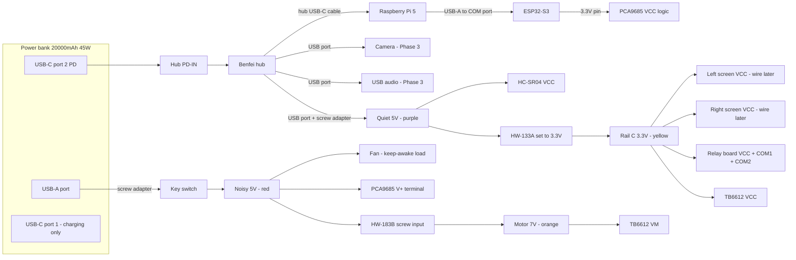
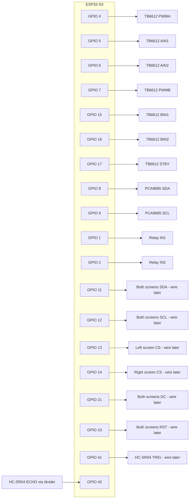
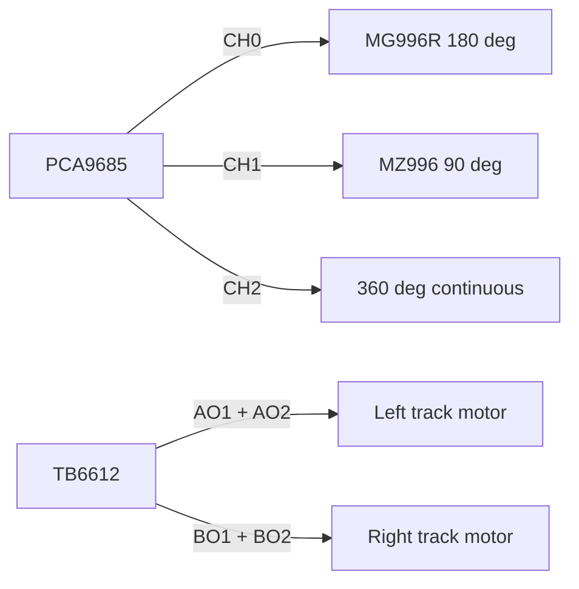

# Abadi Rover — Wiring Reference

Soldering and assembly reference. Pin assignments come from the **Locked pin table** in [plan.md](plan.md); if this file and `plan.md` ever disagree, `plan.md` wins and the mismatch must be reported.

Items marked **(wire later)** belong to Phase 2 or later. Their pins are reserved now; leave them unconnected until that stage.

## Wire colours and sizes

| Colour | Use |
|---|---|
| Red | Noisy 5V (after key switch) |
| Orange | Motor 7V (HW-183B output) → TB6612 VM only |
| Purple | Quiet 5V (hub port) |
| Yellow | Rail C 3.3V |
| Black | GND |
| Any other colour | Signals |

- Power wires: 20–22 AWG. Signal wires: 24–26 AWG.
- Keep motor wires away from screen and sensor signal wires where possible.

## 1. Power diagram

### Ground (star point)

All of these go to **one** star point (a screw-terminal bus bar or lever connector):

```mermaid
flowchart TB
    Star["STAR GROUND POINT"]
    UAneg["USB-A adapter minus"] --> Star
    Quietneg["Quiet 5V adapter minus"] --> Star
    BuckNeg["HW-133A IN- and OUT-"] --> Star
    BoostNeg["HW-183B IN- and OUT-"] --> Star
    FanNeg["Fan minus"] --> Star
    TBg["TB6612 all GND"] --> Star
    PCAg["PCA9685 GND terminal"] --> Star
    SonarG["HC-SR04 GND"] --> Star
    RelayG["Relay board GND"] --> Star
    LightsG["Lights minus"] --> Star
    ScreensG["Screens GND - wire later"] --> Star
    PiG["Pi 5 header GND - one wire"] --> Star
    EspG["ESP32 GND pin - extra wire"] --> Star
```

## 2. Signal diagram

## 3. Per-component checklist

Tick each box once the wire is soldered/screwed and checked.

### Power bank, hub, key switch, Pi, ESP32

| Done | From | To | Colour |
|---|---|---|---|
| [ ] | Bank USB-C port 2 | Hub PD-IN (USB-C cable) | — |
| [ ] | Hub USB-C cable | Raspberry Pi 5 USB-C **power** port | — |
| [ ] | Pi USB-A | ESP32 **COM** USB-C | — |
| [ ] | Hub spare USB port | USB screw adapter = Quiet 5V | — |
| [ ] | Bank USB-A | USB-A screw adapter | — |
| [ ] | USB-A adapter + | Key switch terminal 1 | Red |
| [ ] | Key switch terminal 2 | Noisy 5V bus | Red |
| [ ] | USB-A adapter − | Star ground | Black |
| [ ] | Quiet 5V adapter − | Star ground | Black |
| [ ] | Pi 5 header GND | Star ground | Black |
| [ ] | ESP32 GND pin | Star ground | Black |

### HW-183B boost (motor 7V)

| Done | From | To | Colour |
|---|---|---|---|
| [ ] | Noisy 5V bus | HW-183B screw IN+ | Red |
| [ ] | Star ground | HW-183B screw IN− | Black |
| [ ] | HW-183B OUT+ | TB6612 **VM** | Orange |
| [ ] | HW-183B OUT− | Star ground | Black |

Use the **screw input**, not the HW-183B's USB-C socket, so the key switch can cut the motors. Re-check 7.0V under load after wiring, then glue the dial.

### TB6612FNG

| Done | TB6612 pin | To | Colour |
|---|---|---|---|
| [ ] | VM | HW-183B OUT+ (7V) | Orange |
| [ ] | VCC | Rail C 3.3V | Yellow |
| [ ] | All GND | Star ground | Black |
| [ ] | AO1, AO2 | Left motor (2 wires) | — |
| [ ] | BO1, BO2 | Right motor (2 wires) | — |
| [ ] | PWMA | ESP32 GPIO 4 | Signal |
| [ ] | AIN1 | ESP32 GPIO 5 | Signal |
| [ ] | AIN2 | ESP32 GPIO 6 | Signal |
| [ ] | PWMB | ESP32 GPIO 7 | Signal |
| [ ] | BIN1 | ESP32 GPIO 15 | Signal |
| [ ] | BIN2 | ESP32 GPIO 16 | Signal |
| [ ] | STBY | ESP32 GPIO 17 | Signal |

Leave the seven signal pins empty until Stage 3. STBY sits low by itself, so the motors stay off.

### PCA9685 and servos

| Done | PCA9685 pin | To | Colour |
|---|---|---|---|
| [ ] | VCC | ESP32 3.3V pin | Yellow |
| [ ] | GND (logic header) | ESP32 GND | Black |
| [ ] | SDA | ESP32 GPIO 8 | Signal |
| [ ] | SCL | ESP32 GPIO 9 | Signal |
| [ ] | V+ (screw terminal) | Noisy 5V bus | Red |
| [ ] | GND (screw terminal) | Star ground | Black |
| — | Bulk cap | Already on the PCA9685 board (1000µF), nothing to wire | — |
| — | OE | Not connected | — |
| [ ] | Channel 0 | MG996R plug | — |
| [ ] | Channel 1 | MZ996 plug | — |
| [ ] | Channel 2 | 360° servo plug | — |

Servo plugs: **brown/black = GND, red = V+, orange/yellow = signal (PWM)**. Match the row labels printed on the PCA9685 before plugging in.

### Fan

| Done | From | To | Colour |
|---|---|---|---|
| [ ] | Fan + | Noisy 5V bus | Red |
| [ ] | Fan − | Star ground | Black |

### HC-SR04 (wire later)

| Done | HC-SR04 pin | To | Colour |
|---|---|---|---|
| [ ] | VCC | Quiet 5V | Purple |
| [ ] | TRIG | ESP32 GPIO 41 | Signal |
| [ ] | ECHO | Voltage divider → ESP32 GPIO 42 | Signal |
| [ ] | GND | Star ground | Black |

ECHO is 5V. The ESP32 is **not** 5V-tolerant. Do not connect ECHO straight to GPIO 42.

### HW-133A buck (Rail C 3.3V)

| Done | From | To | Colour |
|---|---|---|---|
| [ ] | Quiet 5V | HW-133A IN+ | Purple |
| [ ] | Star ground | HW-133A IN− | Black |
| [ ] | HW-133A OUT+ | Rail C 3.3V bus | Yellow |
| [ ] | HW-133A OUT− | Star ground | Black |

Set to **3.3V with nothing connected to the output** before wiring any load. Measure again after loads are connected. Confirm 3.3V **before** connecting relay IN1/IN2.

### Relay board and lights

| Done | From | To | Colour |
|---|---|---|---|
| [ ] | Relay VCC | Rail C 3.3V | Yellow |
| [ ] | Relay GND | Star ground | Black |
| [ ] | Relay IN1 | ESP32 GPIO 1 | Signal |
| [ ] | Relay IN2 | ESP32 GPIO 2 | Signal |
| [ ] | Relay COM1, COM2 | Rail C 3.3V | Yellow |
| [ ] | Relay NO1 | ~10Ω resistor → light 1 + | Yellow |
| [ ] | Relay NO2 | ~10Ω resistor → light 2 + | Yellow |
| [ ] | Light 1 −, light 2 − | Star ground | Black |

LED filaments have polarity: one end is usually marked (+, a dot, or a notch). Test each light briefly on 3.3V with the resistor before installing.

### Screens (wire later — Phase 2)

| Done | Screen pin | Left screen | Right screen | Colour |
|---|---|---|---|---|
| [ ] | VCC | Rail C 3.3V | Rail C 3.3V | Yellow |
| [ ] | GND | Star ground | Star ground | Black |
| [ ] | SCL | ESP32 GPIO 12 | ESP32 GPIO 12 | Signal |
| [ ] | SDA | ESP32 GPIO 11 | ESP32 GPIO 11 | Signal |
| [ ] | RST | ESP32 GPIO 10 | ESP32 GPIO 10 | Signal |
| [ ] | DC | ESP32 GPIO 21 | ESP32 GPIO 21 | Signal |
| [ ] | CS | ESP32 **GPIO 13** | ESP32 **GPIO 14** | Signal |

Use a 7-pin female connector housing on each screen. The shared lines (SCL, SDA, RST, DC) are joined at one point, one wire to each screen.

## 4. Safety notes

- **Bulk capacitor polarity:** the stripe on the can marks the **minus** leg. Reversed, it can burst.
- **ESP32 pins are not 5V-tolerant.** Relay IN pins sit at the relay board's VCC — that must be a steady 3.3V *before* IN1/IN2 are connected. HC-SR04 ECHO needs a divider.
- **Never feed power into the Pi 5 GPIO 5V pins, or the ESP32 5V/VIN pin.** Pi = USB-C from the hub only. ESP32 = USB from the Pi only.
- **HW-183B:** set 7.0V under load on the power bank, then glue the dial. TB6612 VM max is 13.5V.
- **Before first power-on:** with everything off, check continuity from each rail's minus to the star point, and check that no + rail beeps to ground.
- **Charging:** robot off, unplug USB-C port 1's cable, then charge.
- Lift the tracks off the table for every first motor test.
- If the Pi 5 shows a lightning bolt or reboots, the hub is not passing enough power.
