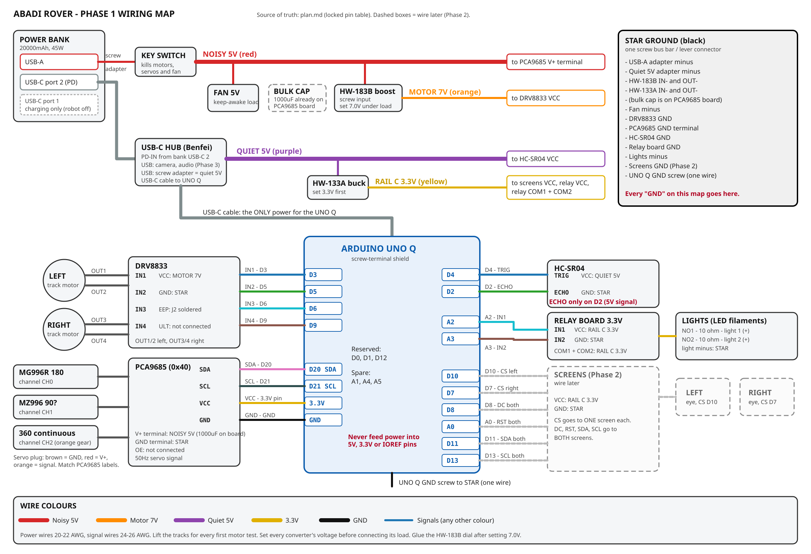
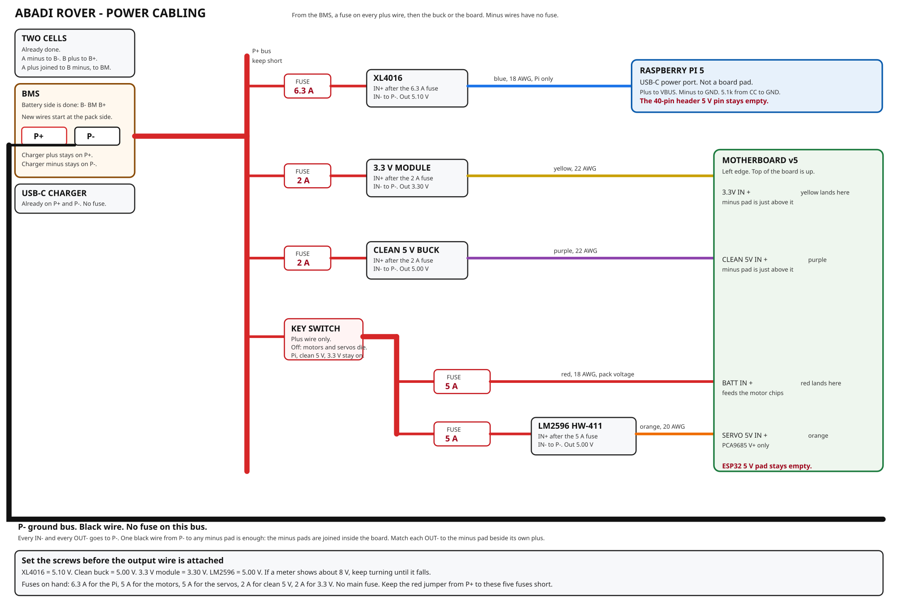
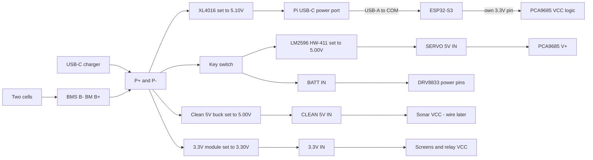
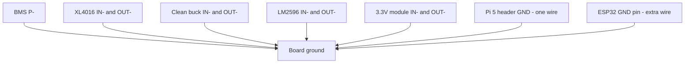
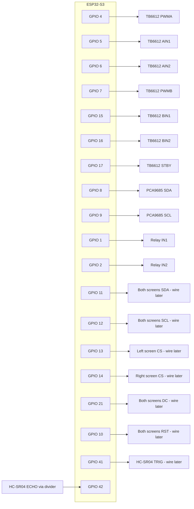
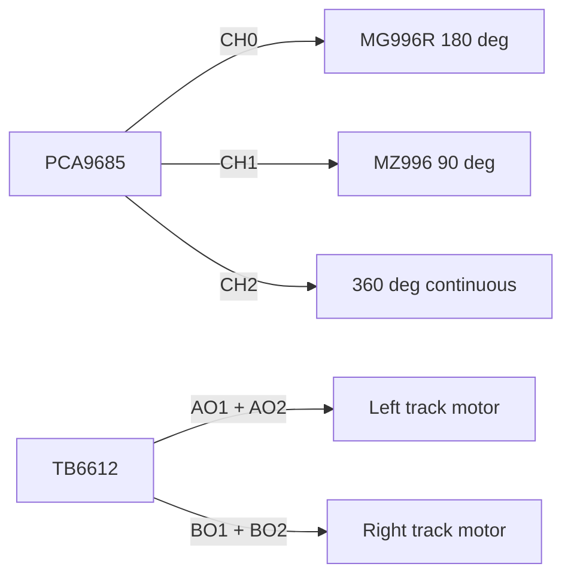

# Abadi Rover — Wiring Reference

Soldering and assembly reference. Pin assignments come from the **Locked pin table** in [plan.md](plan.md); if this file and `plan.md` ever disagree, `plan.md` wins and the mismatch must be reported.

The power section below matches the 7 Nov 2026 power design in `plan.md`. The signal checklists further down still name the old TB6612. Do not solder those signal wires onto Motherboard v5. That board has two DRV8833 sockets. Signal wires wait until the pin table is updated.

Items marked **(wire later)** belong to a later stage. Leave them unconnected until that stage.

## Wire colours and sizes

| Colour | Use |
|---|---|
| Red | Pack plus, BATT IN, after the key switch |
| Blue | XL4016 5.10 V, Pi USB-C only |
| Purple | Clean 5 V |
| Orange | Servo 5 V (LM2596 HW-411) |
| Yellow | 3.3 V |
| Black | GND |
| Any other colour | Signals |

- Short jumper from P+ to the five fuses. Pi and motor branches: 18 AWG. Servo branch: 20 AWG. Clean 5 V and 3.3 V: 22 AWG. Signal wires: 24–26 AWG.
- Keep motor wires away from screen and sensor signal wires where possible.

## 1. Power diagram

Each buck has its own input wires on P+ and P-. A fuse sits on every plus wire. The drawing is the one to follow.

### Ground (star point)

All of these go to **one** star point (a screw-terminal bus bar or lever connector):

The minus pads on the motherboard are already joined. P−, every buck minus, and those pads are one ground.

## 2. Signal diagram

## 3. Per-component checklist

Tick each box once the wire is soldered/screwed and checked.

### Pack, bucks, key switch, Pi, ESP32

Set every output with the meter before the output wire is attached. Glue the screw only after the loaded test in that stage.

| Done | From | To | Colour |
|---|---|---|---|
| [ ] | Cell A minus | BMS **B−** | — |
| [ ] | Cell A plus joined to cell B minus | BMS **BM** | — |
| [ ] | Cell B plus | BMS **B+** | — |
| [ ] | Charger plus | BMS **P+** | — |
| [ ] | Charger minus | BMS **P−** | — |
| [ ] | BMS **P+**, short jumper | the five fuse holders | Red |
| [ ] | 6.3 A fuse | XL4016 IN+ | Red, 18 AWG |
| [ ] | 2 A fuse | Clean buck IN+ | Red, 22 AWG |
| [ ] | 2 A fuse | 3.3 V module IN+ | Red, 22 AWG |
| [ ] | Key switch, then 5 A fuse | **BATT IN +** | Red, 18 AWG |
| [ ] | Key switch, then the other 5 A fuse | LM2596 IN+ | Red, 20 AWG |
| [ ] | XL4016 IN− | BMS **P−** | Black |
| [ ] | XL4016 OUT+ at 5.10 V | Pi USB-C power port, with 5.1 kΩ from CC to ground | Blue |
| [ ] | XL4016 OUT− | Pi USB-C ground | Black |
| [ ] | Clean buck IN− | BMS **P−** | Black |
| [ ] | Clean buck OUT+ at 5.00 V | **CLEAN 5V IN +** | Purple |
| [ ] | Clean buck OUT− | **CLEAN 5V IN −** | Black |
| [ ] | 3.3 V module IN− | BMS **P−** | Black |
| [ ] | 3.3 V module OUT+ at 3.30 V | **3.3V IN +** | Yellow |
| [ ] | 3.3 V module OUT− | **3.3V IN −** | Black |
| [ ] | BMS **P−** | **BATT IN −** | Black |
| [ ] | LM2596 IN− | BMS **P−** | Black |
| [ ] | LM2596 OUT+ at 5.00 V | **SERVO 5V IN +** | Orange |
| [ ] | LM2596 OUT− | **SERVO 5V IN −** | Black |
| [ ] | Pi USB-A | ESP32 **COM** USB-C | — |
| [ ] | Pi 5 header GND | Board ground | Black |
| [ ] | ESP32 GND pin | Board ground | Black |

### TB6612FNG — do not use on Motherboard v5

The printed board has DRV8833 sockets. Leave this checklist until the pin table is replaced. Do not solder these wires.

| Done | TB6612 pin | To | Colour |
|---|---|---|---|
| [ ] | VM | HW-183B OUT+ (7V) | Orange |
| [ ] | VCC | Rail C 3.3V | Yellow |
| [ ] | All GND | Star ground | Black |
| [ ] | AO1, AO2 | Left motor (2 wires) | — |
| [ ] | BO1, BO2 | Right motor (2 wires) | — |
| [ ] | PWMA | ESP32 GPIO 4 | Signal |
| [ ] | AIN1 | ESP32 GPIO 5 | Signal |
| [ ] | AIN2 | ESP32 GPIO 6 | Signal |
| [ ] | PWMB | ESP32 GPIO 7 | Signal |
| [ ] | BIN1 | ESP32 GPIO 15 | Signal |
| [ ] | BIN2 | ESP32 GPIO 16 | Signal |
| [ ] | STBY | ESP32 GPIO 17 | Signal |

Leave the seven signal pins empty until Stage 3. STBY sits low by itself, so the motors stay off.

### PCA9685 and servos

| Done | PCA9685 pin | To | Colour |
|---|---|---|---|
| [ ] | VCC | ESP32 3.3V pin | Yellow |
| [ ] | GND (logic header) | ESP32 GND | Black |
| [ ] | SDA | ESP32 GPIO 8 | Signal |
| [ ] | SCL | ESP32 GPIO 9 | Signal |
| [ ] | V+ (screw terminal) | SERVO 5V IN | Orange |
| [ ] | GND (screw terminal) | Star ground | Black |
| — | Bulk cap | Already on the PCA9685 board (1000µF), nothing to wire | — |
| — | OE | Not connected | — |
| [ ] | Channel 0 | MG996R plug | — |
| [ ] | Channel 1 | MZ996 plug | — |
| [ ] | Channel 2 | 360° servo plug | — |

Servo plugs: **brown/black = GND, red = V+, orange/yellow = signal (PWM)**. Match the row labels printed on the PCA9685 before plugging in.

### Fan

| Done | From | To | Colour |
|---|---|---|---|
| [ ] | Fan + | CLEAN 5V rail, after that buck's current is known | Purple |
| [ ] | Fan − | Star ground | Black |

### HC-SR04 (wire later)

| Done | HC-SR04 pin | To | Colour |
|---|---|---|---|
| [ ] | VCC | CLEAN 5V IN | Purple |
| [ ] | TRIG | ESP32 GPIO 41 | Signal |
| [ ] | ECHO | Voltage divider → ESP32 GPIO 42 | Signal |
| [ ] | GND | Star ground | Black |

ECHO is 5V. The ESP32 is **not** 5V-tolerant. Do not connect ECHO straight to GPIO 42.

### 3.3 V module

The wires are in the pack checklist above. Confirm **3.30 V** on **3.3V IN** before connecting any relay IN pin. Measure again after the screens and relays are connected.

### Relay board and lights

| Done | From | To | Colour |
|---|---|---|---|
| [ ] | Relay VCC | 3.3V IN | Yellow |
| [ ] | Relay GND | Star ground | Black |
| [ ] | Relay IN1 | ESP32 GPIO 1 | Signal |
| [ ] | Relay IN2 | ESP32 GPIO 2 | Signal |
| [ ] | Relay COM1, COM2 | 3.3 V rail | Yellow |
| [ ] | Relay NO1 | ~10Ω resistor → light 1 + | Yellow |
| [ ] | Relay NO2 | ~10Ω resistor → light 2 + | Yellow |
| [ ] | Light 1 −, light 2 − | Star ground | Black |

LED filaments have polarity: one end is usually marked (+, a dot, or a notch). Test each light briefly on 3.3V with the resistor before installing.

### Screens (wire later — Phase 2)

| Done | Screen pin | Left screen | Right screen | Colour |
|---|---|---|---|---|
| [ ] | VCC | 3.3V IN | 3.3V IN | Yellow |
| [ ] | GND | Star ground | Star ground | Black |
| [ ] | SCL | ESP32 GPIO 12 | ESP32 GPIO 12 | Signal |
| [ ] | SDA | ESP32 GPIO 11 | ESP32 GPIO 11 | Signal |
| [ ] | RST | ESP32 GPIO 10 | ESP32 GPIO 10 | Signal |
| [ ] | DC | ESP32 GPIO 21 | ESP32 GPIO 21 | Signal |
| [ ] | CS | ESP32 **GPIO 13** | ESP32 **GPIO 14** | Signal |

Use a 7-pin female connector housing on each screen. The shared lines (SCL, SDA, RST, DC) are joined at one point, one wire to each screen.

## 4. Safety notes

- **Bulk capacitor polarity:** the stripe on the can marks the **minus** leg. Reversed, it can burst.
- **ESP32 pins are not 5V-tolerant.** Relay IN pins sit at the relay board's VCC — that must be a steady 3.3V *before* IN1/IN2 are connected. HC-SR04 ECHO needs a divider.
- **Never feed power into the Pi 5 GPIO 5V pins, or the ESP32 5V/VIN pin.** The Pi is powered only through its USB-C port from the XL4016. The ESP32 is powered only through USB from the Pi.
- **Bucks:** set 5.10 V, 5.00 V, 5.00 V, and 3.30 V with the outputs unconnected. Pack voltage on BATT IN must stay under 10.8 V. Two cells is the top.
- **Before first power-on:** with everything off, check that each rail's minus reaches board ground, and that no plus rail beeps to ground.
- **Charging:** key switch off. Unplug the charger at 4.20 V on a cell or 8.40 V on the pack.
- Lift the tracks off the table for every first motor test.
- If the Pi 5 shows a lightning bolt or reboots, the XL4016 is not holding 5.1 V under the Pi's load.
